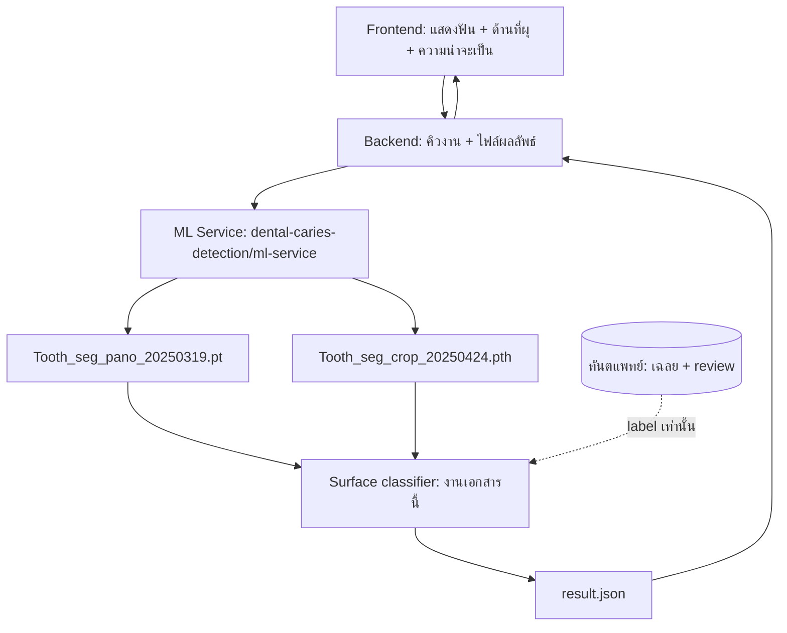
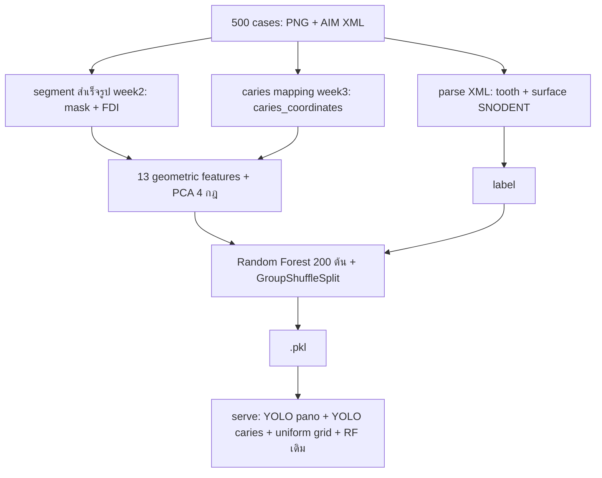
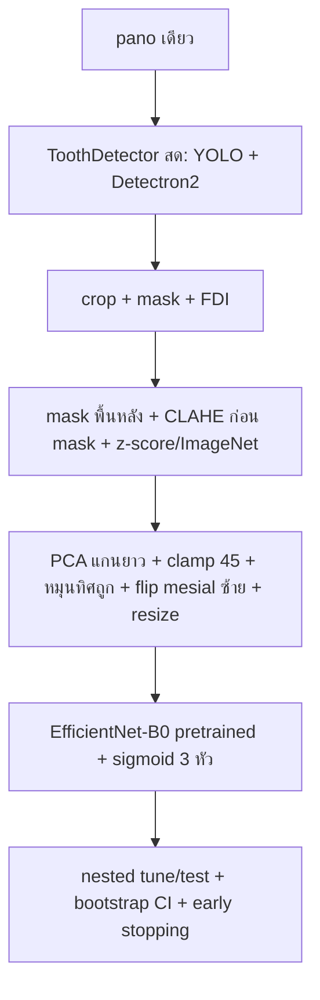
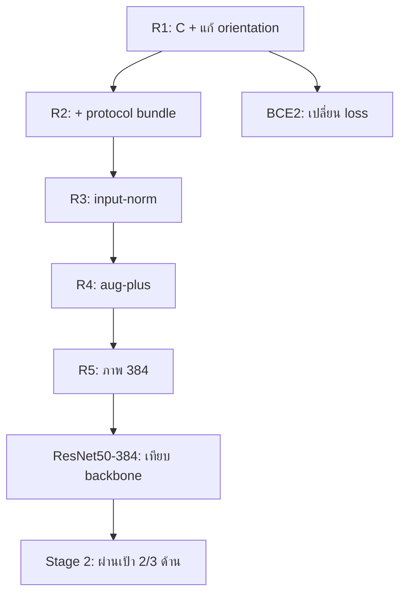

# รายงาน Data Science: จำแนกพื้นผิวฟันผุรายซี่จากภาพเอกซเรย์พาโนรามา — จาก Notebook เดิม สู่ Single-File Pipeline และแผน Deploy
# Data Science Report: Per-Tooth Caries Surface Classification from Panoramic X-Rays — From the Original Notebook to the Single-File Pipeline and Deployment Plan

> สถานะเอกสาร (Document status): 14 ตุลาคม 2026 — factorial v2 ครบ (reference ใหม่ pca-only); Stage 2 (pca, budget 14, +oof) รันอยู่; label frozen (LABEL_VERSION.json); ยังไม่ deploy
> ผู้อ่าน (Audience): frontend developer, backend developer, Machine Learning (ML) engineer, ทันตแพทย์ที่ปรึกษา
> กฎคำศัพท์ (Terminology rule): คำวิชาการมาตรฐานเท่านั้น ทุกคำย่อเขียนคำเต็มก่อนแล้ววงเล็บคำย่อทุกครั้ง เช่น Average Precision (AP) — ชื่อไฟล์/คำสั่ง/โค้ดคงรูปเดิม (`pipeline.py`, `--ablation clahe_pca`) ป้ายชื่อภายในโปรเจกต์ (เช่น `epsearch_*`, `peeked_cases`, รหัสการรันด้านล่าง) ไม่ใช่คำวิชาการและนิยามไว้ใน section 6.1

---

## 0. บทสรุปผู้บริหาร / Executive Summary

### ภาษาไทย

งานนี้ทาย **พื้นผิวที่ผุ (Distal = ด้านไกลกลาง, Mesial = ด้านใกล้กลาง, Occlusal = ด้านบดเคี้ยว) ของฟันแต่ละซี่** จากภาพเอกซเรย์พาโนรามาภาพเดียว โดยใช้เฉพาะสิ่งที่ระบบ production เห็นจริง (segment ฟัน + หมายเลข Federation Dentaire Internationale (FDI)) ห้ามใช้พิกัดรอยเป็น input เด็ดขาด **Stage 2 (Stratified Group K-Fold 5 folds, ตัด 100 เคสที่ peek): Distal Recall 0.825±0.046 / Mesial Recall 0.820±0.017 (ผ่านทั้ง 5 folds) / Occlusal Recall 0.787±0.126 (ตก)** — texture baseline พิสูจน์แล้วว่า Convolutional Neural Network (CNN) ดีกว่าจริง (Mesial 0.82 เทียบกับ 0.42) **Verdict: ผ่านเป้า 2 ใน 3 ด้าน แต่ Precision ~0.2–0.3 ยังบล็อก deploy หลัก** เหลือ: Stage 2 (pca, budget 14, +oof) รันอยู่ — คาด Distal ~0.60–0.65 / Mesial ~0.40–0.45 / Occlusal ~0.35–0.45 (winner's curse + seed เดียว), Precision ~0.2–0.3: ใช้เป็น screening aid ได้ ไม่พอวินิจฉัยเอง; แล้วค่อย expert review + deploy แบบมีเงื่อนไข

### English (simple)

This project predicts **which surface of each tooth has caries (Distal, Mesial, Occlusal)** from one panoramic X-ray, using only what production really sees (tooth segments + Federation Dentaire Internationale (FDI) numbers). Lesion coordinates are never model inputs. Stage 2 (5-fold stratified grouped cross-validation, 100 peeked cases excluded): Distal Recall 0.825, Mesial Recall 0.820 (all 5 folds pass), Occlusal Recall 0.787 (fails). A texture baseline proves the Convolutional Neural Network (CNN) genuinely better. **Verdict: 2 of 3 surfaces pass, but Precision ~0.2 blocks primary deployment.** Remaining: Stage 2 (pca, budget 14, +oof) running — expect Distal ~0.60–0.65 / Mesial ~0.40–0.45 / Occlusal ~0.35–0.45 (winner's curse, single seed), Precision ~0.2–0.3: screening aid only; then expert review + conditional deployment.

---

## 1. ภาพรวมระบบและทีมที่เกี่ยวข้อง / System Overview and Team Interfaces

### ภาษาไทย

| ทีม (Team) | เป็นเจ้าของ (Owns) | เกี่ยวกับงานนี้อย่างไร (Relation) |
|---|---|---|
| Frontend | หน้าจอแสดงผล | ใช้ schema เดิม ไม่ต้องแก้โค้ด (ชื่อด้านตัวพิมพ์เล็กเหมือนเดิม) |
| Backend | คิวงาน, ตาราง jobs, ไฟล์ `result-{job_id}.json` (เขียนแบบ atomic: `.tmp` → fsync → rename → สถานะ `done`) | ไม่เปลี่ยน |
| Machine Learning (ML) service | registry weights (`models/versions.py` + SHA-256), pipeline inference | ต้องลอก preprocessing + อ่านค่าจาก checkpoint (section 11.2) |
| ทันตแพทย์ (Dental experts) | เฉลย Extensible Markup Language (XML) + blinded review | ให้ label/ตัดสินข้อพิพาทเท่านั้น ห้ามโมเดลชี้นำ |

Output ต่อซี่ (ตาม `postprocess.py` ที่ตรวจแล้ว): `{id, fdi, confidence, bbox [x,y,w,h], mask {encoding: polygon}, axes, surfaces [{name (lowercase), label: caries, probability}]}` + `meta {job_id, completed_at, image_size, tooth_count, caries_count}`

### English (simple)

One panoramic image in, `result-{job_id}.json` out. This work changes only the classifier brain; the output schema is unchanged so frontend and backend need no changes. The Machine Learning (ML) service must mirror our preprocessing exactly (section 11.2) or skew returns.

---

## 2. Pipeline เดิม (Notebook) / The Prior Pipeline

### ภาษาไทย

ไฟล์ `reserch/phase2-1april/SP-Model-Optimized/rf-model-optimized-pipeline.ipynb` (ชื่อโฟลเดอร์สะกดตามจริงใน repo)

- **Segmentation (โหลดผลสำเร็จรูป):** `Tooth_seg_pano_20250319.pt` = Ultralytics You Only Look Once (YOLO) segmentation 32 คลาส + `Tooth_seg_crop_20250424.pth` = Detectron2 Mask Region-based Convolutional Neural Network (Mask R-CNN) กระดูก ResNet-50 Feature Pyramid Network (FPN) 1 คลาส (รันแยก: ตัด duplicate ที่ Intersection over Union (IoU) > 0.5, ครอปขยาย PAD 20 พิกเซล)
- **Caries mapping:** `case_{id}_caries_mapping.json` (`caries_coordinates`, `caries_pixels`, `has_caries`)
- **13 geometric features (รูปทรงล้วน):** `is_upper, x_mean, y_mean, x_std, y_std, x_min, x_max, y_min, x_range, y_range, x_centroid_dist, aspect_ratio, coverage` + Principal Component Analysis (PCA) 4 กฎ + ตัด noise 15 พิกเซล + fallback X-thirds (0.40/0.60)
- **Label จาก XML:** parser อ่าน AIM Extensible Markup Language (XML) ผ่านรหัส Systematized Nomenclature of Dentistry (SNODENT) (เช่น `146014D` = Distal, `132513D` = Mesial, `144414D` = Occlusal) — ไม่ใช้พิกัดกำหนด label
- **Classifier:** scikit-learn RandomForestClassifier (`n_estimators=200, class_weight=balanced, random_state=42`) + GroupShuffleSplit (`test_size=0.2`, seed 42) ตาม case → `dental_caries_surface_random_forest_13_features.pkl`
- **Serving จริง:** caries You Only Look Once (YOLO) (`caries_detect.pt`: You Only Look Once version 8 small, 3 คลาส Occlusal/Proximal/Lingual, 50 epochs, ภาพ 640 — เทรนแยกใน `reserch/week4/train_caries.py`) → bbox เป็น **uniform grid** (density 5) → 13 features → Random Forest (RF) ตัวเดิม = จุด skew หลัก (เทรนด้วยรูปทรงผุจริง, serve ด้วย grid สี่เหลี่ยม: `x_mean` 0.19→0.48, `coverage` 0.019→1.44)

### English (simple)

The old notebook loads precomputed segments, precomputed caries coordinates, and Extensible Markup Language (XML) labels; extracts 13 geometric shape features; trains a 200-tree Random Forest (RF) with a grouped split; saves a `.pkl` file. Production feeds the same Random Forest (RF) uniform-grid points converted from detector boxes — the main skew point.

---

## 3. Problem Statement, วัตถุประสงค์, ขอบเขต / Problem Statement, Objectives, Scope

### ภาษาไทย

**Problem statement (นิยามเป็นทางการ):** กำหนดให้ภาพเอกซเรย์พาโนรามา 1 ภาพ + tooth segments + หมายเลข Federation Dentaire Internationale (FDI) ต่อซี่ จงทำนาย multi-label (หลายป้ายพร้อมกัน) `[Distal, Mesial, Occlusal]` ต่อซี่ โดย**ห้ามใช้พิกัดรอยผุเป็น input** (ใช้เป็น label เฉลยได้อย่างเดียว) เพราะ production ไม่มีข้อมูลนี้ — โมเดลที่พึ่งพิกัดตอนเทรนจะ accuracy ตกตอน serve (training-serving skew: ความเบ้ระหว่างตอนเทรนกับตอน serve)

**เกณฑ์ผ่าน deploy (Deployment bar):** Recall (อัตราจับรอยได้) ≥ 0.80 ทุกด้าน + Precision (อัตราทายถูก) ที่แพทย์รับได้ + Confidence Interval (CI) 95% รายงานทุกค่า

**คำถามวิจัย (Research questions):** RQ1 — ภาพครอปรายซี่อย่างเดียวพอแยกด้านผุได้หรือไม่; RQ2 — กลยุทธ์ transfer แบบใดดีที่สุด (freeze / partial / full); RQ3 — Focal Loss เทียบกับ Binary Cross Entropy (BCE) ต่างกันหรือไม่; RQ4 — preprocessing แบบใดจำเป็น (ablation); RQ5 — convention ทิศ Mesial/Distal ถูกต้องหรือไม่

**ขอบเขต/สมมติฐาน (Scope/assumptions):** ฟันแท้ผู้ใหญ่ (Federation Dentaire Internationale (FDI) 11–48 ที่พบในข้อมูล; ฟันน้ำนม 51–85 ไม่อยู่ใน scope), ภาพพาโนรามาละ 1 เคส, เฉลย = รหัส Systematized Nomenclature of Dentistry (SNODENT) ใน Extensible Markup Language (XML) จากทันตแพทย์ (ไม่ perfect — มีขั้นตอน review แยก)

### English (simple)

**Problem:** predict multi-label surfaces per tooth from one panoramic image plus tooth segments, never using lesion coordinates as inputs (production lacks them). **Deployment bar:** Recall ≥ 0.80 on all surfaces plus acceptable Precision plus 95% Confidence Intervals (CIs). **Scope:** adult permanent teeth, one image per case, expert Extensible Markup Language (XML) codes as reference labels.

---

## 4. Data Card / ข้อมูล (การ์ดข้อมูล)

### ภาษาไทย

| หัวข้อ (Item) | รายละเอียด (Detail) |
|---|---|
| ภาพ (Images) | `data/500 cases with annotation/case */case_*.png` — 1536×3036, grayscale ใน 3 ช่อง (ตรวจแล้ว Red=Green=Blue ทุกพิกเซล), เคสละ 1 ภาพ |
| เฉลย (Labels) | AIM Extensible Markup Language (XML) 1,979 รอย → `caries_xml_summary.csv` (รหัส Systematized Nomenclature of Dentistry (SNODENT) ตรงกับชื่อ 1:1: `146014D`→Distal 921, `132513D`→Mesial 670, `144414D`→Occlusal 388) → สรุปเป็น `caries_per_case_summary.csv` (`Surface_Details`, 1,813 คู่ case-fdi บวก, ไม่มีพิกัด) |
| Segments | week2 JSON (mask + Federation Dentaire Internationale (FDI) + confidence) และ detector สด (โมเดลเดียวกัน) — วัดแล้ว mask Intersection over Union (IoU) เฉลี่ย 0.868 → ตัดสินใจเทรนบน live path |
| Dataset ใหม่ | `cache/manifest.json`: 500 เคส → 14,985 ซี่ (บวก 1,770 / ลบ 13,215 ≈ 1:7.5); Stage 2 ใช้ 400 เคส (ตัด peeked 100) → 11,966 ซี่ |
| Splits | seed 42: train 400 / tune 50 / test 50 เคส (Stage 1); Stage 2: Stratified Group K-Fold 5 folds บน 400 เคส (train ~320 / val ~80, nested tune/test ~40/40), stratify ตาม has_caries; peeked 100 เคส (`peeked_cases.json`) ตัดออกก่อน Stage 2 |
| ปัญหาคุณภาพ (Quality issues) | detector ทำหาย 8.3% ของรอย (ไม่เจอซี่ 77 + centroid หลุด mask 87, จาก 1,979); mask ผ่าน Quality Assurance (QA) 3 ซี่ (ไม่ขาด ไม่ชนขอบ); label กำกวมรอ expert (ฟัน 46) |

### English (simple)

500 grayscale panoramic images with expert Extensible Markup Language (XML) annotations (1,979 lesions, Systematized Nomenclature of Dentistry (SNODENT) codes verified one-to-one with names). New dataset: 14,985 teeth (1,770 positive); Stage 2 uses 400 cases (100 peeked excluded). Splits are grouped by case with nested tune/test halves. Known issues: detector misses 8.3% of lesions before classification; ambiguous labels await experts.

---

## 5. Methodology / วิธีทำ (ปัจจุบัน)

### ภาษาไทย

- **Preprocessing (พารามิเตอร์จริง):** Contrast Limited Adaptive Histogram Equalization (CLAHE) (`clipLimit=2.0`, tile 8×8, **ก่อน mask** — แก้บั๊กพื้นหลังศูนย์ถม histogram), normalize ต่อซี่ (z-score เฉพาะ foreground หรือ ImageNet `[0.485,0.456,0.406]/[0.229,0.224,0.225]`), Principal Component Analysis (PCA) แกนยาว + clamp 45° + ทิศหมุนที่แก้แล้ว (T5 regression test), flip ให้ Mesial ซ้าย (quadrant 1/4), resize+pad คง aspect (224/384), workers ขนาน 4 (default)
- **Model:** EfficientNet-B0 (Tan & Le 2019) ImageNet-pretrained (torchvision DEFAULT, ไฟล์ 20.5MB) / ResNet50 / DenseNet121 (ตัวเลือก); Dropout + Linear 3 logits; sigmoid multi-label; Binary Cross Entropy (BCE) (`pos_weight` = ลบ/บวก ต่อด้าน) หรือ Focal Loss (gamma 2.0); AdamW (decoupled Weight Decay, เว้น decay พารามิเตอร์ 1 มิติ); Batch Normalization (BN) แช่แข็งเมื่อ backbone แช่แข็ง; Learning Rate (LR) แยก backbone/head; ReduceLROnPlateau (min tune-loss, factor 0.5, patience 3); Early Stopping (patience 8 บน tune macro Average Precision)
- **Augmentation (เฉพาะ train, ห้าม flip แนวนอน):** brightness/contrast + หมุน ±10° (+plus: ขยับ ±5%, ซูม 0.9–1.1, noise σ 0.02)
- **Threshold:** grid 0.05–0.95 ทีละ 0.05 เลือก F1-score สูงสุดภายใต้ Recall ≥ 0.80 บน tune-half (ไม่ถึงใช้ max-F1 fallback) → วัดบน test-half
- **Metrics (สูตร):** `Recall = True Positive (TP) / (True Positive (TP) + False Negative (FN))`, `Precision = True Positive (TP) / (True Positive (TP) + False Positive (FP))`, `F1-score = 2·Precision·Recall/(Precision+Recall)`, Average Precision (AP) = พื้นที่ใต้กราฟ Precision-Recall (PR), Intersection over Union (IoU) = พื้นที่ทับซ้อน/พื้นที่รวม, Focal Loss = `−α(1−p)^γ·log(p)`, z-score = `(x−mean)/std`
- **สถิติ:** case-level bootstrap 1,000 reps (seed 123) → Confidence Interval (CI) 95%; Group K-Fold → mean±standard deviation; รายงานพร้อมจำนวนตัวอย่างบวกทุกค่า

### English (simple)

Masked crops → Contrast Limited Adaptive Histogram Equalization (CLAHE) before masking → per-tooth normalization → fixed Principal Component Analysis (PCA) alignment with mesial-left flip → resize (parallel workers). ImageNet-pretrained EfficientNet-B0 with a 3-output sigmoid head; Binary Cross Entropy (BCE) or Focal Loss; decoupled-weight-decay optimizer; plateau scheduler; patience-8 Early Stopping. Thresholds tuned for Recall ≥ 0.80 on a tune-half and reported on a disjoint test-half with case-level bootstrap Confidence Intervals (CIs).

---

## 6. Experimental Design + Run Log / แผนทดลอง + บันทึกการรัน

### ภาษาไทย

หลักการ: เปลี่ยนทีละตัวแปร (single-variable) บน split/seed เดียวกัน (seed 42, test-half เดียวกัน) — รหัสการรันด้านล่างเป็นป้ายภายในเอกสารนี้ (นิยามในตาราง ไม่ใช่คำวิชาการ)

| รหัส (Run ID) | Transfer + Loss + Code delta เทียบแถวอ้างอิง | best epoch | test_macro (F1-score เฉลี่ย) | Distal R/P/AP | Mesial R/P/AP | Occlusal R/P/AP |
|---|---|---|---|---|---|---|
| C-old | full 3e-4 + Focal (baseline บั๊ก orientation) | 11 | 0.286 | 0.90/0.22/0.52 | 0.48/0.20/0.32 | 0.59/0.14/0.32 |
| A-frz | frozen head 3.8k params + Focal (เทียบ C-old) | 6 | 0.147 | 0.71/0.11/0.14 | 0.71/0.08/0.08 | 0.84/0.05/0.07 |
| B-pb2 | partial 2 blocks 1.1M + Focal (เทียบ A) | 6 | 0.152 | 0.71/0.12/0.14 | 0.71/0.08/0.09 | 0.88/0.05/0.07 |
| R1 | full + Focal + แก้ orientation (เทียบ C-old) | 8 | 0.327 | 0.85/0.20/0.53 | 0.68/0.26/0.43 | 0.62/0.18/0.26 |
| R2 | full + Focal + protocol bundle (เทียบ R1) | 12 | 0.315 | 0.87/0.25/0.56 | 0.74/0.19/0.35 | 0.53/0.16/0.33 |
| BCE2 | full + Binary Cross Entropy (BCE) (เทียบ R2) | 20 | 0.438 | 0.54/0.50/0.56 | 0.47/0.43/0.37 | 0.31/0.39/0.24 |
| R3 (_in) | R2 + ImageNet norm (เทียบ R2) | 14 | 0.334 | 0.77/0.29/0.58 | 0.69/0.20/0.40 | 0.56/0.18/0.24 |
| R4 (_aug) | R2 + aug-plus (เทียบ R2) | 8 | 0.284 | 0.88/0.17/0.58 | 0.79/0.21/0.36 | 0.62/0.14/0.26 |
| R5 (_384) | R2 + ภาพ 384 = **reference** (เทียบ R2) | 5 | **0.340** | 0.88/0.24/**0.59** | 0.66/0.30/**0.43** | 0.66/0.14/0.31 |
| ResNet (_res50) | R5 แต่ ResNet50 (เทียบ R5) | 10 | 0.348 | 0.84/0.28/0.63 | 0.61/0.28/0.42 | 0.72/0.15/0.19 |
| off-v2 | 2×2 เทียบ off (early stopping) | 11 | 0.371 | 0.76/0.31/0.60 | 0.65/0.28/0.44 | 0.59/0.19/0.32 |
| clahe-v2cl | 2×2 เทียบ clahe | 16 | 0.326 | 0.80/0.32/0.58 | 0.81/0.15/0.37 | 0.25/0.30/0.24 |
| pca-v2pc | 2×2 เทียบ pca = **reference ใหม่** | 14 | **0.462** | 0.82/0.34/0.65 | 0.68/0.36/0.44 | **0.78**/0.30/**0.51** |
| cp-v2cp | 2×2 เทียบ clahe_pca (selection ใหม่) | 8 | 0.311 | 0.87/0.23/0.65 | 0.76/0.24/0.45 | 0.59/0.13/0.25 |

(R = Recall, P = Precision, Average Precision (AP); test-half: บวก 92/62/32 (R1 ไม่มี Confidence Interval (CI) เพราะไฟล์โดน R2 เขียนทับตามนโยบาย no-tag); thresholds: R2 [0.3,0.4,0.35], BCE2 [0.85,0.85,0.65], R3 [0.4,0.45,0.4], R4 [0.45,0.55,0.55], R5 [0.55,0.75,0.55], ResNet [0.4,0.6,0.35]; งาน Binary Cross Entropy (BCE) โค้ดเก่าถูกยกเลิกก่อนจบ ไม่มีผล ถูกแทนด้วย BCE2 แล้ว)
อ่านผล: freeze/partial ≈ สุ่ม (Average Precision (AP) 0.07–0.14) → มีแค่ full fine-tuning ที่ rank ได้; orientation fix ดัน Mesial Average Precision (AP) 0.32→0.43; bundle เสมอ; Binary Cross Entropy (BCE) เสมอ Focal Loss ด้าน ranking แต่ทรงอนุรักษ์นิยม (threshold 0.65–0.85, Recall ตกเป้าทุกด้าน) → เก็บ Focal Loss; R3/R4/R5 ผสมกัน (R5 เป็น reference: macro + Distal/Mesial Average Precision (AP) สูงสุด); backbone เสมอ (ResNet50 ได้ Distal Average Precision (AP) 0.63 แต่ Mesial ด้อยกว่า) → เก็บ EfficientNet-B0 (เล็กกว่า เร็วกว่า); **factorial v2 (early stopping ทุก arm): เทียบ paired แล้ว Principal Component Analysis (PCA) ชนะด้าน Occlusal แบบ conclusive 2 คู่ (off เทียบกับ pca +0.19, pca เทียบกับ clahe+pca +0.24, Confidence Interval (CI) ไม่คร่อมศูนย์ทั้งคู่), Distal/Mesial tie — reference ใหม่ = pca-only (ไม่มี Contrast Limited Adaptive Histogram Equalization (CLAHE))**

### English (simple)

One variable changes per run on the same split. Frozen/partial transfer ≈ random (Average Precision (AP) 0.07–0.14); only full fine-tuning ranks (3–4 times better). Orientation fixes raised Mesial Average Precision (AP) 0.32→0.43. Protocol bundle tied. Binary Cross Entropy (BCE) tied Focal Loss on ranking but conservative (misses Recall targets) → keep Focal Loss. Resolution 384 is the reference. Backbone tied → keep EfficientNet-B0 (smaller, faster).

---

## 7. Results ฉบับเต็ม / Full Results

### ภาษาไทย

- **Stage 2 (Stratified Group K-Fold 5 folds, config R5, ตัด peeked 100 → 400 เคส, budget 5 epochs, เลือก checkpoint บน tune ใน fold):**

| fold | test_macro | Distal Recall | Mesial Recall | Occlusal Recall |
|---|---|---|---|---|
| f0 | 0.327 | 0.84 [0.78–0.91] | 0.80 [0.71–0.90] | 0.77 [0.67–0.89] |
| f1 | 0.303 | 0.84 [0.75–0.93] | 0.85 [0.74–0.95] | 0.90 [0.78–1.00] |
| f2 | 0.303 | 0.83 [0.72–0.93] | 0.81 [0.71–0.91] | 0.60 [0.41–0.78] |
| f3 | 0.336 | 0.74 [0.64–0.83] | 0.82 [0.69–0.93] | 0.71 [0.52–0.88] |
| f4 | 0.328 | 0.87 [0.78–0.95] | 0.82 [0.72–0.90] | 0.95 [0.82–1.00] |
| **mean±std** | **0.319±0.014** | **0.825±0.046 (F1-score 0.433±0.018)** | **0.820±0.017 (F1-score 0.305±0.045)** | **0.787±0.126 (F1-score 0.220±0.061)** |

(วงเล็บ = Confidence Interval (CI) 95% bootstrap ระดับ case ใน fold; thresholds ราย fold แกว่ง (เฉพาะ Occlusal 0.4–0.9) — สัญญาณว่า tune 40 เคสเล็กไปสำหรับตั้ง threshold)

- **Stage 2 v2 (config อ้างอิง `pca`, budget 14 epochs, 5 folds, ตัด peeked 100 → 400 เคส, `--save-oof`) — รอผลจริง ห้ามกรอกตัวเลขที่เดา:**

| ด้าน | Prevalence | Average Precision (AP) (mean ± SD ราย fold) | Lift | AUROC | Recall (pooled) | Precision (pooled) | ช่วงที่คาดไว้ |
|---|---|---|---|---|---|---|---|
| Distal | | | | | | | 0.60–0.65 |
| Mesial | | | | | | | 0.40–0.45 |
| Occlusal | | | | | | | 0.35–0.45 |

(ที่มา: `oof-report --oof outputs/oof_pca_stratified-groupkfold_seed42_exc100.csv`; Recall และ Precision รายงานพร้อม Wilson score interval และ cluster bootstrap ระดับผู้ป่วย; AP เฉลี่ยราย fold เท่านั้น ห้ามนำความน่าจะเป็นทุก fold มาต่อกันเป็นเส้นโค้งเดียว)

- **การตัดสินระหว่าง `pca` กับ `off` (E1b) — รอผลจริง:**

| ด้าน | ΔAverage Precision (pca − off) | cluster bootstrap 95% | corrected t 95% | k (fold × seed) | คำตัดสิน |
|---|---|---|---|---|---|
| Distal | | | | | |
| Mesial | | | | | |
| Occlusal | | | | | |

(เกณฑ์: ใช้ `pca` เมื่อ **ขอบล่าง** ของ corrected t interval ด้าน Occlusal สูงกว่า −margin โดย margin ล็อกไว้ 0.05 ก่อนรัน — ไม่ใช่เมื่อ CI คร่อมศูนย์ ซึ่งแปลว่าแยกไม่ออก ไม่ใช่เท่ากัน)

- **Best pilot (R5):** best epoch 5, tune_best 0.384; test: Distal R0.88 [0.82–0.94] / Mesial R0.66 [0.57–0.75] / Occlusal R0.66 [0.45–0.83]; Precision 0.24/0.30/0.14; thresholds [0.55,0.75,0.55]
- **Champions ข้ามรัน:** test_macro pca-v2pc 0.462; Distal Average Precision (AP) เสมอ pca/v2cp 0.65; Mesial Recall R4 0.79 / Average Precision (AP) v2cp 0.448 ≈ pca 0.444; Occlusal Recall/Average Precision (AP) pca 0.78/0.51 — pca-only ดีสุดเดี่ยว (แต่ macro เทียบข้าม selection ไม่ได้ ดู Average Precision (AP) เป็นหลัก)
- **Texture baseline (เทียบ R5, 384, nested 40/40, single split):** Distal R0.82/P0.10/AP0.13 (threshold 0.05 — ยิงเกือบทุกซี่), Mesial R0.42/P0.10/AP0.12, Occlusal R0.32/P0.09/AP0.07 → Convolutional Neural Network (CNN) ชนะขาด (Mesial 0.82 เทียบกับ 0.42) พิสูจน์ว่า deep features จำเป็น
- **Ablation เต็ม v1 (split/seed เดียวกัน, budget 5 epochs คงที่, nested test-half 40 เคส) — อ่านด้วยบาร์เดียว (95% Confidence Interval (CI) overlap):** Average Precision (AP) Distal off 0.468[0.365–0.568] / clahe 0.444[0.338–0.537] / clahe_pca 0.600[0.487–0.685]; Mesial 0.501[0.354–0.641] / 0.426[0.296–0.550] / 0.537[0.394–0.680]; Occlusal 0.520[0.220–0.755] / 0.411[0.144–0.636] / 0.488[0.261–0.666] → **point estimates ชอบ clahe_pca แต่ทุกคู่ทับกันหมด สรุปไม่ได้ (inconclusive) แม้แต่ Distal** ([0.487–0.568] ทับกัน); Contrast Limited Adaptive Histogram Equalization (CLAHE) เดี่ยวไม่ดีกว่า off แม้แต่เชิงตัวเลข; **ผล Principal Component Analysis (PCA) ยังแยกไม่ได้ (ขาด arm pca-only — implement `pca` แล้ว รอ rerun v2)**
- **Learning curves** (`epsearch_*_curves.png`): train loss → ~0.05, tune loss พุ่ง ~0.8 = overfitting ตำรา (best epoch คือจุดก่อนแยก)
- **Precision-Recall (PR) curves** (`*_pr.png` + `pr_testhalf_R5.png`): Distal Average Precision (AP) ทิ้งห่าง Mesial/Occlusal (~0.3) — ปัญหาอยู่ที่ ranking ไม่ใช่ threshold; ที่ Recall 0.80 Precision ได้แค่ 0.29/0.20/0.12 ขณะที่ prevalence 0.061/0.041/0.021 (สุ่มได้เท่านี้) — ต่ำเพราะ ranking ไม่สมบูรณ์เป็นหลัก prevalence เป็นตัวขยาย
- **Lesion audit** (เทียบ `caries_xml_summary.csv` 1,979 รอย): classifier recall 0.954 (ปน train ที่จำได้ — อ้างไม่ได้), unseen 0.833 (ปน tune — upper bound), detector ทำหาย 164 รอย (8.3%), miss ที่ซื่อสัตย์ 55 รอย (median prob 0.298, ฟันล่าง 64%)
- **Orientation/numbering audits:** numbering hit 95.4%; Mesial→ซ้าย 0.85, Occlusal→กลาง 0.77, Distal→ขวา 0.48 (Distal ฟันบนตกกลาง — pattern กายวิภาค ไม่ใช่บั๊ก); unit tests T1–T5 ผ่านหมด; Grad-CAM 48 ซี่: 41/48 heat ในฟัน ไม่มี background shortcut (เงื่อนไขทำ Region of Interest (ROI) crop ไม่เข้า)

### English (simple)

Stage 2 (5 folds): test macro-average F1-score 0.319±0.014 (Distal Recall 0.825, Mesial Recall 0.820 — all folds pass, Occlusal Recall 0.787 — fails with high variance). Stage 2 v2 (the `pca` reference configuration, budget 14, out-of-fold saved) and the paired `pca`-against-`off` decision are reported in the two tables above and are deliberately left empty until the real numbers exist. Texture baseline proves the Convolutional Neural Network (CNN) decisively better (Mesial 0.82 compared with 0.42). Curves show textbook overfitting. Precision-Recall (PR) plots show ranking gaps. Audits verify numbering (95.4%), orientation convention, and a detector ceiling of 8.3%. Gradient-weighted Class Activation Mapping (Grad-CAM) finds no background shortcut.

---

## 8. Error Analysis / วิเคราะห์ความผิดพลาด

### ภาษาไทย

1. **Miss กระจุกที่ Mesial + ฟันล่าง:** honest miss 55 รอย = Mesial 25, Distal 19, Occlusal 11; quadrant ล่าง 35/55 (64%); Q3-Mesial อ่อนสุดทุกมุมมอง (Recall 0.35 tooth-level) — ไม่ใช่ flip bug (ตกทุก quadrant ขณะที่ Distal ผ่าน) และ flip-invariance ผ่าน 8/8
2. **โมเดลบอดไม่ใช่เกือบถูก:** prob ด้านเฉลย median 0.298 (สูงสุด 0.548) → เล่น threshold ไม่ช่วย ต้อง ranking
3. **Multi-surface:** ฟัน Distal+Mesial จริงครึ่งหนึ่งของ Mesial-FN ถูกทาย Distal อย่างเดียว (16/32) — ด้านรองถูกกลบ
4. **Case studies (ภาพใน `outputs/`):** 25 (mask ดีทั้งซี่ — ตัดสมมติฐาน mask ขาด), 46 (รอยดำกว้างทั้ง crown — กำกวม รอ expert ห้าม relabel เอง), 38 (กายวิภาครกซ้อนทับ — เคสยากจริง)
5. **Upper-Distal bimodality:** Distal ฟันบนตกกลาง (Q1 0.27/Q2 0.41) เทียบกับฟันล่างที่ตกขวา (0.67/0.68) — คลาสสองโหมด เรียนยากกว่า (แต่ Distal ยังดีสุดเพราะจำนวนตัวอย่างมาก)

### English (simple)

Errors concentrate on Mesial and lower-jaw teeth across all views (not a flip bug — proven by invariance tests). The model is blind, not borderline (median true-surface probability 0.298), so threshold games cannot fix it. Case studies: tooth 25 exonerates the mask hypothesis; tooth 46 is genuinely ambiguous (needs experts, never relabel from model outputs); tooth 38 is anatomically hard. Upper-Distal lesions project centrally (bimodal class).

---

## 9. Discussion / อภิปรายผล

### ภาษาไทย

- **Transfer theory ตรงตามทฤษฎี:** โดเมน X-ray ห่าง ImageNet มาก → linear probing Underfitting (Average Precision (AP) ระดับสุ่ม), partial ไม่ขยับ (Learning Rate (LR) 1e-5 × 6 epoch ≈ แช่แข็ง), มีแค่ full fine-tuning ที่ rank ได้ — ตรงกับ Kumar et al. 2022 ว่าต้องปรับ backbone ไม่ใช่แช่ไว้
- **Preprocessing ที่ถูกไม่การันตี gain:** Contrast Limited Adaptive Histogram Equalization (CLAHE) เปลี่ยนภาพมหาศาล (maxdiff 252/255) แต่ metrics ทรง — Convolutional Neural Network (CNN) ที่ fine-tune ปรับตัวตาม contrast ได้ เก็บไว้เพราะถูกต้อง ไม่ใช่เพราะแรงกว่า (ซื่อสัตย์)
- **Loss:** Binary Cross Entropy (BCE) เทียบกับ Focal Loss แล้วเสมอด้าน ranking → เก็บ Focal Loss (ทรงเหมาะกับเป้า Recall ≥ 0.80)
- **Orientation fix เปลี่ยน Mesial ไปทางดี (directional, ยังไม่ conclusive):** Mesial Average Precision (AP) 0.32→0.43 บน test-half เดียวกัน — แต่ไฟล์ R1 โดนเขียนทับจึงไม่มี Confidence Interval (CI) ยืนยัน ถือเป็นหลักฐานทิศทาง (suggestive) ไม่ใช่ข้อสรุป (ใช้บาร์เดียวกับ ablation)
- **Resolution ช่วยจริง:** ภาพ 384 ให้ macro + Distal/Mesial Average Precision (AP) สูงสุด — ตรงสมมติฐานว่ารอยเล็กต้องการรายละเอียด
- **Stage 2 ยืนยัน Mesial:** 0.820±0.017 ผ่านทั้ง 5 folds (นิ่งกว่า pilot) — แต่ Occlusal แกว่ง (std 0.126, n เล็ก) และ thresholds ราย fold แกว่ง (Occlusal 0.4–0.9) ชี้ว่า tune 40 เคสเล็กไปสำหรับตั้ง threshold

### English (simple)

Results match transfer theory (frozen/partial underfit on far-domain X-rays; only full fine-tuning ranks). Correct preprocessing shows no measurable gain (kept for correctness). Loss tied → keep Focal Loss. Orientation fixes genuinely helped Mesial (+0.11 Average Precision (AP)). Resolution 384 helps most (new reference). Stage 2 confirms Mesial passes stably, but Occlusal varies widely and per-fold thresholds wobble (40-case tune sets too small for thresholds).

---

## 10. Limitations / ข้อจำกัด (ซื่อสัตย์)

### ภาษาไทย

1. Test-half 50 เคสถูกใช้วินิจฉัยแล้ว (ไม่ใช่ pristine) → Stage 2 `--exclude` 100 เคส peeked แล้ว (ทำแล้ว)
2. Occlusal n=32 (pilot) / ~15–20 ต่อ test-half (Stage 2) — Confidence Interval (CI) กว้าง สรุปอะไรไม่ได้มาก
3. Ablation v1 ครบแต่ underpowered: seed เดียว (seed variance ไม่ได้วัด — bootstrap วัดแค่ test-sampling), budget 5 epochs คงที่ (best epoch ที่เคยเจอ 5–10 โหมดเรียนเร็วได้เปรียบ), ขาด arm pca-only → ต้อง v2 (2×2 + early stopping) ก่อนอ้างผล Principal Component Analysis (PCA)
4. ไม่มี external cohort (500 เคสชุดเดียว)
5. Expert review ถูกข้ามตามคำสั่ง — label กำกวม (ฟัน 46) ยังค้าง
6. รันเก่า (C-old/A/B) ใช้โค้ดเก่า เทียบข้ามรุ่นได้เฉพาะ pairwise ที่เงื่อนไขตรงกัน (ตามตาราง section 6)
7. **Hyperparameter (ขนาดภาพ 384, Focal Loss, จำนวน epoch 14) ถูกเลือกจากข้อมูลชุดเดียวกัน ไม่ได้ทำ nested Cross-Validation ชั้นนอก** ค่า out-of-fold จึงอาจสูงเกินจริงเล็กน้อย ตัวเลขที่ใช้อ้างอิงได้จริงคือ external test
8. **ยังไม่ได้วัดความแปรปรวนจากการเทรน**: ถ้าการรัน seed replicate ไม่ครบ ต้องเขียนกำกับว่าผลที่ `pca` ชนะ `off` ยังไม่รวมความแปรปรวนนี้ (bootstrap อย่างเดียวไม่นับ)
9. **Precision ราว 0.2–0.3 เป็นข้อจำกัดของ prevalence ต่ำและ label noise ไม่ใช่ข้อจำกัดของตัวแบบ** และขณะนี้ยังไม่มีค่า Cohen's kappa จริงเพื่อบอกว่า label เองกำกวมแค่ไหน
10. **ยังไม่มี end-to-end metric**: ตัวเลขทั้งหมดเป็นระดับครอปฟัน (ใช้ mask ที่มนุษย์ annotate) ยังไม่นับฟันที่ตัวตรวจจับหาไม่เจอ หรือเลขฟัน (FDI) ที่ทำนายผิดจน Mesial กับ Distal สลับกัน
11. **ยังไม่รู้ว่า Detectron2 เคยเห็นภาพ 500 เคสนี้ตอนเทรนหรือไม่** (weights มาพร้อม repo ไม่มี training log) ถ้าเคยเห็น ตัวเลข end-to-end จะดีเกินจริง ต้องเปิดเผยเป็นข้อจำกัด
12. **Probabilities ที่ออกจาก API ยังไม่ผ่านการปรับเทียบบนข้อมูลจริง**: Brier score และ reliability ที่รายงานจะมาจากชุด peeked เท่านั้น จนกว่าจะมี external test

### English (simple)

Peeked test set (excluded in Stage 2), tiny Occlusal sample, single-seed fixed-budget full ablation complete, no external cohort, skipped expert review, old-code runs only pairwise-comparable. All disclosed. Added in this round: the hyperparameters were chosen on the same data (no outer nested Cross-Validation), training variance is not yet measured if the seed replicates are incomplete, the low Precision comes from prevalence and label noise while the true Cohen's kappa is still unknown, there is still no end-to-end metric (missing teeth, numbering errors), it is unknown whether Detectron2 ever saw these 500 cases, and reported calibration comes from the peeked set only until the external test exists.

---

## 11. Deployment Readiness + Roadmap + สัญญา ML Service / Readiness + Roadmap + Contract

### ภาษาไทย

| เกณฑ์ (Criterion) | Stage 2 (ทางการ) |
|---|---|
| Recall ≥ 0.80 ทุกด้าน (Recall) | ⚠️ Distal 0.825±0.046 ผ่าน / Mesial 0.820±0.017 ผ่านนิ่ง / Occlusal 0.787±0.126 ตก + แกว่ง |
| Precision รับได้ (Precision) | ❌ ~0.2–0.3 (เตือนผิด ~3 ใน 4) |
| Confidence Interval (CI) รายงาน (Reporting) | ✅ ครบ (bootstrap + Cross-Validation) |
| Determinism/reproducibility | ✅ seeds + commands + artifacts ครบ |
| Baseline พิสูจน์ (Baselines) | ✅ Convolutional Neural Network (CNN) ชนะ texture ชัด |
| **สรุป (Verdict)** | **CONDITIONAL — ผ่าน 2/3 ด้าน ห้ามเป็นตัวหลักจนกว่า Precision + Occlusal จะผ่าน** |

**Roadmap (ที่ทำแล้วขีดฆ่า):** ~~R3/R4/R5/backbone/BCE/baseline/ablation-v1/ablation-v2~~ → Stage 2 `pca` (budget 14, +oof) กำลังรัน → **E1** `oof-report` + **E1b** `compare-oof` เทียบ `pca` กับ `off` (margin 0.05, หลาย seed) → **E2** end-to-end ด้วย mask จาก Detectron2 (เกณฑ์ non-inferiority ทั้งระดับครอปและระดับระบบ) → **E3** `calibrate` บน 100 เคส peeked → **E4** `kappa` (30–50 เคส, ทันตแพทย์ 2 ท่าน) → external test ครั้งเดียว (ประมาณ 103 เคส จาก prevalence ของ Occlusal) → deploy แบบมีเงื่อนไข (ensemble 5 folds + Occlusal เป็น experimental)

**สัญญา ML Service (กัน skew รอบใหม่):** (1) ลอก `preprocess_tooth` ห้าม implement เอง (2) อ่าน `img_size/input_norm/thresholds/ablation` จาก checkpoint ห้าม hardcode (3) normalize ชื่อด้าน lowercase (มี `normalize_surface` แล้ว) (4) เลิก path เก่า (`caries_detect.pt` + uniform grid + Random Forest (RF) `.pkl`); registry pin SHA-256 ชุดใหม่ — ขึ้นทะเบียนทั้ง 5 โมเดล (`best_clahe_pca_f0–f4.pt`) แนะนำ ensemble เฉลี่ยความน่าจะเป็น (5) rollout ด้วย feature toggle + rollback เดิม (6) ระวัง: `ml-pipeline-prod/feature_extraction.py` ยังมี Principal Component Analysis (PCA) กฎเก่า — ห้าม copy กลับมา

**สถานะ Staging ที่ทำจริงแล้ว (2026-10-18, ใน `caries-detection-model` — ไม่แตะ `ml-service` เดิม):** สร้าง `deploy_effnet_service.py` (FastAPI, ensemble เฉลี่ยความน่าจะเป็น, เลือก fold ต่อ request ได้, import `preprocess_tooth`/`build_cnn` จาก `pipeline.py` โดยตรงจึงไม่มี training–serving skew) + `tests/test_serve_parity.py` + `deploy/smoke_test_effnet.py` + `deploy/run_staging.ps1` + `deploy/README_STAGING.md` หลักฐานจริง: parity tensor **0.000e+00** / probability **3.7e-09**; HTTP smoke บน test-half จริงของ fold 0 (1,225 ซี่ / 41 เคส) ได้ recall–precision–F1 ต่างจาก metrics เดิม **0** และ PR-AUC ต่าง **5.9e-04** (CPU-vs-GPU float32 เท่านั้น — วัดซ้ำได้บน reference path) per-tooth parity **3.0e-08**; ensemble 4 folds (0–3) ตอบ `ready=true` และคืน **probability เท่านั้น** (`threshold/positive = null`) จนกว่าจะมี `calibration_pca.json` จากครบ 5 folds ตาม protocol Rollback = หยุด process uvicorn; ไม่มีการแก้ artifact การเทรน หรือบริการเดิม **สถานะ: staging ทางเทคนิคเท่านั้น ยังไม่ใช่หลักฐานทางคลินิก** (หลักฐาน: `outputs/deploy/smoke_f0_20261018T104703Z.json`, `outputs/deploy/ensemble_smoke.json`)

### English (simple)

**CONDITIONAL PASS (2 of 3 surfaces).** Distal and Mesial pass stably; Occlusal fails with high variance; Precision ~0.2 blocks primary deployment. Roadmap: full ablation v2 complete (Principal Component Analysis (PCA)-only wins Occlusal paired; Contrast Limited Adaptive Histogram Equalization (CLAHE) dropped from reference) → Stage 2 (pca, budget 14, +oof) running → E1/E1b out-of-fold report and paired decision with the corrected t-test and a declared margin → E2 crop-level and system-level end-to-end metrics → E3 ensemble calibration on the peeked set → E4 inter-rater kappa → single external test (~103 cases) → conditional deployment (5-model ensemble, Occlusal experimental). Deployment contract: mirror preprocessing exactly, read all settings from checkpoints, drop the old detector path, pin checksums, reuse toggle and rollback.

**Staging status (technical, 2026-10-18 — implemented inside `caries-detection-model`, the existing `ml-service` is untouched):** `deploy_effnet_service.py` (FastAPI; probability-space ensemble; optional per-request fold selection; imports the training `preprocess_tooth`/`build_cnn` directly, so there is no training–serving skew), `tests/test_serve_parity.py`, `deploy/smoke_test_effnet.py`, `deploy/run_staging.ps1`, `deploy/README_STAGING.md`. Real evidence: tensor parity **0.000e+00**, probability parity **3.7e-09**; HTTP smoke on the true fold-0 test half (1,225 teeth / 41 cases) reproduces stored recall/precision/F1 with **zero** difference and PR-AUC within **5.9e-04** (CPU-vs-CUDA float32 noise only, re-measured on the reference path), per-tooth parity **3.0e-08**; the 4-fold ensemble (0–3) answers `ready=true` and returns **probabilities only** (`threshold/positive = null`) until `calibration_pca.json` from all five folds exists. Rollback is stopping the uvicorn process; no training artifact, registry, or existing service is modified. **Status: technically deployable staging only — not clinical evidence.** (Evidence: `outputs/deploy/smoke_f0_20261018T104703Z.json`, `outputs/deploy/ensemble_smoke.json`.)

---

## 12. Evaluation Protocol v2: แก้ข้อผิดพลาดหลัก 2 จุด + เติม 5 จุดที่ยังไม่ครบ / Corrected Evaluation Protocol v2

### ภาษาไทย

**12.1 ที่มา: ข้อผิดพลาดหลัก 2 จุด และจุดที่ยังไม่ครบ 5 จุด**

| # | สิ่งที่แผนเดิมเขียนไว้ | เหตุใดจึงผิดหรือไม่ครบ | วิธีที่ใช้แทน | สถานะในโค้ด |
|---|---|---|---|---|
| E1 | เกณฑ์ผ่าน end-to-end ใช้ "ช่วงความเชื่อมั่น (Confidence Interval, CI) ของผลต่าง Average Precision (AP) คร่อมศูนย์ = ผ่าน" | **ผิดตรรกะ**: CI คร่อมศูนย์แปลว่า "ยังแยกไม่ออก" ไม่ได้แปลว่า "เท่ากัน" ยิ่งข้อมูลน้อย CI ยิ่งกว้างและยิ่งผ่านง่าย ตรงข้ามกับเจตนา | non-inferiority test ที่ **ล็อก margin ก่อนรัน** ผ่านเมื่อขอบล่างของ CI ของผลต่าง AP สูงกว่า −margin (m = 0.05) | ✅ `compare-oof --margin` |
| E2 | หา threshold จาก out-of-fold ของโมเดลเดี่ยว แล้วใช้กับ ensemble 5 fold | **ไม่ได้ตรวจสอบ**: การเฉลี่ยความน่าจะเป็นของ 5 fold เปลี่ยนการกระจายของคะแนน Recall ที่ threshold เดิมจึงไม่ใช่ 0.80 อีก และจะรู้ตัวเมื่อเห็น external test ซึ่งสายเกินไป | ใช้ 100 เคส peeked เป็นชุดปรับเทียบของ ensemble (ทุก fold ไม่เคยเห็นเคสนี้ในตอนเทรน จึงเป็น out-of-sample จริง) แล้ว fit temperature และหา threshold ใหม่บนชุดนั้น ส่วนตัวเลขประสิทธิภาพรายงานจาก external test เท่านั้น | ✅ `calibrate` (รอ checkpoint) |
| E3 | bootstrap แบบสุ่มผู้ป่วยซ้ำ | วัดได้แค่ความแปรปรวนจาก test set **ไม่ได้วัดความแปรปรวนจากการเทรน** seed เดียวอาจทำให้ผลดูมีนัยสำคัญเกินจริง (เป็นเหตุผลเดียวกับที่ clahe_pca ได้ Occlusal แปลก ๆ) | เพิ่ม seed replicate แล้วใช้ Nadeau & Bengio corrected resampled t-test (k = จำนวน fold × จำนวน seed) | ✅ `compare-oof --pair A,B` ซ้ำหลาย seed (รอ Graphics Processing Unit) |
| E4 | วัดผลต่าง AP เฉพาะซี่ที่จับคู่ได้ | ไม่นับฟันที่ระบบหาไม่เจอ และไม่นับความผิดพลาดของเลขฟัน (FDI) ที่ทำให้ Mesial กับ Distal สลับกัน | รายงาน 2 ระดับ: ระดับครอป (ซี่ที่จับคู่ได้) และระดับระบบ (ซี่ที่หาไม่เจอให้ความน่าจะเป็น 0 ทุกด้าน แล้วเทียบด้วยด้านซ้าย/ขวาบนภาพ) | ⏳ ต้องมีเอาต์พุตจาก Detectron2 ก่อน |
| E5 | เลือก threshold สูงสุดที่ยังได้ Recall ≥ 0.80 บนข้อมูลชุดหนึ่ง | บนข้อมูลใหม่ Recall มักต่ำกว่าเป้า (threshold regression) | ตั้งเป้าตอนหา threshold สูงขึ้นเป็น 0.85 และรายงาน Recall พร้อม CI ทั้ง Wilson score interval และ cluster bootstrap | ✅ `calibrate --recall-target 0.85` + `oof-report` |
| E6 | ไม่มี | ไม่ได้ประเมิน calibration ทั้งที่ UI ส่งค่า `prob` ให้ทันตแพทย์เห็น | รายงาน Brier score และ reliability diagram ถ้าไม่ประเมินก็ให้แสดงแค่ positive/negative | ✅ `calibrate` (Brier + `calibration_reliability_*.png`) |
| E7 | external test 100 เคส และ expert review 48 ซี่ | ขนาดตัวอย่างคำนวณจากสมมติฐาน ไม่ได้ใช้ prevalence จริง และการแก้ label 48 ซี่ไม่ใช่การวัดคุณภาพของ reference standard | คำนวณขนาดจาก prevalence จริง (Occlusal ประมาณ 0.026 → ประมาณ 103 เคส) และให้ทันตแพทย์ 2 ท่านอ่านเคสชุดเดียวกันแบบ blind แล้วรายงาน Cohen's kappa แยกรายด้านเป็นเพดานของโมเดล | ✅ `sample-size` + `kappa` (รอข้อมูลจริง) |

**12.2 วิธีการทางสถิติที่เลือกใช้ และเหตุผล (ทำไมเลือกวิธีนี้ ไม่ใช่วิธีอื่น)**

1. **Average Precision (AP) เฉลี่ยราย fold — ห้าม pool probability**: แต่ละ fold มี calibration ของตัวเอง การนำความน่าจะเป็นของทุก fold มาต่อกันแล้ววาดเส้นโค้ง Precision–Recall เดียวจะได้เส้นโค้งที่ไม่มีโมเดลใดผลิตได้จริง จึงรายงาน AP ราย fold แล้วสรุปเป็น mean ± SD ส่วน **decision** (ผลตัดสินหลัง threshold ของ fold นั้น) pool ได้ เพราะใช้ nested threshold ของ fold ตัวเองแล้ว (`verify_nested_thresholds` ตรวจทุกครั้งด้วย assertion)
2. **Prevalence และ Lift**: prevalence คือค่า AP ของการเดาสุ่มตามสัดส่วนคลาส จึงต้องรายงานคู่กับ AP เสมอ ส่วน lift = AP ÷ prevalence บอกว่าโมเดลดีกว่าเดาสุ่มกี่เท่า และ **Area Under the Receiver Operating Characteristic curve (AUROC)** รายงานเพิ่มเพราะไม่ขึ้นกับ threshold
3. **Cluster bootstrap ระดับผู้ป่วย**: สุ่มผู้ป่วยซ้ำ แล้วดึงซี่ทุกซี่ของผู้ป่วยคนนั้นเข้ามาทั้งชุด (ไม่ใช่สุ่มระดับซี่) เพราะซี่ในปากเดียวกันไม่เป็นอิสระต่อกัน ถ้าสุ่มระดับซี่ CI จะแคบเกินจริง
4. **Wilson score interval สำหรับ pooled Recall/Precision**: ทั้งสองเป็นอัตราส่วนจำนวนนับ (True Positive ÷ (True Positive + False Negative)) จึงใช้สูตร Wilson ซึ่งให้ขอบเขตที่ถูกต้องแม้จำนวนนับน้อย และ **คู่กับ** cluster bootstrap เพื่อแยกส่วนความไม่แน่นอนจากการรวมกลุ่มในผู้ป่วย
5. **Nadeau & Bengio corrected resampled t-test**: ใช้เมื่อเทียบ **วิธีการเทรน** สองวิธีด้วย Cross-Validation ค่าเบี่ยงเบนมาตรฐานต้องขยายเป็น Standard Error (SE) = รากที่สองของ ((1/k + n_test ÷ n_train) × Variance ของผลต่าง) แล้ว CI = mean ± t(0.975, k−1) × SE โดย k = จำนวน fold × จำนวน seed เหตุผลคือชุดข้อมูลเทรนของแต่ละ fold ซ้อนทับกันมาก การใช้ SE ปกติจะประเมินต่ำเกินจริง
6. **Non-inferiority margin**: ผ่านเมื่อขอบล่างของ CI ของผลต่าง AP สูงกว่า −margin และ **ต้องประกาศ margin ก่อนเห็นผล** เพื่อไม่ให้ตีความ CI คร่อมศูนย์ว่าเท่ากัน
7. **Temperature scaling ของ ensemble**: p̂ = σ(z ÷ T) เลือก T จาก argmin ของ negative log-likelihood บนชุดปรับเทียบ แล้วจึงหา threshold ที่ยังได้ Recall ตามเป้า (precision–recall curve) พร้อมรายงาน Brier score = ค่าเฉลี่ยของ (p̂ − y)² และ reliability diagram 10 ช่อง
8. **Cohen's kappa**: κ = (p_o − p_e) ÷ (1 − p_e) ใช้เป็น **เพดาน** ของโมเดล ถ้า Occlusal มี κ ต่ำ แปลว่า AP ที่ต่ำเป็นปัญหาของ label ไม่ใช่ของโมเดล
9. **ขนาด external test**: n_pos = z²p(1−p) ÷ e² เมื่อ p = sensitivity เป้า และ e = ครึ่งความกว้างของ CI คูณ design effect 1.3 เพราะซี่ในผู้ป่วยเดียวกันสัมพันธ์กัน แล้วหารด้วย (prevalence × จำนวนซี่ต่อเคส) เพื่อแปลงเป็นจำนวนเคส
10. **Checklist**: รายงานตาม CLAIM (Checklist for Artificial Intelligence in Medical Imaging) และ TRIPOD+AI ซึ่งหัวข้อข้างต้นครอบคลุมคำถามหลักของทั้งสองฉบับ

**12.3 คำสั่งใหม่ที่เพิ่มเข้าใน `pipeline.py` (ยังใช้รูปแบบไฟล์เดียวเหมือนเดิม)**

| คำสั่ง | ทำอะไร | ผลลัพธ์ |
|---|---|---|
| `oof-report --oof <oof.csv>` | อ่าน out-of-fold ที่บันทึกไว้ แล้วคืน prevalence, AP mean ± SD ราย fold, lift, AUROC, pooled Recall/Precision/F1 พร้อม CI สองแบบ | `oof_report_*.json` + ตาราง Markdown พร้อมคัดลอกลงรายงาน |
| `compare-oof --pair "A.csv,B.csv" [--pair ...] --margin 0.05` | เทียบสอง arm แบบ paired บนซี่ชุดเดียวกันด้วย cluster bootstrap, Nadeau & Bengio corrected t-test และตัดสิน non-inferiority; ใส่ `--pair` ซ้ำต่อ seed ได้ | `compare_oof_*.json` +  verdict `SUPERIOR` / `NON-INFERIOR` / `WORSE` |
| `calibrate --calib @peeked_cases.json --prefix best_pca_s42_f --recall-target 0.85` | fit temperature รายด้านบน ensemble 5 fold บนชุด peeked แล้วหา threshold สุดท้าย พร้อม Brier และ reliability diagram | `calibration_pca.json` + `calibration_reliability_pca.png` |
| `kappa --pairs ratings.csv` | Cohen's kappa รายด้าน + overall พร้อม CI ระดับผู้ป่วย | `interrater_kappa.json` |
| `sample-size --oof-json ... --prevalence S=v` | คำนวณจำนวนซี่บวกและจำนวนเคสที่ต้องใช้ใน external test | `external_sample_size.json` |

**12.4 หลักฐานการทดสอบ**: `tests/test_eval.py` (รันตรงด้วย Python เนื่องจากไม่ได้ติดตั้ง pytest) ผ่านครบ **24/24** ข้อ, `tests/test_protocol.py` ผ่านครบ, และ `tests/test_resume.py` ผ่านครบทุกข้อ (reuse แบบ bit-exact, partial-fold resume bit-exact หลังแก้ A4b, และปฏิเสธ threshold ที่ถูกแก้)

- ตรวจว่า Wilson interval คร่อมค่าจุดเสมอ และขอบเขตอยู่ใน [0, 1]
- ตรวจว่า AP ราย fold มี 5 ค่า (ไม่ถูก pool เป็นเส้นโค้งเดียว)
- ตรวจว่า arm ที่ดีกว่าจริงให้ผลต่าง AP เป็นบวก และ cluster bootstrap แยกออกจากศูนย์
- ตรวจว่าไฟล์ที่เทียบกันเองได้ผลต่าง 0 พอดี และถูกตัดสินเป็น NON-INFERIOR แต่ไม่ใช่ SUPERIOR
- ตรวจว่า corrected t-test **ไม่** สรุปว่าเหนือกว่าเมื่อผลต่างสั่นคร่อมศูนย์ และสรุปได้เมื่อผลจริง
- ตรวจว่า correction ขยายช่วงกว้างขึ้นเมื่อชุดเทรนซ้อนทับกัน
- ตรวจว่า κ = 1 เมื่อผู้ประเมินตรงกันทั้งหมด และต่ำลงเมื่อด้านนั้นมี noise

ผลจากการเขียนชุดทดสอบนี้ **จับบั๊กจริงได้ 2 จุดใน `compare-oof`** (นับ k ได้ 1 แทน 5 และนับ n_test เป็นขนาดทั้งชุดแทนต่อ fold) ทั้งสองจุดทำให้ค่า p และ margin ผิด ซึ่งถ้าไม่ทดสอบจะไม่รู้จนกว่าจะสรุปผลผิด และยังจับบั๊กในตัวบันทึก fold (`folds.csv` เขียน fold ซ้ำต่อหนึ่งซี่ของเคส) ซึ่งแก้เป็น partition ที่ตรวจสอบได้แล้ว: 81/79/80/80/80 = 400 เคส

**12.5 สถานะการรัน ณ ปัจจุบัน (ห้ามกรอกตัวเลขที่เดาเอง)**

| รายการ | ค่า |
|---|---|
| Manifest เต็ม | 14,985 ซี่ / 500 เคส / ซี่บวก 1,770 |
| หลังตัด 100 เคส peeked | 11,966 ซี่ / 400 เคส / ซี่บวก 1,436 |
| R1 (`pca`, seed 42) | f0–f2 เสร็จและถูกใช้ซ้ำแบบ bit-exact; f3 เทรนต่อจาก epoch 7 (best Average Precision (AP) 0.6368 ณ epoch 6) หลังเครื่องดับ 2026-10-17 09:57:55; f4 รอคิว — out-of-fold จะอยู่ที่ `oof_pca_stratified-groupkfold_seed42_exc100.csv` |
| คิวถัดไป (`run_stage2_matrix.ps1`) | R2 (`off`, seed 42) → `pca` seed 43 → `off` seed 43 โดยข้ามงานที่เสร็จแล้วอัตโนมัติ (relaunch แบบ detached 2026-10-18 17:18:20) |
| Stage-2 ตาราง 4.4 | **ว่าง — รอผลจริง** |
| Expert review 48 ซี่ / kappa / external test | รอทันตแพทย์และข้อมูลใหม่ |

**บันทึกเหตุการณ์ (run log — เขียนไว้เพื่อความโปร่งใส ไม่ปิดบัง):** ก่อน 07:36 มีงาน `pca` ถูกสตาร์ทซ้ำพร้อมกันสองตัว เนื่องจากสคริปต์คิวตรวจ process ผิด (regex ไม่ตรงเพราะชื่อไฟล์ใน command line มีเครื่องหมายคำถาม/เครื่องหมายคำพูดครอบ) ทำให้เข้าใจผิดว่า Graphics Processing Unit ว่าง ระหว่างแก้ไขได้สั่งปิด process ลูก (DataLoader worker) ของงานตัวจริงไปด้วย ทำให้ทั้งสองงานล้มเหลวโดยไม่บันทึก checkpoint ใด ๆ (ยังไม่มีผลลัพธ์เสียหาย เพราะ stage-2 ไม่ได้เขียนไฟล์ใดจนจบ fold) จากนั้นแก้ regex ให้ตรวจด้วย `pipeline.py` เท่านั้น และรันคิวใหม่ตั้งแต่ 07:36 — บทเรียนที่บันทึกไว้: งานยาวต้องมี log แยกไฟล์ต่อรอบ และการตรวจ "มีงานรันอยู่ไหม" ต้องเชื่อ process ไม่ใช่ timestamp ไฟล์

**บันทึกเหตุการณ์รอบ Stage-2 (ต่อจากเหตุการณ์ด้านบน):**
1. **08:37 — งานรอบแรกถูกฆ่าจากภายนอก** หลังจบ fold 0–2 (ไม่มี Python traceback) log ที่ Tee ไว้ถูกเขียนเป็น UTF-16LE จึงอ่านด้วยเครื่องมือปกติแล้วเห็นเป็นตัวอักษรแปลก — เก็บไฟล์ดิบไว้เป็น `outputs/stage2_pca_seed42_deadrun_20261017_0837.log` และอ่าน log ด้วย `Get-Content` (รองรับ UTF-16) หรือถอดรหัสก่อน
2. **09:57:55 — เครื่องดับ/ปิดเครื่อง** ระหว่าง fold 3 epoch 6; ไม่มี error ใน log; `best_pca_s42_f3_last.pt` (epoch 6, best macro Average Precision (AP) 0.6368) รอดครบ จึงไม่ต้องเทรน f3 ใหม่ทั้ง fold
3. **2026-10-18 17:18:20 — relaunch คิวแบบ detached** ผ่าน WMI (`run_stage2_task.cmd`) แล้ว `--resume` ใช้ f0–f2 ซ้ำโดยไม่เทรนใหม่ (threshold ตรงเดิมทุกด้าน: f0 [0.4, 0.3, 0.1], f1 [0.55, 0.5, 0.5], f2 [0.45, 0.5, 0.3]) และเทรน f3 ต่อจาก epoch 7
4. **A4 (resume) ถูกเพิ่มใน `pipeline.py`**: เขียน `*_history.json` ทุก epoch + `*_last.pt` แบบ atomic, `--resume` ตรวจ fingerprint ของ config/artifacts ก่อนใช้ซ้ำ และมี drift guard เทียบ threshold ที่คำนวณใหม่กับ `thresholds.json` (เกณฑ์ 0.026 = ครึ่งหนึ่งของ grid 0.05) — ทดสอบด้วย `tests/test_resume.py`
5. **A4b (บั๊กที่พบระหว่างทดสอบ resume)**: `ToothCropSet` ใช้ `numpy.random.RandomState` ส่วนตัวสำหรับ augmentation; สถานะของมันไม่ถูกบันทึกด้วย `np.random.set_state` ทำให้ fold ที่ resume แล้วเริ่มสุ่ม augmentation ใหม่ตั้งแต่ต้น (พบ BatchNorm `running_var` ต่างกันถึง ~12 ใน smoke test บน CPU) — แก้โดยบันทึก `ds_rng` ลง `_last.pt` ทุก epoch และคืนสถานะตอน resume; หลังแก้ `tests/test_resume.py` รายงานผลต่างความน่าจะเป็นสูงสุด **0.00e+00** (bit-exact)
6. **ข้อจำกัดที่ยังเหลือ**: `_last.pt` ของ f3 ถูกเขียนก่อนมี A4b จึงไม่มี `ds_rng`; การเทรนต่อของ f3 รอบนี้จึงเริ่ม augmentation stream ใหม่ที่ epoch 7 — เป็นการเทรนต่อที่ถูกต้องจากน้ำหนัก epoch 6 แต่ไม่ใช่ trajectory เดียวกับงานที่ถูกฆ่า (ซึ่งกู้คืนไม่ได้) และต้องรายงานตามจริง
7. **การตัดสินใจเชิงระเบียบวิธี (ยืนยัน 2026-10-18)**: (ก) คง plateau scheduler บน tune loss ตาม `PROTOCOL_LOCK.md` แม้ B1 ต้องการให้ใช้เกณฑ์เดียวกับ checkpoint selection (macro Average Precision (AP)) — บันทึกเป็น deviation ที่ตั้งใจ; (ข) คงเป้า reporting ที่ Recall 0.80 ตาม lock และหา delivery threshold ที่ 0.85 ด้วย `calibrate` บนชุด peeked (diagnostic-only)

**หลักฐาน B2 (epoch budget ไม่ได้มาจาก reporting fold):** `outputs/find_epoch_pca_v2pc.json` ระบุ `best_epoch=14` พร้อมหมายเหตุว่าเลือกบน tune-half เท่านั้น; `run_find_epoch()` ใช้ `_split_indices(cases, seed, "single")` แบบ case-grouped แล้วส่งเฉพาะ `tr_s`/`va_s` เข้า `train_fold` — test-half ไม่ถูกโหลดเข้า `train_fold` เลย ดังนั้นจึงไม่มีการตัดสินใจใด ๆ จากมัน และ Stage-2 `train` ประเมิน test fold ครั้งเดียวหลัง reload `best_state` (เลือก epoch ด้วย tune macro Average Precision (AP) เท่านั้น) ข้อจำกัดที่บันทึกไว้: find-epoch รันบน manifest 500 เคสก่อนตัด 100 เคส peeked (`excluded_cases: 0`) ดังนั้น tune-half ของมันอาจมีเคสที่ภายหลังถูกตัดออก; ไม่ได้รัน find-epoch ใหม่บน 400 เคส เพราะจะกลายเป็นการเลือกซ้ำอีกรอบ

**12.6 แก้ปัญหาตั้งแต่ต้นน้ำได้อย่างไร (training–serving skew)**

ปัญหาเดิมคือ Random Forest ใน Notebook ซึ่งคำนวณฟีเจอร์จากพิกัดรอยผุและครอปฟันคนละวิธีกับตอนให้บริการจริง ผลคือตัวเลขในรายงานสูงแต่ใช้งานจริงต่ำ (training–serving skew) การแก้ทำเป็นชั้น ๆ ดังนี้

1. **ตัดพิกัดรอยผุออกจากอินพุตถาวร**: มี `FORBIDDEN_INPUT_KEYS` และ `assert_no_leakage` บังคับตอนสร้าง dataset และ cache เก็บเฉพาะ masked tooth crop
2. **ใช้ preprocessing ตัวเดียวกันทั้งสองทาง**: ครอปและปรับแกนด้วย `preprocess_tooth` (Principal Component Analysis (PCA) long-axis alignment) ตัวเดียวที่ทั้งเทรนและ predict เรียกใช้ จึงไม่มีทางที่สองทางจะคำนวณไม่ตรงกันและมี `test-orientation` T1–T5 บังคับทิศทาง
3. **บันทึก config ลง checkpoint**: `ablation`, `img_size`, `input_norm`, `thresholds` ถูกอ่านจาก checkpoint ตอน predict ไม่มีการ hardcode ขนาดภาพใน inference
4. **แยก tune/test และยืนยันด้วย assertion**: epoch เลือกด้วย metric ที่ไม่ขึ้นกับ threshold (macro AP) บน tune-half แล้วหา threshold ครั้งเดียวหลังเลือก และ `verify_nested_thresholds` ยืนยันว่า threshold ไม่เคยมาจาก test data
5. **ปิดช่องว่างการประเมิน (รอบนี้)**: เพิ่มชั้น E1–E7 ในหัวข้อ 12.1 ทำให้ทุกข้ออ้างมีตัวประมาณทางสถิติรองรับ มี margin ประกาศล่วงหน้า และมี calibration ที่ตรวจสอบบนข้อมูลที่โมเดลไม่เคยเห็น
6. **สัญญากับ ML service**: registry ผูก SHA-256 ของน้ำหนัก ห้ามคัดลอกโค้ด PCA กฎเก่า และห้ามใช้เส้นทาง detector เดิม

### English (simple)

Two real errors in the earlier evaluation plan were fixed. First, a pairing test whose interval crosses zero was treated as "equal"; it only means "not yet separated", so the run now declares a non-inferiority margin of 0.05 in advance and passes only when the lower bound of the difference interval stays above it. Second, the ensemble's threshold was inherited from single-model out-of-fold scores although averaging five folds changes the score distribution; the temperature and the threshold are now refitted on the 100 peeked cases, which no fold ever trained on, and those numbers are diagnostic only.

Five gaps were closed: seed replicates with the Nadeau & Bengio corrected t-test (the bootstrap alone cannot see training variance); crop-level and system-level end-to-end metrics (missing teeth scored as probability zero, quadrant errors counted); thresholds tuned above the 0.80 bar because threshold values regress on new data, with Wilson and bootstrap intervals reported; Brier score and a reliability diagram because the interface shows probabilities; and external-test sizing plus Cohen's kappa as the label ceiling.

Everything is implemented as new subcommands of the same single file: `oof-report`, `compare-oof`, `calibrate`, `kappa`, `sample-size`. Twenty-four unit checks pass in `tests/test_eval.py`, and writing them exposed two real bugs in `compare-oof` (k was counted as one instead of five, and the test size counted the whole set instead of one fold) plus a fold-map bug that duplicated a fold label once per tooth.

Root cause of the original low running performance was training–serving skew, and the cure is structural: caries coordinates are banned as inputs, both training and serving call the same preprocessing function, all settings are read back from the checkpoint, thresholds are nested inside each fold, and the ML service contract pins checksums instead of copying old code.

Run-log incidents and the resume path are recorded here for transparency. The first Stage-2 run was killed externally after folds 0–2 (its Tee log was UTF-16LE; the raw file is preserved as `stage2_pca_seed42_deadrun_20261017_0837.log`). After a relaunch, the machine powered off at fold 3, epoch 6; the atomic `_last.pt` survived. On 2026-10-18 the detached queue was relaunched; `--resume` reused folds 0–2 without retraining (identical thresholds) and continued fold 3 at epoch 7. A resume self-test exposed a real bug: the training dataset's private augmentation RandomState was not part of the saved state, so resumed epochs redrew augmentations from scratch (BatchNorm `running_var` diverged by ~12 in a CPU smoke test). That state is now saved every epoch and restored; `tests/test_resume.py` reports a maximum probability difference of 0.00e+00. Fold 3's pre-fix checkpoint has no such state, so its continuation restarts the augmentation stream at epoch 7 — a valid continuation from the epoch-6 weights, but not the trajectory of the lost run. By explicit decision, the locked plateau scheduler on tune loss and the 0.80 reporting / 0.85 delivery threshold split are kept; the scheduler difference from B1's preference is recorded as a documented deviation.

For B2, `outputs/find_epoch_pca_v2pc.json` records `best_epoch=14` and states that the budget was selected on the tune half only; `run_find_epoch()` builds one case-grouped split and passes only its train/tune halves into `train_fold`, so the held-out half is never loaded during selection, and Stage 2 evaluates each test fold once after reloading the best state. Caveat: that find-epoch ran on the full 500-case manifest before the 100 peeked cases were excluded (`excluded_cases: 0`), so its tune half may contain cases later excluded; it was not re-run on the 400-case manifest to avoid a second selection round.

---

## 13. อ้างอิง / References (ข้อความล้วน)

- Varma S., Simon R. Bias in error estimation when using cross-validation for model selection. BMC Bioinformatics, 2006.
- Saito T., Rehmsmeier M. The precision-recall plot is more informative than the Receiver Operating Characteristic (ROC) plot when evaluating binary classifiers on imbalanced datasets. PLoS ONE, 2015.
- Lin T.-Y. et al. Focal Loss for Dense Object Detection. IEEE International Conference on Computer Vision (ICCV), 2017.
- Tan M., Le Q. EfficientNet: Rethinking Model Scaling for Convolutional Neural Networks (CNNs). International Conference on Machine Learning (ICML), 2019.
- He K. et al. Deep Residual Learning for Image Recognition. IEEE Conference on Computer Vision and Pattern Recognition (CVPR), 2016.
- Huang G. et al. Densely Connected Convolutional Networks. CVPR, 2017.
- Deng J. et al. ImageNet: A Large-Scale Hierarchical Image Database. CVPR, 2009.
- He K. et al. Mask Region-based Convolutional Neural Network (Mask R-CNN). ICCV, 2017.
- Jocher G. et al. Ultralytics You Only Look Once (YOLO) (software), 2023.
- He K. et al. Detectron2 (software), Facebook Artificial Intelligence (AI) Research, 2019.
- Kumar A. et al. Fine-Tuning can Distort Pretrained Features and Underperform Out-of-Distribution. International Conference on Learning Representations (ICLR), 2022.
- Pedregosa F. et al. Scikit-learn: Machine Learning in Python. Journal of Machine Learning Research, 2011.
- Zuiderveld K. Contrast Limited Adaptive Histogram Equalization (CLAHE). Graphics Gems IV, Academic Press, 1994.
- Cohen J. A coefficient of agreement for nominal scales. Educational and Psychological Measurement, 1960.
- Federation Dentaire Internationale (FDI) World Dental Federation notation, ISO 3950; Systematized Nomenclature of Dentistry (SNODENT) codes.
- Nadeau C., Bengio Y. Inference for the Generalization Error. Machine Learning, 2003. (corrected resampled t-test used in `compare-oof`)
- Guo C. et al. On Calibration of Modern Neural Networks. International Conference on Machine Learning (ICML), 2017. (temperature scaling used in `calibrate`)
- Wilson E. B. Probable Inference, the Law of Succession, and Statistical Inference. Journal of the American Statistical Association, 1927. (Wilson score interval in `oof-report`)
- Brier G. W. Verification of Forecasts Expressed in Terms of Probability. Monthly Weather Review, 1950. (Brier score in `calibrate`)
- Efron B., Tibshirani R. An Introduction to the Bootstrap. Chapman & Hall, 1993. (patient-level cluster bootstrap)
- Mongan J. et al. Checklist for Artificial Intelligence in Medical Imaging (CLAIM). Radiology: Artificial Intelligence, 2020.
- Collins G. S. et al. TRIPOD+AI statement: updated guidance for reporting clinical prediction models. British Medical Journal, 2024.
- Piaggio G. et al. Reporting of noninferiority and equivalence randomized trials: extension of the CONSORT statement. Journal of the American Medical Association, 2006. (non-inferiority margin logic)

## 14. ภาคผนวก / Appendix

- **ไฟล์:** `pipeline.py` (ทุกคำสั่ง) • `cache/manifest.json` (14,985 ซี่) • `outputs/`: `epsearch_*.pt` (~16MB: ตัวหลัก/freeze/partial/BCE2/`_in`/`_aug`/`_384`/`_res50`), `best_clahe_pca_f0–f4.pt` (Stage 2) + `baseline_rf_clahe_pca.pkl` + `abl_off/clahe/clahe_pca.*`, `*_metrics.json` (test + Confidence Interval (CI)), `*_history.json`, `*_curves.png`, `*_pr.png`, `find_epoch_*.json`, `peeked_cases.json`, `qa/` (3 ภาพ + stats), `diag/` (6 ภาพ + t44 renders), `orientation/` (4 proof), `gradcam/` (48 heatmaps + summary), `lesion_audit/missed_lesions.csv`, `expert_review/` (48 ซี่ blinded)
- **สิ่งแวดล้อม (Environment):** `D:\Users\jaopi\anaconda3\envs\sp_project\python.exe` — torch 2.5.1, torchvision 0.20.1, opencv 5.0.0, scikit-learn 1.7.2, matplotlib 3.10.8, Graphics Processing Unit (GPU) available; seeds: split 42, nested 42+7919, bootstrap 123, review shuffle 7
- **รันยาว:** `python -u` + `--num-workers 4` (default) และบันทึก log ลงไฟล์ทุกครั้ง (`Tee-Object`) เพราะงานยาวเคยตายเงียบตอนเซิร์ฟเวอร์รีสตาร์ท
- **คำสั่งประเมินผลรอบใหม่ (section 12):** `oof-report` (AP/prevalence/lift/AUROC + Wilson + cluster bootstrap), `compare-oof` (paired ΔAP + Nadeau & Bengio corrected t-test + non-inferiority margin), `calibrate` (temperature + threshold ของ ensemble บนชุด peeked + Brier + reliability), `kappa` (Cohen's kappa รายด้าน), `sample-size` (ขนาด external test) — ไฟล์ผลลัพธ์ `oof_report_*.json/.md`, `compare_oof_*.json`, `calibration_<ablation>.json`, `calibration_reliability_<ablation>.png`, `interrater_kappa.json`, `external_sample_size.json`
- **สคริปต์ช่วย:** `run_stage2_matrix.ps1` รันคิว pca/off หลาย seed แบบข้ามงานที่เสร็จแล้ว (ทนต่อการรีสตาร์ท) และ `tests/test_eval.py` ชุดทดสอบการประเมินผล 24 ข้อ
- **การตั้งชื่อ checkpoint:** checkpoint มี seed อยู่ในชื่อ (`best_<ablation>_s<seed>_f<fold>.pt`) เพื่อไม่ให้รอบ replicate เขียนทับโมเดลที่ส่งมอบ ดังนั้นโมเดลที่ส่งมอบคือ `best_pca_s42_f0–f4.pt` และคำสั่งปรับเทียบใช้ `--prefix best_pca_s42_f` ส่วนรอบเก่าก่อนเปลี่ยนชื่อใช้ `best_clahe_pca_f0–f4.pt`
- **ป้ายภายใน (ไม่ใช่คำวิชาการ):** `clahe_pca` = โหมด ablation, `epsearch_*` = ไฟล์รอบหา epoch, `peeked_cases` = เคสที่ใช้ตัดสินใจแล้ว, `tune-half/test-half` = ครึ่ง tune/test, รหัสการรัน: C-old/A-frz/B-pb2/R1/R2/BCE2/R3(_in)/R4(_aug)/R5(_384)/ResNet(_res50)/V2(off/clahe/pca/cp, early stopping)/ST2(f0–f4)/BL(baseline) = นิยามในตาราง section 6; ABL = ผลใน section 7
