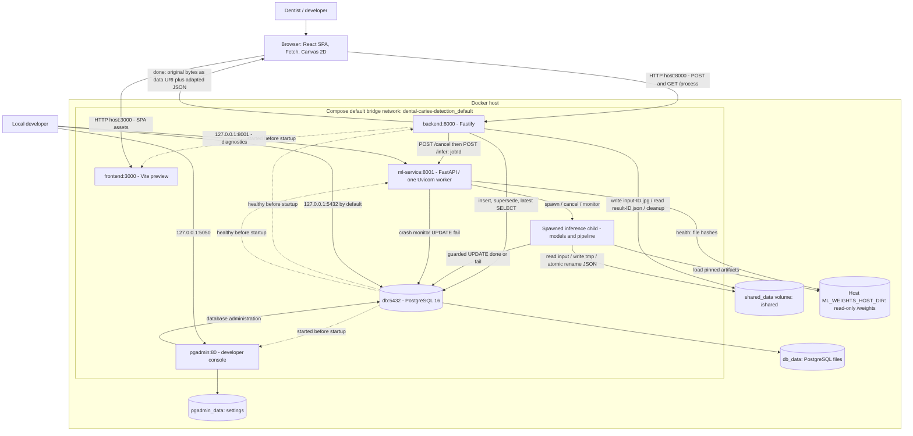
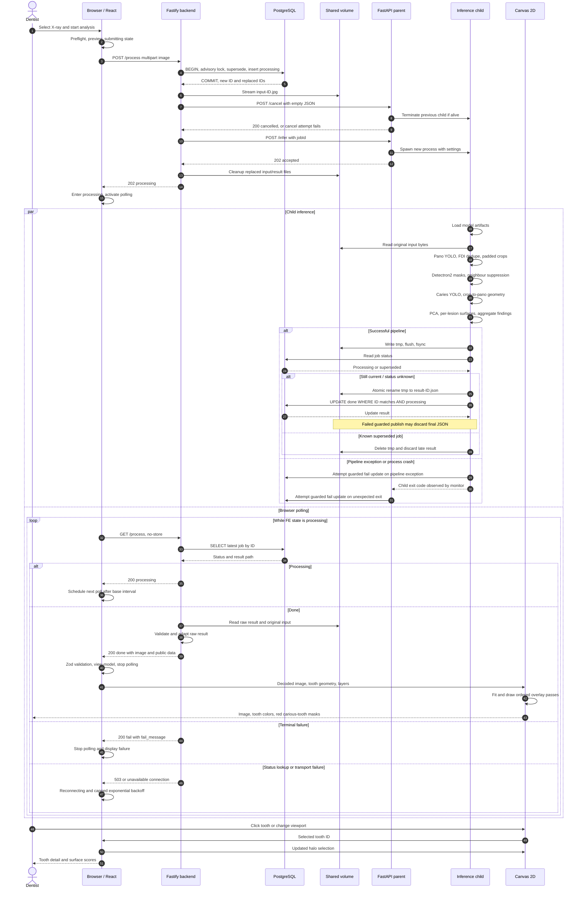

# Dental Caries Detection AI (Web-based): Project Master Documentation

> **Code and evidence snapshot:** 2026-11-09, Asia/Bangkok. Repository HEAD at inspection: `50355a33d0087f3e068d4978a401c3fc30cffd7c`. The working tree also contains local modifications and untracked research code; this document describes the files present during inspection, including those changes. It is not a claim that every described file exists in that Git commit.
>
> **Scope:** `dental-caries-detection/`, its frontend, backend, ML inference service, Docker ecosystem, research workflow, and available evaluation artifacts. Parent-workspace CI is discussed where it affects this application. Dataset images and model binaries are referenced by their roles and recorded provenance; images are not reproduced here.
>
> **Authority:** This is the master guide to the inspected implementation. Executable source, schemas, and content-bound experiment artifacts determine actual behavior. Older design documents and comments sometimes describe earlier phases. Differences are called out explicitly rather than silently treating proposed behavior as implemented behavior. A future code change must update this document and the affected API contract together.
>
> **Evidence vocabulary:** **Implemented** means directly visible in executable source. **Recorded** means supported by a saved artifact or an existing report, with its scope stated. **Rationale** means an engineering interpretation of the design unless a source states the decision. **Proposed** means work that is not implemented. Nothing here establishes clinical approval or independent-patient performance.

> **Backend draft update (2026-11-14):** Backend now implements the [v2 draft](api-contract-v2-draft.md): lesion `id`, nullable `surface`, and `probability`, omitting tooth confidence and lesion bbox. Missing ML IDs are generated and missing surfaces become null. Surface mismatches log warnings while retaining results. Fixtures use recorded case 10 ML lesion polygons; source hashes and v2 adaptations are documented in backend/src/fixtures/README.md. Frontend migration and freeze remain pending; v1 descriptions and fingerprints below describe the older snapshot.

## Contents

1. [Executive summary and global technology stack](#1-executive-summary-and-global-technology-stack)
2. [System architecture and Docker ecosystem](#2-system-architecture-and-docker-ecosystem)
3. [Frontend repository: Sukollapat's domain](#3-frontend-repository-sukollapats-domain)
4. [Backend repository: Naris's domain](#4-backend-repository-nariss-domain)
5. [ML service and training lifecycle](#5-ml-service-and-training-lifecycle)
6. [Communication protocols and API contracts](#6-communication-protocols-and-api-contracts)
7. [End-to-end workflow](#7-end-to-end-workflow)
8. [Engineering decisions and trade-offs](#8-engineering-decisions-and-trade-offs)
9. [Configuration, deployment, and operations](#9-configuration-deployment-and-operations)
10. [Verification, maintenance, and audit register](#10-verification-maintenance-and-audit-register)
11. [Source map and glossary](#11-source-map-and-glossary)

## 1. Executive summary and global technology stack

### 1.1 Purpose and product boundary

The application accepts a panoramic dental radiograph, also called an OPG, processes it locally through a multi-stage image pipeline, and returns tooth identities, tooth geometry, detected caries instances, and surface findings. A browser presents the image, interactive overlays, a tooth list, and a selected-tooth detail panel. The supported surface vocabulary is **mesial**, **distal**, and **occlusal**.

The runtime combines learned image models with a deterministic geometry rule:

```text
OPG pixels
  -> YOLO panoramic tooth instances and FDI identity
  -> per-tooth crops and Detectron2 tooth-mask refinement
  -> YOLOv8s-seg caries instances on each crop
  -> lesion coordinates restored to the original panorama
  -> PCA-aligned geometric surface assignment
  -> raw result file -> backend adapter -> browser view-model -> canvas
```

The project does not implement patient accounts, a patient-history interface, DICOM ingestion, a multi-user work queue, a durable task broker, WebSocket streaming, or webhook completion. The current interface is a single analysis workflow. A new accepted submission replaces the previous active analysis globally for that deployment.

The term **stateless** in older project material needs qualification. The browser uses local React state and has no persisted analysis history. Backend routes do not maintain an in-memory job registry. However, PostgreSQL rows and files on named Docker volumes persist across normal restarts. This is a local processing tool with persistent implementation state, not a system that guarantees zero data retention.

The visible frontend also needs precise interpretation. Current production API results contain lesion polygons, but the view-model does not forward `caries[]` to the renderer. The canvas draws **tooth** boxes in identity colors and fills the **whole tooth mask** red when its aggregate surface list is nonempty. It does not currently render a separate red lesion box or lesion mask. See sections 3.5 and 7.

### 1.2 Complete application and infrastructure stack

Versions below come from the inspected manifests, not a claim that these exact packages are installed on every machine.

**Frontend application** — [package manifest](../frontend/package.json):

- React and React DOM **18.3.1**, using functional components, hooks, and development `StrictMode`.
- TypeScript **5.9.3**, ES modules, JSX, and Vite **6.4.3**; React Vite plugin **5.2.0**.
- Tailwind CSS **4.3.3** and `@tailwindcss/vite` **4.3.3**; CSS-first tokens in `src/styles/global.css`.
- Zod **4.6.4** for runtime validation of polled responses.
- Browser Fetch, FormData, AbortController, FileReader, object URLs, ImageBitmap, HTMLImageElement decoding, Canvas 2D, Path2D, ResizeObserver, Pointer Events, and requestAnimationFrame.
- MSW **2.15.0** for development request interception.
- Vitest **5.0.0**, jsdom **25.0.1**, Testing Library React **16.1.0**, and user-event **14.5.2** for tests.
- ESLint **10.10.0**, TypeScript ESLint **8.70.0**, React Hooks/Refresh plugins, Prettier **3.9.6**, and associated type packages.

**Backend application** — [package manifest](../backend/package.json):

- Node.js **22** container image; manifest requires Node **>=22.12.0**.
- TypeScript **5.9.3**, ES modules compiled to `dist/`, Fastify **5.12.4**.
- `@fastify/cors` **11.3.0**, `@fastify/multipart` **10.1.1**.
- `pg` / node-postgres **8.23.0** for PostgreSQL access; Zod **4.6.4** for raw ML result validation.
- Node Fetch and AbortController for ML control requests; stream pipelines and filesystem promises for image/result storage.
- `tsx` **4.23.13** for local development, Vitest **5.0.0**, ESLint/Prettier, and Node/PostgreSQL type definitions.
- Fastify's structured request logging when `server.ts` builds the app with `logger: true`.

**ML inference application** — [requirements](../ml-service/requirements.txt), [Dockerfile](../ml-service/Dockerfile):

- Python **3.10-slim** container; FastAPI **0.115.0**, Uvicorn **0.30.6**, Pydantic **2.8.2**, pydantic-settings **2.4.0**.
- SQLAlchemy **2.0.35** and psycopg2-binary **2.9.9**.
- Torch **2.4.1**, torchvision **0.19.1** in the runtime requirements.
- Detectron2, installed separately by a wheel URL with fallback to its Git repository. This fallback is not pinned to a commit.
- Ultralytics **>=8.3.0**. This lower bound is not a reproducible version lock.
- NumPy **1.26.4**, opencv-python-headless **4.10.0.84**, Pillow **10.4.0**.
- scikit-learn **1.7.2**, joblib **1.4.2**, pandas **2.2.3**. Some dependencies support legacy/research paths rather than the active geometric classifier.
- Python multiprocessing with the `spawn` context, threading, SHA-256 hashing, JSON files, and POSIX-compatible atomic rename in the container.

**Research and training tooling**:

- Ultralytics training/validation APIs, OpenCV polygon processing, AIM XML parsing, PyYAML, notebooks/Jupyter, pandas, and PyTorch.
- `research_workflow/evaluation.py` uses SciPy's `linear_sum_assignment`; API benchmarking uses Requests. Research/test tools and notebook dependencies are not fully defined as an independent locked environment by runtime `requirements.txt`.
- Historical validation artifacts record a different Windows Python environment: Python **3.10.19**, Torch **2.5.1**, torchvision **0.20.1**, Ultralytics **8.4.175**, NumPy **2.0.1**, and Detectron2 **0.6**. A later candidate run records Ultralytics **8.4.6**. These are separate evidence bundles, not interchangeable runtime specifications.

**Infrastructure**:

- Docker Compose v2, a default project bridge network, five services, and three named volumes.
- PostgreSQL **16** and `dpage/pgadmin4` with an unpinned image tag.
- Multi-stage Node Docker builds; `vite preview` serves the built frontend. There is no Nginx container in this project.
- Local read-only bind mount for model weights; shared filesystem volume for uploaded radiographs and raw result JSON.
- No Redis, RabbitMQ, Celery, BullMQ, object-storage service, reverse proxy, TLS termination, or external model-serving platform is defined in the Compose file.

### 1.3 What each identity and confidence value means

- **Job ID:** a monotonically allocated integer based on milliseconds, stored as PostgreSQL `BIGINT`. It identifies a submission, not a patient.
- **Tooth `id`:** an array-index identity within one adapted result; used for React keys, selection, and colors.
- **FDI:** model-predicted permanent-tooth number. Valid intended ranges are `11–18`, `21–28`, `31–38`, `41–48`.
- **Tooth `confidence`:** panoramic tooth detector confidence, not caries probability.
- **Lesion `confidence` / `caries_confidence`:** the caries detector's score; the two aliases must agree in v1.3.
- **Surface `probability`:** highest caries detector score among lesions assigned to that surface. It is not a calibrated probability that the surface assignment is correct.
- **Lesion ID:** currently `tooth-{tooth_id}-caries-{index}`, unique within one result. It is not stable across new inference runs.

## 2. System architecture and Docker ecosystem

### 2.1 Container responsibilities

The authoritative deployment definition is [docker-compose.yml](../docker-compose.yml).

**`frontend`** builds the React SPA and serves static assets on container port **3000** using `vite preview`. Browser JavaScript executes on the user's computer and calls the configured backend URL directly. The frontend container does not proxy `/process` to the backend. Its `depends_on: backend` controls startup ordering only.

**`backend`** exposes Fastify on container port **8000**, accepts multipart uploads, allocates job rows, writes images to `/shared`, dispatches ML control calls, reads the latest job, validates/adapts raw results, and returns the image and adapted JSON. It runs migrations before listening in its Docker entrypoint.

**`db`** runs PostgreSQL on **5432**. It is the shared authority for job state, including the race guard against stale ML completion. Both backend and ML access it. It is not an image store: images and full result JSON reside on the shared volume.

**`ml-service`** exposes FastAPI on container port **8001**, owns one in-memory child-process runner, loads models inside a fresh child for each job, executes synchronous inference there, publishes a result file, and writes terminal job status directly to PostgreSQL. No completion callback to the backend exists.

**`pgadmin`** exposes its database-management UI on container port **80**, published as host **5050**. It is for developers and is not required for inference. It has its own settings volume and connects to PostgreSQL using host `db`, port `5432` inside the network.

The six items in a typical initial `docker compose up -d` progress report are **five containers plus one network**. The network is not a sixth container. `docker compose ps` lists the service containers. The Compose definition has no profiles; bare `up -d` starts pgAdmin and ML even if comments describe them as optional or phase-dependent.

### 2.2 Architecture and storage graph

Solid arrows below represent application traffic or data access. Dashed arrows represent startup dependencies. The application data transfer to ML is through files; `/infer` carries a job identifier.



### 2.3 Host bindings and service discovery

- Frontend: `0.0.0.0:3000:3000`.
- Backend: `0.0.0.0:8000:8000`.
- PostgreSQL: `127.0.0.1:${POSTGRES_HOST_PORT:-5432}:5432`.
- pgAdmin: `127.0.0.1:5050:80`.
- ML: `127.0.0.1:${ML_SERVICE_PORT:-8001}:8001`.

Inside the Docker network, `db` and `ml-service` are service DNS names. A browser cannot normally resolve `http://ml-service:8001` or `http://backend:8000`; its API base URL must be reachable from the browser host. A dentist accessing the frontend from another computer cannot use `localhost:8000` to reach the server: that would target the dentist's own computer.

Changing `POSTGRES_HOST_PORT` only changes host access. Backend and ML continue using `db:5432`. Changing a process's internal port without changing Compose mappings and health probes can make the service unreachable. In particular, the ML Docker command always binds `8001`; its environment setting is not substituted into that command.

### 2.4 Volumes, ownership, and persistence

**`shared_data`**, mounted read/write at `/shared` in backend and ML, contains:

```text
/shared/input-<jobId>.jpg       original uploaded bytes; name does not imply transcoding
/shared/result-<jobId>.tmp      incomplete result during publication
/shared/result-<jobId>.json     completed raw ML result
```

The backend uses the non-root Node user. ML creates `mluser` with UID/GID **1000**, matching the intended shared-volume ownership. Both Dockerfiles create and chown `/shared`. This is a practical local permission convention, not a general identity-management mechanism for arbitrary existing host mounts.

**`db_data`** persists PostgreSQL data at `/var/lib/postgresql/data`. Job rows are retained; `startJob()` supersedes rows rather than deleting them.

**`pgadmin_data`** persists pgAdmin's settings at `/var/lib/pgadmin`.

**Weights** are a separate host bind mount at `/weights`, read-only in ML. They are not baked into the image. `weights/.gitignore` excludes local model binaries. The binding must resolve to the actual directory on the Docker host.

Normal `docker compose down` retains named volumes. `down -v` removes them and destroys retained database/filesystem state; it is not an ordinary troubleshooting prerequisite.

### 2.5 Image builds and health semantics

The frontend builder runs `npm ci` and `npm run build`, which invokes TypeScript and Vite. Two build arguments explicitly enter the frontend bundle: `VITE_FRONTEND_API_BASE_URL` and `VITE_POLL_INTERVAL_MS`. Runtime `.env` injection does not rewrite a built JavaScript bundle. The runtime image installs production dependencies and uses `npm run preview`; Vite and its imported plugins are regular dependencies because the config is loaded at runtime.

The backend builder compiles TypeScript; the runtime installs production dependencies only. Its command is:

```sh
node dist/db/migrate.js && exec node dist/server.js
```

This ensures the Docker startup migrates before listening and makes Node receive container termination signals. Local `npm run dev`/`npm start` does not execute migration automatically.

The ML image installs native system dependencies, Torch/vision and Python requirements, attempts a Detectron2 CPU wheel, and falls back to a source install. It copies only `app/` and `models/`. The `.dockerignore` allowlist excludes datasets, weights, runs, notebooks, and training scripts. The process command runs **one** Uvicorn worker: adding workers would create independent runners and undermine single-concurrency assumptions.

Healthchecks are different guarantees:

- PostgreSQL uses `pg_isready`, interval 5 seconds, timeout 5 seconds, 10 retries.
- Backend fetches `/health`, interval 10 seconds, timeout 5 seconds, 5 retries, 10-second start period. The endpoint returns `{"status":"ok"}` without querying the DB or ML.
- Frontend fetches its root page with the same timing. It does not prove a browser can contact the backend.
- ML fetches `/health`, interval 15 seconds, timeout 10 seconds, 5 retries, 90-second start period. The probe checks **HTTP status**, not the returned `ready` or `caries_enabled` values.

ML `/health` normally returns HTTP 200 even when a required artifact is missing. `ready` covers the tooth pipeline only; `caries_enabled` reports verified caries artifact availability. File hashes do not prove that a model can load into the installed runtime or fit available memory. `/infer` does not first call a readiness gate: it accepts a child launch, and loading may fail asynchronously.

All services use `restart: unless-stopped`. This restarts exited containers, not necessarily unhealthy containers or stuck processing jobs. Compose startup dependencies do not provide ongoing failover or automatic job recovery.

## 3. Frontend repository: Sukollapat's domain

### 3.1 Structure and responsibilities

The frontend has one main analysis view and no client router or external global store.

```text
src/main.tsx                         optional MSW startup, StrictMode, React root
src/App.tsx                          page shell, mode badge, footer information modal
src/styles/global.css                Tailwind import, theme tokens, base/focus styles
src/api/processClient.ts             multipart upload, polling fetch, ApiError
src/domain/inference.ts              wire types, Zod parser and v1.3 invariants
src/features/analysis/AnalysisView.tsx workflow state, preview, selection, orchestration
src/features/analysis/usePolling.ts   one request at a time, retries and abort cleanup
src/features/analysis/analysisTypes.ts pure API-to-view-model mapping
src/components/ImageUploader.tsx     input/drop interaction and preflight errors
src/components/CanvasViewer/          image decoding, layers, renderer, primitives
src/components/FindingsTable.tsx      sort and select detected teeth
src/components/ToothDetailPanel.tsx   selected tooth and surface scores
src/components/InfoModal.tsx          focus trap, Escape, scroll/focus restoration
src/data/siteContent.ts              informational page content
src/mocks/                           development handlers and synthetic results
src/lib/validation.ts                image type, size, decode, dimension preflight
src/lib/rle.ts                       polygon decoding; RLE branch is unimplemented
```

### 3.2 React and Tailwind v4 UI architecture

`main.tsx` enables any requested development mock before rendering, so the first application request is intercepted consistently. `App.tsx` owns the open information section and renders `AnalysisView`, the footer, and modal content. The workflow and image state live in `AnalysisView`; presentation components receive props and callbacks.

The CSS entry imports Tailwind with `@import 'tailwindcss'` and defines `@theme` variables for font, brand colors, danger colors, success/warning colors, and card shadows. Utilities such as `bg-brand-600` therefore map to shared tokens. Responsive grid classes switch the workspace between one and two columns; visual states are declared close to the component markup. The implemented theme is a blue scale even though one comment calls it teal-blue.

**Rationale:** Tailwind v4's Vite integration and CSS theme tokens let layout and state styling remain consistent without building a separate CSS naming system for every component. The cost is lengthy class strings and the need to distinguish styling changes from behavioral code during review. The official [Tailwind Vite setup](https://tailwindcss.com/docs/installation/using-vite) documents this integration; the exact project choice is evidenced by `vite.config.ts` and `global.css`.

Accessibility includes visible `:focus-visible` styles, keyboard activation of the upload drop zone, labeled layer toggles, error alerts, and modal focus management. `InfoModal` traps Tab, closes on Escape/backdrop, locks page scrolling, and restores prior focus. This is not evidence of a complete accessibility audit: sortable table headers and clickable rows, for example, require further keyboard review.

### 3.3 Workflow state and lifetime

`WorkflowState` is a TypeScript discriminated union:

```ts
type WorkflowState =
  | { phase: 'empty' }
  | { phase: 'selected'; file: File }
  | { phase: 'submitting'; file: File }
  | { phase: 'processing' }
  | { phase: 'done'; imageBase64: string; data: InferenceData }
  | { phase: 'fail'; failMessage: string };
```

The normal transition is `empty -> selected -> submitting -> processing -> done` or `fail`. A transport failure during submission returns to `selected` with the same file and a retry message. A server-side 422 becomes `fail`. While busy, normal UI submission controls are disabled. A separate preview state stores an object URL and filename so the left input panel can keep showing the selected image while workflow phases change.

Selection is `selectedToothId: number | null` in the common parent; the table, canvas, and detail panel share it. New file selection clears selection and submission errors. Object URLs are revoked on replacement/unmount. `Start over` clears browser state and stops polling, but it does not send `/cancel`, delete server files, or remove DB rows. It is exposed after completion/failure in the current UI.

Refreshing the page recreates local state as `empty`. There is no startup status fetch to resume a previous server job. A database job can still be active or completed independently of what the refreshed page shows.

### 3.4 Wire data, adapter boundary, and view-model mapping

Three transformations must remain distinct:

1. Python produces a **raw ML file** with `meta.completed_at`, `meta.image_size`, teeth, lesion instances, and extra diagnostics.
2. Backend `adaptInferenceResult()` validates and normalizes that into the **public API shape**: `meta.processed_at`, top-level `image`, stable default fields, and normalized surfaces.
3. Frontend `toViewModel()` creates **presentation data** such as `displayLabel`, identity color, a grammatical surface-count string, and aggregate counts.

Representative mapping from [analysisTypes.ts](../frontend/src/features/analysis/analysisTypes.ts):

```ts
const cariesCount = tooth.surfaces.filter((surface) => surface.label === 'caries').length;
// Selected fields from the returned ToothViewModel:
const display = {
  id: tooth.id,
  displayLabel: `FDI ${tooth.fdi}`,
  cariesCount,
  cariesSummary: `${cariesCount} caries ${cariesCount === 1 ? 'surface' : 'surfaces'}`,
  hasCaries: cariesCount > 0,
  colorKey: IDENTITY_COLOR_PALETTE[tooth.id % IDENTITY_COLOR_PALETTE.length],
};
```

The mapper is a pure function without React imports. `AnalysisView` memoizes its result. Components do not repeatedly interpret API naming or recompute identical presentation values. `totalCariesSurfaces` counts distinct surface findings, not lesions. Two lesions on one surface yield one counted surface.

Identity colors cycle through six colors by tooth `id`; they identify a tooth within a result, not clinical status. Array-index assignment means colors are not guaranteed to remain attached to the same FDI after a new inference run.

**Current limitation:** `ToothViewModel` copies the tooth `mask`, `bbox`, axes, confidence, and aggregate `surfaces`, but omits the API `caries[]` instances. The geometry is available on the wire but inaccessible to current overlay primitives. Adding lesion overlays requires extending this mapper and its tests, then implementing distinct rendering primitives; it is not enabled by changing a color constant alone.

### 3.5 HTML5 Canvas: coordinate spaces and HiDPI

The renderer works with three coordinate systems:

- **Image pixels:** all API geometry, with origin at top-left and positive y downward.
- **Canvas backing-store pixels:** `canvas.width` and `canvas.height`, multiplied by device pixel ratio.
- **CSS/client pixels:** pointer positions and layout dimensions in the browser.

`useLayoutEffect` measures the parent container and sets backing dimensions to rounded `clientWidth * devicePixelRatio` and `clientHeight * devicePixelRatio`. `ResizeObserver` repeats this when the container changes. Geometry uses backing-store dimensions directly; the code does not separately call `ctx.scale(dpr, dpr)`.

For image size `(Iw, Ih)` and backing size `(Cw, Ch)`, Fit uses:

```text
s  = min(Cw / Iw, Ch / Ih)
ox = (Cw - Iw * s) / 2
oy = (Ch - Ih * s) / 2
canvasPoint = imagePoint * s + offset
```

Rendering saves context state, translates by offset, scales by `s`, and draws the image and overlays in original image coordinates. Filter controls apply brightness and contrast only to `drawImage`; `ctx.filter` is reset to `none` before overlays.

`1:1` sets `scale=1` in backing-store units. On a DPR=2 display this means one image pixel per backing pixel, approximately half a CSS pixel, rather than one image pixel per CSS pixel. This distinction matters when describing actual-size behavior.

### 3.6 Frame coalescing and draw order

The renderer stores viewport and drag values in refs so pointer movement does not trigger a React state update for every pixel. Many redraw requests within one browser frame become one scheduled draw:

```ts
const requestRedraw = useCallback(() => {
  if (rafIdRef.current !== null) return;
  rafIdRef.current = requestAnimationFrame(() => {
    rafIdRef.current = null;
    drawRef.current();
  });
}, []);
```

`drawRef.current` is refreshed with the latest render closure. Cleanup cancels pending animation frames and sets the ref back to `null`; otherwise development StrictMode's effect cleanup/restart could leave the canvas believing a frame was still pending forever.

The exact draw order is:

1. Clear backing store.
2. Apply viewport transform.
3. Draw original radiograph with image-only brightness/contrast.
4. Draw all tooth bounding boxes.
5. Draw all tooth masks.
6. Draw all PCA axes if enabled.
7. Draw all labels.
8. Draw the selected-tooth halo last.
9. Restore context state.

Each overlay type gets a complete pass over teeth, avoiding per-tooth ordering that could make one tooth's mask cover another tooth's label. Defaults: boxes on, masks on, axes off, labels on. The selection halo is an independent final effect, not one of these toggle keys.

The polygon core in [overlays.ts](../frontend/src/components/CanvasViewer/overlays.ts) is:

```ts
ctx.fillStyle = tooth.hasCaries ? CARIES_FILL : SOUND_FILL;
for (const ring of rings) {
  if (ring.length === 0) continue;
  ctx.beginPath();
  ctx.moveTo(ring[0][0], ring[0][1]);
  for (const [px, py] of ring.slice(1)) ctx.lineTo(px, py);
  ctx.closePath();
  ctx.fill();
}
```

`CARIES_FILL` is translucent red `rgba(220, 38, 38, 0.35)` and `SOUND_FILL` translucent blue `rgba(37, 99, 235, 0.15)`. The blue state means no aggregate finding was returned, not proof of clinical absence. Boxes use identity colors, axes green, labels white with black outline, and selection orange. Axis lines are centered on bbox center, not the mask's area centroid. Line widths and text sizes are in image units and therefore also scale during zoom.

### 3.7 Pointer mapping, zoom, pan, and hit testing

The inverse transform maps a pointer to image space:

```ts
const rect = canvas.getBoundingClientRect();
const canvasX = ((clientX - rect.left) / rect.width) * canvas.width;
const canvasY = ((clientY - rect.top) / rect.height) * canvas.height;
return [(canvasX - offsetX) / scale, (canvasY - offsetY) / scale];
```

Wheel zoom uses factor **1.1** or its reciprocal and clamps interactive scale to **0.2–8**. The cursor is used as a pivot: the image point under it remains fixed when offsets are recomputed. The listener is registered with `passive: false` and prevents default scrolling. Fit can compute a scale outside those interactive limits because it is a separate operation.

Hit testing first builds mask `Path2D` rings and checks `isPointInPath` in reverse tooth order, then tries bboxes in reverse order. The context transform is reset to identity for this test because the input point is already in image space. Thus visual geometry and pointer coordinates are not transformed twice.

Two implementation caveats are observable in [useCanvasRenderer.ts](../frontend/src/components/CanvasViewer/useCanvasRenderer.ts): pan adds CSS-pixel deltas directly to offsets stored in backing pixels, so pan distance can differ on HiDPI screens; and the pointer position used for the four-pixel click/drag threshold is updated during dragging, so it measures from the last move rather than total gesture displacement. These are code-review findings, not browser-measured fixes in this documentation task.

`decodeMask()` currently returns one ring for polygon encoding. Its RLE branch throws an error. Although the frontend type union allows `rle`, the active pipeline and backend emit polygons. A future RLE producer must implement the decoder and rendering tests first.

### 3.8 Client-side validation, errors, and polling resilience

Preflight allows `image/jpeg` and `image/png`, limits input to **10 MiB** by default, decodes with `createImageBitmap`, checks minimum dimensions **1000 × 500**, and closes the bitmap. The environment can override the frontend thresholds at build time. This provides fast user feedback; it is not backend security validation.

`submitOpg()` appends the file under multipart field `image` and lets the browser create the Content-Type boundary. HTTP 202 becomes `processing`; HTTP 422 returns a failure message. Network/unexpected HTTP errors become `ApiError` with `kind` of `network`, `http`, or, for polling JSON/schema failures, `parse`.

`usePolling()` immediately fetches status when activated, then uses recursive `setTimeout` **after** each request settles. This avoids overlapping polling requests. Normal interval is **2000 ms**. After failures, the multiplier is `min(2 ** consecutiveFailures, 8)`, producing **4 s, 8 s, 16 s, 16 s...** delays at the default interval. The next successful response clears the failure count and reconnecting indicator.

```ts
try {
  const response = await fetchStatus(controller.signal);
  if (cancelled) return;
  // Callback refs and connectivity reset are omitted in this excerpt.
  onUpdateRef.current(response);
  scheduleNext(POLL_INTERVAL_MS);
} catch (err) {
  if (cancelled) return;
  if (err instanceof DOMException && err.name === 'AbortError') return;
  consecutiveFailures += 1;
  onConnectivityChangeRef.current?.(true);
  const multiplier = Math.min(2 ** consecutiveFailures, 8);
  scheduleNext(POLL_INTERVAL_MS * multiplier);
}
```

On `done`/`fail`, the parent leaves `processing`; hook cleanup aborts the current Fetch and clears the timer. Callback refs avoid restarting the loop merely because a callback identity changed. `GET /process` uses `cache: 'no-store'`, and Zod validates its discriminated union before any viewer update.

Retries currently treat network, HTTP, JSON, and schema errors alike. A permanent incompatible response can therefore remain in reconnecting mode indefinitely. There is no jitter, retry budget, fetch deadline, or total inference timeout in this frontend hook. If GET returns `idle` during processing, the parent stays in processing and continues polling. A lost POST acknowledgement is also ambiguous: retrying may submit a new job and preempt an accepted one.

### 3.9 MSW development integration

`main.tsx` enables MSW only when `import.meta.env.DEV` is true and `VITE_API_MOCKING` equals `enabled` (the development default). It dynamically imports the worker and starts it with unhandled requests bypassed. A production `vite build`/`preview` has DEV false and does not activate that branch.

The handlers intercept the same API base URL used by the real client. POST checks that `image` is a File and applies the 10 MiB limit, returns 202, and starts a delayed synthetic completion. Each submission gets a `Symbol` token: only the current token may publish, including after an asynchronous result build. Delay defaults to **4000 ms**, and `VITE_MOCK_ML_FAILURE_RATE` controls simulated terminal failures.

The result factory reads real uploaded image dimensions/bytes but fabricates tooth geometry, FDI examples, and confidence values. It still uses historical `RF` method labels and does not certify current v1.3 production semantics. MSW allows frontend work without a backend or weights; it does not test SQL, real inference, artifact integrity, or inter-container networking.

**Important correction to older instructions:** the current backend `dispatchInference()` has no `ML_DRIVER` branch. `ML_DRIVER=mock` in `.env.example` does not implement backend mock execution. Browser MSW is the implemented mock path. For local Vite development against the real backend, explicitly disable `VITE_API_MOCKING` and ensure Vite receives the intended environment from `frontend/`.

## 4. Backend repository: Naris's domain

### 4.1 Fastify composition and route surface

The backend uses **Fastify**, not Express. [app.ts](../backend/src/app.ts) constructs an instance without listening so tests can call `app.inject()`. It registers CORS, multipart, `/health`, process routes, and an `onClose` hook that closes the shared DB pool. [server.ts](../backend/src/server.ts) enables logging, binds `0.0.0.0`, and installs SIGINT/SIGTERM handlers to close Fastify before process exit.

The implemented application routes are:

- `GET /health`: HTTP 200, `{"status":"ok"}`; process liveness only.
- `POST /process`: multipart upload and asynchronous ML dispatch.
- `GET /process`: status/result of the latest global job, without a job ID query or path parameter.

There is no patient/session authentication, public cancel endpoint, download route, webhook endpoint, or server-sent events endpoint in these source files.

### 4.2 Asynchronous processing: a single active slot

This is not a conventional FIFO queue. The backend records one current processing job, the ML runner accepts one child at a time, and new uploads supersede old work. PostgreSQL enforces at most one `processing` row. The job is acknowledged only after upload storage and ML acceptance complete, but before inference completes.

**Rationale:** short control requests avoid holding the original upload connection open for a potentially long CPU/GPU operation. Polling lets a browser observe DB-backed completion without maintaining a socket session. It fits the deliberately small, single-deployment workflow and separates JavaScript orchestration from Python compute. The trade-off is polling overhead, completion latency up to a poll interval, weak multi-client correlation, and the absence of a durable retry/dispatch mechanism.

No webhook was selected or implemented in the current protocol. The child writes its result and updates the DB; the backend learns completion through `GET /process` reading the row. Calling the design “polling/webhooks” would incorrectly imply an implemented callback path.

### 4.3 Database schema and constraints

Migration lives in [src/db/migrate.ts](../backend/src/db/migrate.ts), not a separate SQL migrations directory. Its effective schema is:

```sql
CREATE TABLE IF NOT EXISTS jobs (
  id BIGINT PRIMARY KEY,
  status VARCHAR(255) NOT NULL DEFAULT 'processing',
  result_path VARCHAR(255),
  fail_message VARCHAR(255),
  updated_at TIMESTAMP,
  created_at TIMESTAMPTZ NOT NULL DEFAULT now()
);
-- Added by the idempotent migration when absent:
ALTER TABLE jobs ADD CONSTRAINT jobs_status_check
  CHECK (status IN ('processing', 'done', 'fail', 'superseded'));
CREATE UNIQUE INDEX IF NOT EXISTS one_active_job
  ON jobs ((true)) WHERE status = 'processing';
```

The migration guards constraint creation, adds a missing `created_at` column, and supersedes older active rows before creating the unique partial index. It does not insert an initial `idle` row. An empty table maps to public `idle`. `updated_at` has no timezone type while `created_at` is timezone-aware; public completion time comes from the result JSON rather than either column.

The partial index indexes the constant `true` for processing rows, so two such rows conflict. `superseded` is an internal DB state, absent from the public response union. The current GET maps it to `processing`; normally a superseded row is no longer the latest row.

Rows contain a path to the raw result, not the result itself. There are no user, patient, image-blob, or structured clinical findings tables in this schema.

### 4.4 Connection pools and guarded mutations

[pool.ts](../backend/src/db/pool.ts) creates one lazy `pg.Pool` per backend process with maximum **5** clients. Tests/liveness checks that do not use DB helpers need not instantiate it. Idle-client errors are logged instead of being allowed to crash the process. `closePool()` drains the pool on shutdown.

ML uses a SQLAlchemy engine configured with pool size **2**, overflow **0**, and `pool_pre_ping=True`. The API parent has its engine for crash-monitor updates; a spawned child creates its own engine. The two-client limit is per engine, not one global cross-process limit.

Both sides use parameterized SQL. Terminal updates include `WHERE id = :job_id AND status = 'processing'` (or PostgreSQL `$1` equivalents), so late work cannot turn a superseded or already terminal row into `done`/`fail`.

### 4.5 Atomic job allocation and idempotency boundaries

`startJob()` in [jobs.ts](../backend/src/db/jobs.ts) performs these operations on one borrowed client:

1. Begin transaction.
2. Acquire `pg_advisory_xact_lock(4170001)`.
3. Mark all processing rows `superseded` and collect their IDs.
4. Read the prior latest row for file cleanup.
5. Insert a new processing row with ID greater than every prior ID.
6. Commit; release the client in `finally`, or rollback on error.

Core allocation excerpt:

```ts
await client.query('BEGIN');
await client.query('SELECT pg_advisory_xact_lock($1)', [START_JOB_LOCK_KEY]);
await client.query(
  "UPDATE jobs SET status = 'superseded', updated_at = now() WHERE status = 'processing' RETURNING id"
);
const inserted = await client.query<{ id: string }>(
  `INSERT INTO jobs (id, status, updated_at)
   SELECT GREATEST($1::bigint, COALESCE(max(id), 0) + 1), 'processing', now() FROM jobs
   RETURNING id`,
  [now]
);
await client.query('COMMIT');
```

The real function also captures previous/superseded IDs and returns them. `BIGINT` is returned by `pg` as a string and converted to JavaScript Number; current timestamp values are within its safe integer range, but arbitrary BIGINT growth has no explicit safe-integer guard.

Idempotency is local and specific:

- Re-running migration is intended to be safe.
- Repeated GET observes the same terminal result until a new submission.
- Repeated `/cancel` is safe when no child runs.
- Guarded terminal updates become no-ops when the row is no longer processing.
- **POST upload is not idempotent**: there is no idempotency key or content-hash deduplication, and each retry allocates a new job.

The allocation transaction does not encompass file writing, cancel, or dispatch. Concurrent uploads can be committed in ID order but reach `/cancel` and `/infer` in a different order. The DB guard protects state from stale completion, but it does not serialize the complete distributed upload-and-dispatch workflow. Consequently “last submission wins” is the intended normal behavior with meaningful race protection, not proof that every adversarial concurrent upload ends in a successful newest-job inference.

### 4.6 Upload handling and image store

`POST /process` calls `req.file()` and returns 422 if no file is present. It then allocates the job, streams the upload to `input-{jobId}.jpg`, and calls `dispatchInference(jobId)`. Only after ML returns acceptance does it clean replaced jobs' input/result files and send 202.

```ts
const started = await startJob();
jobId = started.jobId;
await saveInputImage(jobId, data.file);
const accepted = await dispatchInference(jobId);
if (!accepted) {
  await failJob(jobId, 'ML service rejected the job.');
  return reply.status(422).send({
    status: 'fail', fail_message: 'ML service rejected the job.',
  });
}
await Promise.all(started.replacedJobIds.map(cleanupJobFiles));
return reply.status(202).send({ status: 'processing' });
```

[imageStore.ts](../backend/src/lib/imageStore.ts) uses `pipeline(stream, createWriteStream(dest))`, avoiding an intentional full upload buffer before writing. Filenames are generated from job IDs, not client filenames. The shared directory is expected to exist; the Dockerfile creates it. Direct local runs must provide it.

The executable multipart limit is **10 × 1024 × 1024 bytes**. `MAX_IMAGE_MB=25` in `.env.example` is not read by this route. Backend code does not validate MIME type, image dimensions, actual decodeability, or that the first file part is named `image`; the browser contract expects that name, but `req.file()` itself simply retrieves a file part. The backend also does not transcode PNG to JPEG: original bytes are saved under a `.jpg` name, and the GET response unconditionally labels them `data:image/jpeg;base64,...`. This MIME mismatch should be corrected in implementation before claiming exact MIME preservation.

On caught upload/dispatch exceptions after allocation, the route attempts to mark the row failed and delete input/result files, then returns generic 422. The explicit ML-rejection branch marks failure but does not perform the same cleanup. Cleanup only targets `.jpg` and `.json`, not `.tmp`, and uses `Promise.allSettled` so missing/deletion-failing files do not reject it.

### 4.7 ML control client and timeouts

[mlClient.ts](../backend/src/services/mlClient.ts) resolves `ML_SERVICE_URL`, default `http://ml-service:8001`, and applies a **10-second timeout per Fetch**:

```ts
await cancelInference().catch(() => {
  /* cancellation failure is ignored before attempting the next dispatch */
});
const res = await fetchWithTimeout(`${ML_SERVICE_URL}/infer`, {
  method: 'POST',
  headers: { 'Content-Type': 'application/json' },
  body: JSON.stringify({ jobId }),
});
return res.status === 202;
```

The two calls are sequential; upload time plus cancellation time plus inference-acceptance time contribute to POST latency. The timeout is for control acceptance, not the duration of inference. If cancellation takes close to its own ten-second terminate wait, the client's cancellation deadline may expire before it finishes. Failures of cancel are logged/ignored; failure or non-202 from infer becomes rejected dispatch.

`checkMlHealth()` exists but is not called by the upload route or backend `/health`. Its return type omits `caries_enabled`; it should not be mistaken for an enforced inference readiness policy.

### 4.8 Result retrieval and adapter responsibilities

GET first sets `Cache-Control: no-store`, then queries the latest row by descending ID. DB lookup failure returns **503** with `{"fail_message":"Status database unavailable."}`, causing the frontend to retry rather than terminate the analysis.

For a done row, the route resolves its result path under `SHARED_DIR`, reads JSON, invokes `adaptInferenceResult()`, reads the original image, and returns the done envelope. Unreadable result/image produces an HTTP 200 public fail message. Invalid result schema produces `Invalid inference result.`. These read failures do not change the stored DB status from done.

The path guard accepts a stored path whose resolved string begins with the shared directory plus a separator; otherwise it falls back to the conventional filename. This blocks simple path escape by a DB path but is not a symlink-aware sandbox.

The adapter validates the raw shape, normalizes timestamp to UTC ISO, moves image dimensions, assigns contiguous tooth IDs, adds missing axes defaults, and constructs a bbox polygon when the tooth mask has fewer than three points. It lowercases surface names, rejects unsupported surface methods, coalesces duplicate surface findings by maximum score, forces `XThirds_Fallback` probability to null, and derives `has_caries` from the final surface list. Extra raw fields such as `surface_source`, `x_rel`, and raw aggregate counters are not forwarded unless explicitly mapped. Timing keys default to `{}`.

For v1.3 it checks all-or-none assignment fields, parent FDI agreement, equal confidence aliases, unique lesion IDs, explicit `caries` arrays, and usable lesion polygons. These checks preserve per-instance semantics while keeping historical unmarked files readable. They do not prove every numeric coordinate is in bounds, every FDI is anatomically valid, or every aggregate surface is consistent with every lesion; those are additional semantic constraints to consider.

## 5. ML service and training lifecycle

### 5.1 Runtime layers and model responsibility

The inference stack has four distinct layers:

1. **API parent** — FastAPI receives job IDs and cancellation requests; it does not receive uploaded image bytes through `/infer`.
2. **Runner** — `InferenceRunner` owns one multiprocessing child and a monitor thread.
3. **Image pipeline** — synchronous Python processes files and model outputs, performs geometry, and publishes JSON.
4. **Research tooling** — separate dataset, training, evaluation, candidate selection, and API-parity code. This tooling does not automatically replace production models.

The orchestrator imports `detection`, `pca_alignment`, `surface_heuristic`, and `postprocess`. It does **not** import the legacy RF or surface-CNN serving paths. The active surface provenance is `geometry_heuristic`.

### 5.2 Pinned artifacts and integrity

[models/versions.py](../ml-service/models/versions.py) is the production manifest.

**Panoramic tooth model**:

```text
key: pano_detector
file: Tooth_seg_pano_20250319.pt
architecture: Ultralytics YOLO segmentation
classes: 32 permanent-tooth FDI classes
SHA-256: 502bd58099e50d5c5bb16245aa5a135943fbd87debe9f66928a5b938798ca579
```

The registry identifies it as `yolo_segment`; the source inspected does not establish a specific YOLO size/backbone for this upstream model. It must not be described as YOLOv8s merely because the separate caries model is YOLOv8s.

**Tooth-crop refinement model**:

```text
key: crop_segmenter
file: Tooth_seg_crop_20250424.pth
architecture: Mask R-CNN ResNet-50 FPN, Detectron2
classes: 1 tooth class
score threshold: 0.50
shortest-edge resize: 800; maximum edge: 1333
SHA-256: b39fef8288634e6e756d3aace628d145d0f927a76d3f7d9bfa17f919a8c9b4a9
```

**Caries instance-segmentation model**:

```text
key: caries_detector
file: caries_crop_seg_20261028.pt
architecture: YOLOv8s-seg
classes: 1, named caries
recorded training image size: 640
SHA-256: c0d4768fdbd90567feb28c5df34fa760321e79a08acbb47e11ba84a5c2c67d74
```

The manifest records a historical dataset of **500 cases / 3,243 crops**, split into **400 training cases and 100 validation cases**. This is provenance of that checkpoint, not a statement about the current mutable dataset directory.

`verify_artifacts()` hashes each configured file in 65,536-byte chunks and returns `verified`, `missing`, `checksum_fail`, `not_configured`, or `disabled` as applicable. A `load_failed` constant exists but the health verifier does not perform a model-load attempt. `is_ready()` requires verified pano and verified-or-disabled crop refinement; it intentionally does not require the caries model.

The loader treats the models differently. Pano and enabled Crop-Seg are loaded from their registered paths and failures propagate. Caries is separately checksum-checked immediately before loading and is skipped if absent/mismatched. The pano/crop loader itself does not enforce a preceding successful `verify_artifacts()` call. Therefore the current production path does not establish a uniform pre-load checksum gate for all three models, even though health reports all three hashes. A future hard gate should be explicit rather than inferred from `/health`.

### 5.3 Why detection and instance segmentation are different

A bounding box answers “where is an object approximately?” with an axis-aligned rectangle. A mask answers “which pixels belong to this particular object?” It can follow curved tooth boundaries and irregular lesions rather than treating the entire box as involved.

This distinction matters at several project-specific boundaries:

- Tooth masks support PCA orientation and a tooth-local surface frame.
- Neighbour suppression needs actual tooth shape, since adjacent tooth boxes can overlap.
- Lesion polygon centroids determine geometric surface assignment.
- Mask IoU measures overlap with annotated lesion shape during full-image evaluation.
- Current UI tooth overlays can show approximate extent even if only a rectangle fallback is available, but that is weaker shape evidence.

Instance segmentation keeps separate lesions/teeth separate. Semantic segmentation alone would mark a class over pixels without the same per-object identity. The current caries network emits individual instances of one `caries` class, not a whole-image binary risk map or three surface classes. Ultralytics documents separate box/mask outputs in its [segmentation task reference](https://docs.ultralytics.com/tasks/segment).

**Rationale for this combination:** the existing panoramic model supplies tooth identity and coarse spatial context; Mask R-CNN is an available specialized mask-refinement dependency; crop-based caries segmentation allocates model resolution to a small tooth region instead of the entire panorama. This reuses upstream models and avoids retraining every task together. It also creates cascading failure points: a missing/misnumbered tooth or wrong crop can prevent correct lesion detection even when the caries network would otherwise succeed.

Mask R-CNN's general architecture uses a feature backbone/FPN, region proposals, region classification/box refinement, and a per-region mask head. Here its one-class checkpoint only refines teeth; it does not assign FDI or diagnose caries. Its original training dataset, full historical optimizer settings, annotation review, and independent performance are not established by this repository's current caries training scripts. They must be obtained from upstream provenance before making claims about their original training.

### 5.4 API reception and process isolation

FastAPI defines a Pydantic request model with `jobId: int`:

```python
class InferRequest(BaseModel):
    jobId: int

@app.post("/infer", status_code=202)
def infer(req: InferRequest):
    try:
        runner.start(req.jobId, settings.model_dump(by_alias=True), db_engine)
        return {"status": "accepted", "job_id": req.jobId}
    except HTTPException:
        raise
    except Exception as exc:
        logger.error("Failed to start inference: %s", exc, exc_info=True)
        raise HTTPException(status_code=500, detail=str(exc))
```

This equivalent excerpt from [main.py](../ml-service/app/main.py) shows the actual protocol: the image already exists at `settings.input_path(jobId)`. The handler does not use `UploadFile`, does not call `model.predict()` on the HTTP thread, and does not return the finished result in the 202 response. The request type is not explicitly restricted to positive strict integers; it does not check row ownership, file existence, or readiness before spawning.

[runner.py](../ml-service/app/runner.py) uses `multiprocessing.get_context("spawn")`. It passes a job ID and serializable settings to a module-level child entry point. Models are constructed inside the fresh child; Torch/CUDA/OpenMP state is not inherited through `fork` or pickled across the boundary. A lock protects `_process` and `_active_job_id`. Starting while a child is alive raises HTTP **409**.

After starting, a daemon monitor thread joins that child. Unexpected nonzero exit marks the still-processing DB row failed. The pipeline itself also catches exceptions and attempts a failure update; repeated guarded updates are harmless after the first terminal update. Exceptions during initial model loading occur before `run_pipeline()`'s try block and are handled by the monitor's exit-code path.

`cancel()` is idempotent if no process is alive. Otherwise it records the cancellation, terminates the child, waits up to **10 seconds**, then kills it if necessary. The monitor must not turn an intentionally canceled old job into fail; backend supersession already records the state change. Application shutdown calls `runner.cancel()` in the lifespan finalizer.

**Trade-off:** each job reloads model weights and creates a fresh process, adding cold-start time. Isolation makes hard cancellation and memory reclamation straightforward. There is no warm persistent GPU worker pool, distributed scheduler, or durable child ownership after a container restart.

### 5.5 Stage 1a: decode, panoramic inference, and FDI

[run_stage1()](../ml-service/app/pipeline/detection.py) first decodes the stored image with `cv2.imread`, yielding a BGR array. A failed decode raises `ValueError`. The pano model separately receives the image path:

```python
results = pano_model.predict(
    image_path,
    conf=detection_threshold,
    verbose=False,
)
```

The production wrapper explicitly sets confidence, but does not explicitly set pano image size, pano NMS IoU, or device. Those remain resolved by the model/library runtime. Historical evaluation artifacts record pano `imgsz=640` and IoU 0.70 for their run; those values must not be assumed to be explicitly enforced by this call.

If there is no result or `results[0].masks is None`, the function returns an empty tooth list. This is a valid completed no-detections path, not necessarily a thrown failure. For each returned box it:

1. Reads YOLO class ID and tooth score.
2. Looks up the name in `pano_model.names` and converts that string to the FDI integer.
3. Clamps xyxy bounds to image width/height and skips degenerate boxes.
4. Converts them to `[x, y, width, height]` for downstream/API use.
5. Copies the corresponding original-image mask polygon when present and valid; otherwise uses the rectangle polygon for that instance.

FDI is derived from the named model class, not sorted x-position. A missing/unparseable class is logged and skipped. The helper parses the class name as an integer; anatomical range validation is stronger in the intended contract than the helper itself.

### 5.6 Stage 1a postprocessing: NMS and FDI deduplication

YOLO's own prediction processing supplies model-level confidence filtering and NMS behavior. The project then adds `dedupe_detections()`:

- Group tooth detections by predicted FDI.
- Rank each group by descending pano confidence.
- Drop same-FDI boxes whose bbox IoU is greater than `DEDUPE_IOU`, default **0.50**, against retained boxes.
- If several non-overlapping candidates still share one FDI, warn and retain only the highest-confidence candidate.
- Preserve retained detections in their original array order.

This guarantees one production tooth result per FDI, even if two conflicting non-overlapping boxes have the same predicted identity. It simplifies surface/axes lookup but may discard a physically distinct candidate carrying a wrong FDI. A research switch preserves such conflicts; it is not enabled in serving.

Three thresholds should never be conflated: **caries NMS IoU** suppresses overlapping predictions during model prediction; **tooth dedupe IoU** removes same-FDI candidates; **evaluation mask IoU** decides whether a prediction matches ground truth. The historical full-image evaluation threshold 0.30 is not the serving NMS threshold 0.50.

### 5.7 Stage 1b: tooth crops and Detectron2 refinement

Each pano bbox is expanded by **20 original-image pixels** in all directions, using floor/ceil, then clamped to image boundaries. A crop bbox is internally xyxy `(x1, y1, x2, y2)`. Empty/degenerate crops are skipped. The original crop bounds remain attached even if refinement later changes the displayed tooth bbox.

The registry creates Detectron2 from `COCO-InstanceSegmentation/mask_rcnn_R_50_FPN_3x.yaml`, sets ROI classes to 1 and threshold to 0.50, disables the config weight URL, builds the model, puts it in eval mode, and loads the local checkpoint with `DetectionCheckpointer`. It provides a `ResizeShortestEdge([800, 800], 1333)` transform in the bundle.

Per crop, the current source:

1. Reverses BGR channels with `crop[:, :, ::-1]`.
2. Applies `ResizeShortestEdge` if available.
3. Creates a contiguous float32 CHW tensor.
4. Calls the model under `torch.no_grad()` with original crop `height` and `width` as desired output dimensions.
5. Selects the returned instance with the highest score.
6. Resizes the binary mask to original crop size with nearest-neighbour if shape differs.
7. Converts the largest external contour to a simplified polygon.
8. Adds crop origin to get pano coordinates, replaces the tooth polygon, and recomputes its bbox.

The current code always reverses channels; it does not branch on `cfg.INPUT.FORMAT`. Official Detectron2 specifies that tensor channels depend on that configuration and that `height`/`width` are desired output dimensions in its [model input specification](https://detectron2.readthedocs.io/en/stable/tutorials/models.html). Therefore the code's comment claiming exact `DefaultPredictor` equivalence is broader than its implemented conditional behavior. Verify the checkpoint's actual training channel convention before changing it. An apparently reasonable RGB/BGR “cleanup” can invalidate a measured pipeline.

Crop refinement is defensive: no instance, invalid contour, disabled model, or per-crop exception retains the pano mask. It logs how many teeth were refined and warns if none were. It chooses the highest score rather than explicitly matching the target pano tooth by mask overlap; a neighbouring tooth can be a stronger crop candidate. The research `target_overlap` experiment addresses this as a candidate, not current serving behavior.

`ML_DEVICE` is applied to Detectron2, with CPU fallback when CUDA is requested but unavailable. Production YOLO calls do not explicitly pass that setting, so it is not a uniform device policy across all models.

### 5.8 Neighbour suppression and train/serve parity

Before caries prediction, `suppress_other_teeth()` rasterizes the refined target mask and neighbouring tooth polygons in crop coordinates. It dilates the target with a **31 × 31 elliptical kernel**, corresponding to `preserve_pad=15`. Pixels belonging to other teeth outside that preserved region are zeroed; the target boundary margin remains visible to avoid erasing proximal lesions at contacts.

```text
targetKeep = dilate(targetToothMask, radius 15)
remove = otherToothMask AND NOT targetKeep
outputCrop[remove] = black
```

The same helper is used by dataset preparation and serving. Otherwise a neighbouring lesion inside a target crop could become a mislabeled negative during training or be assigned to the wrong tooth during inference.

Suppression depends on predicted masks, so bad tooth masks can remove useful context or leave neighbour context visible. It does not mask every non-target background pixel, nor does it establish perfect anatomical ownership. Production ownership is simply “lesion predicted in this tooth crop belongs to this tooth.” Cross-crop duplicates can still exist because caries NMS runs independently for each crop.

### 5.9 Stage 1c: caries prediction and geometry restoration

`_validate_caries_model()` rejects a known class list unless it contains exactly one label named `caries`. The rejected old three-class `Occlusal/Proximal/Lingual` checkpoint is not a valid replacement. The production registry explicitly documents that deprecated artifact.

The core call is:

```python
results = caries_model.predict(
    source=crop,
    conf=caries_conf,  # default 0.25
    iou=caries_iou,    # default 0.50
    verbose=False,
)
```

The crop passed is the suppressed image if suppression is enabled. No XML, manual lesion ROI, true FDI, or annotated surface is passed to `predict()`.

The active serving path does not apply the legacy surface-CNN's CLAHE/ImageNet-normalization preprocessing as a shared image stage. YOLO and Detectron2 have their own model input handling. Copying a transform from a retained reference module into serving would be a preprocessing change requiring new parity/evaluation evidence.

Each prediction supplies xyxy bounds, confidence, and preferably a mask polygon. If the mask is absent/too short, the project uses the box corners as a polygon. Crop-space points are transformed back to panorama space:

```python
polygon_pano = crop_to_pano(polygon_crop, crop_bbox)
bbox_pano = bbox_crop_to_pano(bbox_crop, crop_bbox)
centroid = polygon_centroid(polygon_pano)
```

For crop origin `(x1, y1)`, point restoration is addition: `p_pano = p_crop + [x1, y1]`. The inverse subtracts that origin. There is no extra UI normalization. YOLO's returned polygon coordinates already correspond to its original crop input, so applying network-letterbox scaling again would be incorrect.

`polygon_centroid()` uses OpenCV polygon moments; a degenerate polygon falls back to vertex mean. A `CariesLesion` keeps bbox xyxy internally, pano polygon, raw score, and pano centroid. Postprocessing later converts bbox to public xywh and rounds score to four decimals. All lesions remain distinct; their polygon points are also concatenated into a compatibility field used by historical helpers.

If the caries model is missing or checksum-rejected, the pipeline can return teeth with no caries findings. The current public result has no explicit degraded-mode flag. `/health` is needed to distinguish “no lesions predicted” from “caries detector disabled/unavailable”; the ordinary UI does not query that field.

### 5.10 Stage 2: PCA orientation

[pca_alignment.py](../ml-service/app/pipeline/pca_alignment.py) computes PCA on **polygon vertices**, not every filled-mask pixel. Their vertex mean is the center. Contour sampling density can therefore influence the PCA differently from an area-weighted mask PCA.

The general computation centers points, calculates covariance eigenvectors, and identifies a vertical axis from whichever eigenvector has the larger absolute y component. It fixes axis direction using upper/lower jaw and FDI quadrant, calculates a rotation toward canonical vertical orientation, and normalizes that rotation into `[-pi, pi]`.

If the required tilt exceeds **45 degrees**, it sets rotation to zero and marks `clamped=true`; it does not clip it to +45 or -45. `compute_axes()` separately returns the raw eigenvectors rounded to four decimals and rotation rounded to two decimals. Raw eigenvector signs may flip while representing the same axis, so the viewer draws lines in both directions rather than interpreting them as clinical arrows.

For fewer than three polygon points or a caught PCA failure, axes are absent internally and are serialized as zero-vector defaults. Degenerate shapes are handled defensively rather than failing the whole inference.

### 5.11 Stage 3: geometric surface assignment

[classify_lesion_surface()](../ml-service/app/pipeline/surface_heuristic.py) receives predicted FDI, the predicted tooth polygon, and the predicted lesion centroid. It recomputes the same canonical PCA angle, rotates tooth points and centroid around the same center, and calculates:

```text
x_rel = (rotatedLesionX - rotatedToothMinX) / rotatedToothWidth
x_rel is clamped into [0, 1]
```

The configured default regions are:

```text
FDI Q1/Q4: x_rel < 0.30 -> distal
           0.30 <= x_rel <= 0.70 -> occlusal
           x_rel > 0.70 -> mesial

FDI Q2/Q3: x_rel < 0.30 -> mesial
           0.30 <= x_rel <= 0.70 -> occlusal
           x_rel > 0.70 -> distal
```

The quadrants reflect the patient's right/left under the dataset's panorama orientation convention. A horizontally mirrored image can invalidate anatomical direction assumptions; no explicit orientation-verification workflow is implemented.

A degenerate tooth extent defaults to occlusal with a fallback diagnostic. If PCA throws, assignment falls back to the unrotated pano x extent. Diagnostics may include `x_rel`, rotation clamping, or a fallback reason in raw findings. The public adapter does not preserve all of these fields.

This classifier does not learn from pixels or output a calibrated probability. It derives a label from geometry. It cannot reliably separate a centrally positioned proximal lesion from an occlusal lesion solely by centroid. It also does not support buccal/lingual/palatal diagnosis in the public surface vocabulary.

### 5.12 Postprocessing, v1.3 assignment, and aggregate findings

The orchestrator computes **one assignment per lesion** and passes that same list both to instance encoding and aggregate surface construction. This prevents the instance and summary paths from using different classification decisions.

For a tooth with several lesions, `aggregate_surface_findings()` groups by surface, retains the highest raw detector score per surface, and sorts in mesial/occlusal/distal order. Instance encoding retains **all lesions**, even multiple lesions on the same surface.

`encode_caries_lesions()` converts internal xyxy to public xywh, preserves polygon geometry in pano space, rounds confidence to four decimals and centroid/bbox to two decimals, and adds the five assignment fields together:

```python
{
    "lesion_id": f"tooth-{tooth_id}-caries-{index}",
    "fdi": int(fdi),
    "surface": surface,
    "caries_confidence": encoded_confidence,
    "surface_method": "geometry_heuristic",
}
```

The raw result includes `meta.schema_version="1.3"`, UTC `completed_at`, image dimensions, counts, model filenames, and `surface_source="geometry_heuristic"`. The field named `models.classifier` currently carries the **caries segmentation checkpoint filename**, not a trained surface classifier. The backend preserves that compatibility name. No per-stage timing measurement is added by this orchestrator, so the adapted `timings_ms` is normally empty.

Polygon conversion of binary masks uses external contours, the largest contour, and Douglas-Peucker simplification with epsilon **0.005 × perimeter**. Dataset label clipping uses a separate **0.002 × perimeter** simplification. These produce single-ring geometry and do not preserve holes or every disconnected component.

### 5.13 Atomic result publication and crash consistency

The child publishes in [orchestrator.py](../ml-service/app/pipeline/orchestrator.py):

1. Serialize complete JSON to `result-{id}.tmp`.
2. Flush Python buffers and call `os.fsync(fileDescriptor)`.
3. Read job status; if a known status is no longer processing, remove temp and discard work.
4. `os.replace(tmp, finalJson)` within the same shared directory.
5. Guardedly update `jobs` to done with `result_path`.
6. If update fails and the precheck saw a known status, remove the final JSON.

```python
with open(tmp_path, "w", encoding="utf-8") as file:
    json.dump(result, file, ensure_ascii=False)
    file.flush()
    os.fsync(file.fileno())

current_status = get_job_status(engine, job_id)
if current_status is not None and current_status != "processing":
    tmp_path.unlink(missing_ok=True)
    return
os.replace(tmp_path, result_path)
updated = update_job_done(engine, job_id, str(result_path))
if not updated and current_status is not None:
    result_path.unlink(missing_ok=True)
```

Atomic rename prevents readers from observing partly written final JSON. The SQL predicate is the primary stale-job guard; the precheck is only an optimization. DB and filesystem are **not one transaction**: process/container failure between rename and DB update can leave a result file with a processing row. File fsync is not a directory-fsync protocol for every possible host power-loss scenario.

DB helpers catch exceptions and return False/None. `get_job_status()` returns None both when a row is missing and when DB access fails. If precheck is None and the done update fails, the final JSON is retained; the pipeline can exit cleanly without a terminal DB state. There is no heartbeat, lease expiry, stuck-job sweeper, or container-start reconciliation to repair this automatically.

### 5.14 Training inputs and annotation lifecycle

The legacy crop-builder expects a dataset outside this service:

```text
data/500 cases with annotation/
  case 1/
    case_1.png
    one-or-more.xml
  case 2/
    case_2.png
    one-or-more.xml
```

[xml_annotations.py](../ml-service/app/pipeline/xml_annotations.py) parses AIM XML using namespace-local tag names. Each valid `ImageAnnotation` provides a permanent-tooth name, surface characteristic, and a `MarkupEntity` labeled exactly `Draw closed polygon ROI`. It reads `TwoDimensionSpatialCoordinate` x/y points in original panorama pixels and intentionally ignores unrelated coordinate artifacts.

Tooth names are mapped to FDI by jaw, patient side, and tooth type: central/lateral incisor, canine, first/second premolar, and first/second/third molar. Primary teeth and unmapped names are not silently converted to permanent teeth. Surface parsing recognizes more surface strings than production outputs; unsupported targets require explicit review in the research scorer.

The parser can identify malformed XML, missing characteristics, unsupported tooth names, or unusable polygons. Structural parsing is not proof of label correctness, completeness, inter-rater agreement, or clinical consensus. The workspace's supplied-XML research policy explicitly treats physician-supplied XML as an assumption about authoritative labels; it is not a newly performed annotation review by this documentation.

### 5.15 Legacy dataset preparation: practical steps

[prepare_caries_crop_dataset.py](../ml-service/scripts/prepare_caries_crop_dataset.py) performs:

1. Discover `case N` folders and corresponding PNGs.
2. Load existing pano and optionally Crop-Seg models.
3. Select validation **cases before saving crops**, using `seed + 1` (default split seed 43).
4. Parse XML and group GT lesions by true FDI for label assignment.
5. Run predicted tooth localization/dedupe/refinement and define crops.
6. Keep positive labeled tooth crops and up to **three sampled lesion-free crops per case** by default.
7. Suppress neighbouring teeth with the same serving helper.
8. Clip the correct tooth's XML lesion polygons to the crop; reject tiny intersections below default **4 pixels** area.
9. Normalize polygon coordinates by crop width/height into `[0,1]` and write class `0` YOLO segmentation label rows.
10. Skip a known-positive tooth whose lesions are all outside/invalid in its crop, rather than saving it as a false negative.
11. Save images, labels, optional QC overlays, YAML, counts, issues, arguments, model metadata, and split manifest.

Representative label format:

```text
0 0.120000 0.220000 0.260000 0.200000 0.280000 0.390000 0.130000 0.410000
```

Every pair after the class ID is a normalized polygon vertex, not bbox center/width/height. An empty `.txt` file indicates a sampled negative crop. This model learns a one-class mask; no mesial/distal/occlusal class is encoded into its labels.

The generated `data.yaml` points to `images/train`, `images/val`, and `names: ['caries']`. It has no independent test split. `--crop-seg auto` can fall back when Detectron2 fails; `--crop-seg on` requires successful model loading. For experiments intended to match production, explicit `on` avoids accidentally changing preprocessing.

**Important dataset-selection bias:** this dataset contains crops available from the tooth pipeline, not every raw GT lesion in every original panorama. An upstream tooth miss or out-of-crop lesion can disappear from crop training/validation while remaining a full-image false negative. That is why crop-level scores alone cannot measure end-to-end system recall.

### 5.16 Train/validation/test separation and current evidence

The historical checkpoint description and 29 October evaluation refer to **400 training / 100 validation cases**. The audit report records 626 validation crops, 354 saved crop lesion instances, and 373 raw panorama validation lesions. Those denominators differ by design.

The dataset manifest currently present at `ml-service/datasets/caries_crop_v1/manifest.json` is **not that historical manifest**. At inspection it contains **500 train entries, zero val entries, zero test entries**, with note `Fresh provisional development assignments. Not an approved final split.` Its SHA-256 is:

```text
8098d19f7af8dc17dcb1ab095c733a1e10d089ef06c31d68519d0f8fb4faf114
```

The saved historical full-evaluation artifact instead records manifest hash:

```text
1d89d1c9f3347f7912bd6014607637840e062e8e278daa66ee2da7c5b877e5bd
```

Therefore rerunning a legacy command against the current directory without restoring/verifying its intended manifest is not reproduction of the historical evaluation. The full-evaluation file contains its historical case IDs, but that alone does not restore every original dataset file or label.

Newer `runs/production_workflow/.../integrity/fixed_split_manifest.json` artifacts inspected record 400 train / 100 val / 0 test under `case_based_doctor_xml`, with `patient_independence_verified=false`. These are distinct evidence bundles. Grouping by case or exact-image family reduces leakage, but unknown patient IDs must remain unknown. Neither a random crop split nor the presence of 100 held-out case IDs proves independent patients.

An independent test set would require disjoint, verified patient lineage, labels frozen before final evaluation, and evidence that model/threshold/preprocessing decisions did not use those patients. The current inspected manifests do not establish such a cohort. Do not report validation-tuned results as clinical test performance.

### 5.17 Caries training wrapper and fine-tuning

[train_caries_crop_seg.py](../ml-service/scripts/train_caries_crop_seg.py) checks that YAML declares exactly one class `caries` and that train/val image directories exist. It initializes an Ultralytics segmentation model, invokes training, validates, locates `weights/best.pt`, optionally copies it to an export path, computes SHA-256, and prints a proposed manifest entry. It does not automatically update `models/versions.py`.

Core training call:

```python
model = YOLO(args.model)
results = model.train(
    data=args.data,
    epochs=args.epochs,
    imgsz=args.imgsz,
    batch=args.batch,
    device=args.device,
    project=args.project,
    name=args.name,
    patience=args.patience,
    seed=args.seed,
    workers=args.workers,
    task="segment",
    exist_ok=args.exist_ok,
    plots=True,
    verbose=True,
)
```

The script defaults are `yolov8n-seg.pt`, 100 epochs, image size 640, batch 8, device CPU, patience 30, seed 42, workers 4. These defaults do **not** reconstruct the shipped `s` model run without explicit overrides.

Existing ML README records the shipped run as YOLOv8s-seg, up to 100 epochs with early stopping at 88, batch 16, GPU 0, patience 20, workers 8, pretrained initialization, and automatic optimizer selection resolving to AdamW. The original `runs/caries_crop_seg/v1/args.yaml` referenced there was **not present at that path during this inspection**. Treat those detailed historic training settings as reported context rather than newly verified raw-run evidence. The checkpoint hash and saved validation artifacts provide stronger local evidence for artifact identity and measured results.

Transfer learning initializes from a generic pretrained segmenter and updates compatible weights on tooth crops. That can reduce data and optimization requirements versus random initialization. It does not mean the generic model already diagnoses dental caries or that all upstream tooth models are retrained. The current workflow fine-tunes only the caries model.

### 5.18 Loss functions: what is optimized and what is not

The repository delegates numerical training losses to the installed Ultralytics version. It does not implement a custom caries loss. The local environment's inspected YOLOv8 segmentation implementation uses box localization, class-score, distribution focal, and mask terms; a semantic auxiliary term exists for architectures that emit it. The saved candidate CSV includes `box_loss`, `seg_loss`, `cls_loss`, `dfl_loss`, and `sem_loss`, with semantic loss zero in its recorded epoch 60.

Conceptually:

```text
L_total = weighted box term
        + weighted class-score term
        + weighted box-distribution term
        + weighted instance-mask term
        + optional architecture-specific auxiliary term
```

- Box localization rewards agreement in location, overlap, and geometry; the inspected local bbox criterion uses IoU-family localization.
- The class-score term uses binary cross-entropy with logits against assigned targets, even when there is only one foreground class.
- Distribution Focal Loss trains distributions over box edge distances rather than only a single unstructured scalar coordinate.
- The inspected local instance-mask path combines mask coefficients with prototype masks, applies pixelwise BCE with logits, crops loss to target boxes, and normalizes by area.
- Semantic BCE/Dice machinery existing in a library does not imply that Dice is the active instance-mask loss of this checkpoint.

The official [Ultralytics loss reference](https://docs.ultralytics.com/reference/utils/loss) documents the criterion family, but its current implementation can evolve. Exact reproduction must preserve the **training package version and source**, not substitute today's documentation for a historical dependency. No separate old-YOLO objectness term should be invented for this specific wrapper merely because a generic YOLO tutorial mentions one.

No learned surface classification loss is optimized in the active production pipeline: surface assignment is a post-inference geometric rule. Likewise the theoretical Mask R-CNN training losses do not establish how the supplied upstream crop checkpoint was actually trained; its training lifecycle is outside the provided caries trainer.

### 5.19 Augmentation, optimizer settings, and controlled experiments

The newer [research training config](../ml-service/research_workflow/training.py) makes previously implicit choices explicit: AdamW, initial LR **0.001**, final LR fraction **0.01**, weight decay **0.0005**, warmup **3 epochs**, seed **42**, deterministic mode, full compatible-layer fine-tuning (`freeze=0`), resume false, and AMP false. Default batch is 16, but the inspected later run overrides it to **8**. That run's `args.yaml` records image size 640, device 0, workers 0, max 100 epochs, and patience 20.

Recorded augmentation choices include:

- Horizontal flips: probability **0.5**. These are for a one-class caries crop task; FDI/surface labels are not network training classes.
- Translation **0.1** and scale **0.5**: improve tolerance to crop placement and size variation.
- Mosaic **1.0**, disabled for the last **10** planned epochs by `close_mosaic=10`: introduces mixed training contexts but can change dental realism.
- HSV settings **0.015 / 0.7 / 0.4**: inherited image perturbations whose effect on radiographs should be assessed rather than assumed useful.
- Rotation **0**, vertical flip **0**, mixup **0**, copy-paste **0**, no rectangular training mode, mask ratio **4**, overlap masks enabled.

Not every key in a generic saved Ultralytics args file applies to segmentation. Classification-only augmentation names in that file are not evidence those transforms actually changed segmentation batches. Preserve actual code/version and sample augmented batches to verify effects.

Hyperparameter tuning should hold split, preprocessing, upstream weights, evaluation definition, and initialization constant when comparing learning rates or image sizes. The notebook defines a baseline, isolated preprocessing experiments, a generic pretrained LR=1e-3 run, optional LR=1e-4/960-pixel experiments, and an explicitly controlled prior-caries initialization option. Merely defining an experiment does not show it completed or improved performance.

The active research trainer rejects `optimizer='auto'`, generic resume, changed package version when an expected version is specified, unreviewed/full-ineligible datasets, unsupported config keys, and reused output names. It records actual optimizer defaults, effective args, trainable/frozen parameter names, initialization hash, dataset manifest hash, runtime, and checkpoint hashes. Reusing a prior dental checkpoint requires an explicit lineage allowance; it is not automatically safe for a newly held-out cohort.

### 5.20 Research integrity and dataset gates

The newer `research_workflow/` modules are substantive local code but were untracked during this documentation task. They are excluded from the production Docker image and should be committed and reviewed separately if they are to be reproducible from a clone.

`integrity.py` snapshots image bytes, decoded content, annotation content/structure, case metadata, and review information. It groups exact/related images and known patient relationships, proposes group-consistent splits, and binds manifests to content hashes. It includes two policies:

- `strict_patient_review`: requires content-bound review, verified patient identities, annotation completeness, and independent-test lineage where applicable.
- `case_based_doctor_xml`: permits case-group research under explicit supplied-XML assumptions, conservatively groups image variants, preserves differing annotations, and keeps unknown patient identities unknown. It must not claim independent-patient acceptance.

The training gate distinguishes `smoke_only` from completed `built` datasets. Smoke must be exactly one epoch and is performance-ineligible. Full training verifies dataset files/hashes, one-class polygon labels, source-case lineage, split membership, and the integrity manifest. Test entries cannot enter the train/val dataset.

`inference.py` accepts image-only inputs and an explicit `PipelineConfig`; it does not accept annotation paths or GT FDI. Research switches include target-overlap crop-mask selection, preserving conflicting FDI candidates, ownership reassignment, cross-crop dedupe, and explicit pano/caries prediction options. These are candidates, not production defaults. `to_service_result()` rejects conflicting FDI candidates that cannot fit the current production contract assumptions.

`workflow.py` binds the three checkpoint hashes, source hashes, runtime, preprocessing, and configuration into a bundle. Candidate locking requires completed full-training evidence bound to the current split, a passing exact validation result, matching threshold, and an unchanged bundle. A lock is a research candidate record; it does not deploy or establish independent-patient accuracy.

### 5.21 Evaluation metrics and denominators

For one-to-one lesion matching:

```text
IoU = intersection area / union area
precision = TP / (TP + FP)
recall    = TP / (TP + FN)
F1        = 2*TP / (2*TP + FP + FN)
```

**Crop-level validation** tests the caries network on prepared crops. Box metrics and mask metrics are distinct. AP integrates a precision-recall curve as confidence changes; mAP averages AP over classes and/or specified IoU thresholds. For one class, class averaging is trivial, but averaging over IoU thresholds is not. `mAP50` uses IoU 0.50; `mAP50-95` averages thresholds 0.50 through 0.95 in 0.05 steps. A single operating-point F1 at IoU 0.30 is a different metric and must not be labeled mAP.

**Legacy full-pipeline evaluation** in [evaluate_caries_pipeline.py](../ml-service/scripts/evaluate_caries_pipeline.py) evaluates raw panoramic cases, retaining lesions the crop pipeline misses. It matches per FDI, greedily in GT order, selecting an unmatched prediction at or above a mask-IoU threshold. It collects low-confidence predictions once and sweeps stricter confidence cutoffs offline. It computes surface agreement **only among matched lesions**. This is neither Ultralytics AP matching nor a guarantee of globally optimal assignment.

**New research evaluation** in [evaluation.py](../ml-service/research_workflow/evaluation.py) uses SciPy linear assignment to maximize valid match count first, then total mask IoU, with canonical sorted-ID tie ordering. It separately scores localization-only, correct-FDI, and joint correct-FDI-plus-surface matching. A wrong surface on a localized lesion can count as an FP and FN in joint scoring rather than disappearing into a conditional accuracy denominator.

The newer scorer retains failed jobs and all original GT, reports per-surface metrics, FP per image, unsupported labels, failure records, and tooth-surface accuracy under its own definition. Its default acceptance gate asks that **each** supported surface have precision and recall at least **0.80**, nonzero support, and no unresolved failed jobs/unsupported labels. These are software experiment targets, not certified clinical thresholds or achieved results.

Threshold selection is validation-only and forbidden on marked test records. It cannot sweep below the confidence used to collect predictions. If no threshold meets all targets, it returns no accepted threshold rather than silently picking the best failing one. Bootstrap intervals resample whole patients when known, otherwise trusted integrity groups, with a documented legacy case fallback; this does not create patient independence when identities are unavailable.

### 5.22 Recorded validation of the pinned model

The inspectable [crop validation artifact](../outputs/validation-20261029.json) records fresh validation mask precision **0.537279**, recall **0.508405**, mAP50 **0.484282**, and mAP50-95 **0.157320**. Its separate `checkpoint_metrics` fields contain older embedded values and must not be mixed with the fresh `metrics` block. The report concerns crops, not complete panorama performance.

The [29 October full-evaluation artifact](../outputs/notebook-final-review-20261029/fresh_full_evaluation.json) records 100 validation cases, the pinned caries checkpoint hash, mask-IoU match threshold **0.30**, and confidence **0.25**:

```text
Raw GT lesions:                 373
TP / FP / FN:                  246 / 219 / 127
Precision:                     52.9032%
Recall:                        65.9517%
F1:                            58.7112%
Correct surfaces among TPs:     217 / 246 = 88.2114%
```

Its confusion counts, GT first, are mesial->mesial 78; occlusal->mesial 5, occlusal->occlusal 30, occlusal->distal 10; distal->mesial 1, distal->occlusal 13, distal->distal 109.

The confidence sweep also illustrates the trade-off: at 0.05 it recorded 301 TP, 986 FP, 72 FN; at 0.50, 105 TP, 36 FP, 268 FN. Lowering confidence increases recall and false positives; it is not a universal quality improvement. The historical sweep selected 0.25 by its F1 criterion, which differs from the newer per-surface 0.80 acceptance gate.

The [audit summary](../outputs/notebook-final-review-20261029/audit_summary.json) labels these results validation without an independent clinical-test claim. It records a case-bootstrap F1 interval approximately **0.5443–0.6251**, under that report's resampling method. This remains historical case-level uncertainty, not a new independent-patient estimate.

The **88.21%** number excludes the 127 missed lesions and 219 unmatched predictions from its denominator. It is not overall caries accuracy. The older 79.7% surface-direction study uses a separate sample and definition and is not a competing end-to-end score.

The historical report also records source hashes. Current pipeline files include later v1.3/local changes and the current dataset manifest differs. This documentation did not rerun inference to prove byte-identical equivalence with that historical bundle. A file named `production`, `best`, or `final` alone does not establish current runtime parity.

### 5.23 Newer run status and promotion boundary

A later local candidate directory, `runs/production_workflow/20261103T121632Z_998582/training/T2_pretrained_lr1e3/`, contains args, results CSV, and provenance. At inspection its CSV had records through **epoch 60**, while the provenance did not contain `status: completed`. This establishes available intermediate evidence, not successful completed training or a currently running process.

Its provenance states `case_based_doctor_xml`, `patient_independence_verified=false`, and `independent_patient_acceptance_eligible=false`. No promotion of that candidate into the current `models/versions.py` is established by these files. The production manifest still points at `caries_crop_seg_20261028.pt`.

The notebook contains both current `research_workflow_v2` execution cells and a legacy appendix. The durable runner [run_research_notebook.py](../ml-service/scripts/run_research_notebook.py) executes tagged current cells, snapshots the source notebook, stores executed outputs, and publishes cell/run status. Its inspect/smoke/full modes have different cost and evidence meaning. The specialized resume script is bound to a specific interrupted run and expected hashes; it is not a generic shortcut around training-readiness checks.

Promotion requires a coherent bundle: reviewed code, immutable data/split evidence, completed training, exact validation and chosen threshold, API parity, documented limitations, and a deliberate registry/weights update. The research code's existence is not evidence that these stages have completed. This documentation task did not train, benchmark against a live service, or replace weights.

## 6. Communication protocols and API contracts

### 6.1 Boundary ownership and communication inventory

The application is one repository directory with three service domains, rather than three independently versioned Git repositories inside this folder. Their communication boundaries are nevertheless explicit:

- **Browser -> frontend container:** HTTP asset requests on host port 3000; no patient image upload needs to pass through the Vite server.
- **Browser -> backend:** Fetch multipart POST and uncached JSON GET on the configured browser-reachable API URL.
- **Backend -> PostgreSQL:** parameterized insert/supersede/latest/fail queries over the Docker network.
- **Backend -> shared filesystem:** streamed input write, raw JSON/image reads, selective cleanup.
- **Backend -> ML API:** JSON `/cancel` followed by JSON `/infer` at service DNS `ml-service:8001` by default.
- **ML parent -> child:** multiprocessing spawn arguments, process lifecycle, exit code, and parent monitor state.
- **ML child -> weights:** local filesystem checkpoint reads from the read-only bind mount.
- **ML child -> shared filesystem:** input read, temporary JSON write, atomic final-file replacement.
- **ML child/parent monitor -> PostgreSQL:** guarded terminal updates; child also reads status around publication.
- **Backend -> browser:** status envelope, original image bytes encoded as a data URI, and adapted inference data.
- **Browser data -> canvas:** validated wire data mapped to `AnalysisViewModel`, then props and imperative Canvas 2D drawing.
- **pgAdmin -> DB:** developer administration outside the normal analysis path.

There is no browser-to-ML image request, direct frontend database access, ML result push to the browser, or ML-to-backend webhook. The backend is the sole public result adapter, although ML's diagnostics port is published on localhost.

### 6.2 Contract v1 family and additive v1.3

[api-contract-v1.md](api-contract-v1.md) is the existing contract document. The filename refers to the v1 family, whose header is currently v1.3. Its additive v1.3 semantics are implemented in both backend and frontend schema refinements. Some older sections of that file still describe unimplemented status codes, 25 MB uploads, true MIME preservation, and old duplicate-FDI behavior. Use the executable behavior documented here for the inspected deployment; section 10 lists these discrepancies for maintenance.

The public result union is:

```ts
type ProcessResponse =
  | { status: 'idle' }
  | { status: 'processing' }
  | { status: 'fail'; fail_message: string }
  | { status: 'done'; image_base64: string; data: InferenceData };
```

The public API deliberately omits job ID from upload acknowledgement and polls the latest global job. `data.meta.job_id` appears on completed results for diagnostics. There is no per-client job correlation token during processing.

### 6.3 Browser upload request and response

Request:

```http
POST /process HTTP/1.1
Host: localhost:8000
Content-Type: multipart/form-data; boundary=<browser-generated>

--<browser-generated>
Content-Disposition: form-data; name="image"; filename="opg.png"
Content-Type: image/png

<binary image bytes>
--<browser-generated>--
```

Browser implementation:

```ts
const form = new FormData();
form.append('image', file);
const response = await fetch(`${BASE_URL}/process`, {
  method: 'POST',
  body: form,
});
```

Successful acceptance is **HTTP 202**:

```json
{ "status": "processing" }
```

Expected application upload/dispatch rejection is **HTTP 422**, including no file, caught upload errors, and rejected ML dispatch:

```json
{ "status": "fail", "fail_message": "ML service rejected the job." }
```

Other implemented route messages include `No image provided.` and `Failed to upload image.`. This implementation does not intentionally expose distinct 413/415/503 upload responses described in some older contract prose. Framework-level unexpected errors remain possible; the client treats unexpected HTTP codes as `ApiError`.

### 6.4 Status requests and terminal envelopes

`GET /process` has no request body or job ID. Responses set `Cache-Control: no-store`.

Normal status examples, **HTTP 200**:

```json
{ "status": "idle" }
```

```json
{ "status": "processing" }
```

```json
{ "status": "fail", "fail_message": "Inference failed." }
```

A transient status database lookup failure is **HTTP 503** and does not use the terminal union:

```json
{ "fail_message": "Status database unavailable." }
```

The following **handcrafted illustrative done payload** is structurally representative of current v1.3. Coordinates are simplified to demonstrate the schema; they are not actual model predictions. Its base64 is deliberately abbreviated and must be replaced with real image bytes before image decoding.

<!-- example: public-done -->
```json
{
  "status": "done",
  "image_base64": "data:image/jpeg;base64,/9j/ABBREVIATED",
  "data": {
    "meta": {
      "schema_version": "1.3",
      "job_id": 1794182400000,
      "processed_at": "2026-11-09T00:00:00.000Z",
      "models": {
        "detector": "Tooth_seg_pano_20250319.pt",
        "classifier": "caries_crop_seg_20261028.pt"
      },
      "timings_ms": {}
    },
    "image": { "width": 1000, "height": 500 },
    "teeth": [
      {
        "id": 0,
        "fdi": 36,
        "confidence": 0.94,
        "bbox": [100, 100, 120, 200],
        "mask": {
          "encoding": "polygon",
          "data": [[100, 100], [220, 100], [220, 300], [100, 300]]
        },
        "axes": {
          "major": [0, 1],
          "minor": [1, 0],
          "rotation_deg": 0,
          "clamped": false
        },
        "has_caries": true,
        "surfaces": [
          {
            "name": "mesial",
            "label": "caries",
            "probability": 0.81,
            "method": "Geometry_Heuristic"
          }
        ],
        "caries": [
          {
            "lesion_id": "tooth-0-caries-0",
            "fdi": 36,
            "surface": "mesial",
            "caries_confidence": 0.81,
            "surface_method": "geometry_heuristic",
            "bbox": [110, 160, 20, 30],
            "mask": {
              "encoding": "polygon",
              "data": [[110, 160], [130, 160], [130, 190], [110, 190]]
            },
            "confidence": 0.81,
            "centroid": [120, 175]
          }
        ]
      }
    ]
  }
}
```

Every bbox is `[x, y, width, height]` in the original panorama coordinate system. Polygons are ordered `[x,y]` vertices with an implicit closing edge, one external ring, no guaranteed holes. Tooth confidence and lesion confidence refer to different predictions.

### 6.5 Raw ML file versus public response

The raw result has no public status envelope or image base64. An abbreviated but schema-complete one-tooth example corresponding to the public example is:

<!-- example: raw-result -->
```json
{
  "meta": {
    "schema_version": "1.3",
    "job_id": 1794182400000,
    "completed_at": "2026-11-09T00:00:00+00:00",
    "image_size": { "width": 1000, "height": 500 },
    "tooth_count": 1,
    "caries_count": 1,
    "caries_lesion_count": 1,
    "models": {
      "detector": "Tooth_seg_pano_20250319.pt",
      "classifier": "caries_crop_seg_20261028.pt"
    }
  },
  "surface_source": "geometry_heuristic",
  "teeth": [
    {
      "id": 0,
      "fdi": 36,
      "confidence": 0.94,
      "bbox": [100, 100, 120, 200],
      "mask": {
        "encoding": "polygon",
        "data": [[100, 100], [220, 100], [220, 300], [100, 300]]
      },
      "axes": {
        "major": [0, 1], "minor": [1, 0],
        "rotation_deg": 0, "clamped": false
      },
      "surfaces": [
        {
          "name": "mesial", "label": "caries", "probability": 0.81,
          "method": "Geometry_Heuristic", "x_rel": 0.1667
        }
      ],
      "caries": [
        {
          "lesion_id": "tooth-0-caries-0",
          "fdi": 36, "surface": "mesial", "caries_confidence": 0.81,
          "surface_method": "geometry_heuristic",
          "bbox": [110, 160, 20, 30],
          "mask": {
            "encoding": "polygon",
            "data": [[110, 160], [130, 160], [130, 190], [110, 190]]
          },
          "confidence": 0.81, "centroid": [120, 175]
        }
      ]
    }
  ]
}
```

The backend transforms `completed_at -> processed_at`, `meta.image_size -> image`, drops unmapped raw diagnostics/counters, adds `has_caries`, assigns tooth IDs, and supplies `timings_ms={}` when absent. `x_rel` and `surface_source` are useful raw provenance but are not public fields in the current mapped response.

### 6.6 ML control API

`POST /infer` request:

```json
{ "jobId": 1794182400000 }
```

HTTP **202** response:

```json
{ "status": "accepted", "job_id": 1794182400000 }
```

If a child is already alive, the runner raises **409** with FastAPI detail `Inference already running. Call POST /cancel first.`. A malformed body uses FastAPI/Pydantic validation errors, normally HTTP **422**. A child-start exception uses **500**. A later model-load/inference failure happens after HTTP acceptance and is observed through the DB/polling path, not a second HTTP reply.

`POST /cancel` is called by the backend with JSON `{}` and returns:

```json
{ "status": "cancelled" }
```

It is not scoped to a requested job ID: it cancels the runner's active process. This is another reason concurrent-client control must not be treated as a per-user queue.

Illustrative `GET /health` JSON for a correctly mounted artifact bundle:

```json
{
  "ready": true,
  "caries_enabled": true,
  "artifacts": {
    "pano_detector": "verified",
    "crop_segmenter": "verified",
    "caries_detector": "verified"
  },
  "active_job_id": null
}
```

This is an example of the shape, not a live health observation. FastAPI also normally exposes its generated `/docs`, `/redoc`, and `/openapi.json` under the default app settings; these are ML diagnostics, not frontend workflow routes.

### 6.7 Schema compatibility and failure contracts

The v1.3 marker means every tooth has an explicit `caries` array, possibly empty, and every lesion has all assignment fields. Historical unmarked responses may omit them. Backend/frontend reject partial assignment groups, unequal confidence aliases, parent/child FDI mismatch, duplicate lesion IDs, and marker-bearing results lacking required assignments.

Historical `RF`, `CNN`, and `XThirds_Fallback` methods remain accepted for old result files. Their presence in the schema is not an active model switch. A historical tooth with multiple aggregate surfaces cannot be used to reconstruct a missing per-lesion surface assignment. The research API benchmark deliberately treats missing per-instance assignments as unavailable evidence.

The schemas' integer `min(11).max(48)` checks are broader than the anatomical FDI set: numbers such as 19 are numerically inside that interval. Likewise four numeric bbox values are not a full check that width/height are positive or the box is in bounds. Typed parsing prevents many shape errors, but clinical/geometric correctness needs additional tests and evidence.

### 6.8 Failure and disconnection behavior

**Frontend loses GET connectivity:** the poll throws, reconnecting appears, and retries back off. ML can continue because it does not depend on that connection. When connectivity returns, the next GET can obtain the persisted latest state.

**Frontend loses the POST response:** backend may already have stored/accepted the job. The UI returns to selected with a retry message. There is no idempotency key or returned job ID to resolve acceptance unambiguously; retry can supersede that job.

**Backend times out on `/infer`:** ML may have spawned before the response was lost. Backend marks the row failed if still processing; the child's later guarded completion cannot overwrite it. This protects state but may waste compute. There is no reconciliation handshake for ambiguous dispatch.

**Backend process restarts after acceptance:** PostgreSQL/files remain, and a separate ML child may continue. A reopened poll can observe completion if the backend returns. A refreshed browser still starts empty because it does not automatically resume polling.

**Backend fails after row insert but before dispatch:** its catch block can repair a caught error; a hard crash bypasses that code and can leave processing without an ML child. No outbox/lease sweeper repairs it.

**ML child throws or crashes:** pipeline and/or monitor attempts a guarded fail update. FE eventually receives `status=fail` and stops polling. If the DB update cannot be persisted, processing can remain stuck.

**ML container dies:** its in-memory process/monitor state is lost. Compose can restart the container, but it does not replay a processing row. Hard termination can leave temp/result files and a nonterminal row.

**DB connection drops:** backend GET returns 503 on lookup failure and FE retries; SQLAlchemy attempts pre-ping when obtaining connections. A terminal child update can still fail without retry, so connection recovery alone may not repair that job.

**Result missing/corrupt/schema-incompatible:** GET returns public fail with `Result file unavailable.` or `Invalid inference result.` and logs details. The DB row can remain done because this is a read-path failure response.

**New upload preempts previous work:** backend supersedes the old row, asks ML to cancel globally, starts the new child, and cleans replaced files after acceptance. SQL status guards discard late old completions. Complete dispatch order is not protected by the allocation lock, as discussed in section 4.5.

**No detected teeth:** pipeline can complete with `teeth=[]`; UI shows no detected teeth. **No caries model:** pipeline can complete without lesion findings; this is a degraded state which is not explicitly surfaced in the public result.

## 7. End-to-end workflow

### 7.1 The complete successful journey

1. The browser loads the built SPA from frontend port 3000. Production does not enable MSW.
2. A dentist selects or drops a JPEG/PNG. The browser checks declared MIME, file size, decodeability, and minimum dimensions.
3. `AnalysisView` stores the File and a preview object URL. The user starts analysis; state becomes submitting and the normal upload controls are disabled.
4. `submitOpg()` sends multipart field `image` to backend port 8000.
5. Fastify obtains the first file stream. `startJob()` locks allocation, supersedes active work, inserts a fresh monotonically increasing processing row, and commits.
6. Backend streams the bytes to `/shared/input-{id}.jpg`.
7. Backend sends ML `/cancel`, waits for its attempt, then sends `/infer` with the new job ID.
8. ML starts a fresh child using spawn and returns 202 before model load/inference completion. Backend cleans replaced inputs/results and returns 202 to FE.
9. FE changes to processing and immediately polls GET, then schedules another poll after each response.
10. Child loads the three configured model roles, reads the input, detects/deduplicates teeth, crops/refines masks, suppresses neighbours, and detects caries instances.
11. It restores all lesion geometry to pano pixels, calculates PCA axes, assigns each lesion a surface, and derives per-tooth surface summaries.
12. It serializes raw v1.3 result to temp, fsyncs, atomically renames to final JSON, and conditionally updates the job row to done.
13. A later GET sees done. Backend reads raw JSON, validates/adapts it, reads original input bytes, and returns public data plus the data URI.
14. FE validates the response with Zod, stops polling, creates the view-model, and decodes the returned image asynchronously.
15. Canvas sizes for its container/DPR, fits the image, and draws boxes, whole-tooth masks, labels, and any enabled axes/selection.
16. A tooth with at least one aggregate caries surface gets a red translucent **tooth-mask** fill. Boxes retain identity colors. The table/detail panel show returned surfaces and detector scores.
17. Clicking a box/mask or table row updates shared selection. The orange halo and selected detail panel update together. Pan/zoom/filter/layer controls affect presentation only, not model results.
18. Start over resets browser state. Server data remains until replaced/cleaned according to the implemented file/DB policy.

The requested “red bounding boxes” describes a possible future lesion display, not the current rendering primitive. Current red evidence is whole-tooth mask highlighting; the API already carries individual lesion geometry for a later implementation.

### 7.2 Sequence diagram



The `par` block expresses actual independence after acceptance: child work and browser polling proceed concurrently. The figure illustrates normal protocol paths; hard process/DB failures and the cancellation/dispatch race retain the limitations documented in sections 4–6.

## 8. Engineering decisions and trade-offs

### 8.1 Separate raw ML, public API, and presentation models

**Decision implemented:** Python result format, backend adapter, and frontend view-model are separate layers.

**Why:** model-specific metadata and filesystem publication can evolve without forcing every UI component to understand Python naming and defaults. Zod catches structural incompatibility at both service and browser boundaries. A pure display mapper centralizes count/label/color derivation.

**Accepted cost:** two TypeScript schemas and Python serializers can drift. Extra fields can be dropped silently unless mapped deliberately. The present lesion-overlay gap is an example: data exists at the API boundary but the display model does not carry it. Changes require coordinated raw encoding, backend adapter, frontend schema, mapper, renderer, and tests.

### 8.2 Tailwind v4 and a small React state model

**Decision implemented:** Tailwind Vite plugin, CSS theme tokens, local hooks, and a single workflow view.

**Why:** there are few state owners and one main task, so a global state library/router would add coordination that current interactions do not require. CSS tokens provide consistent semantics for danger, selection, and identity while utility classes express responsive layout.

**Accepted cost:** refresh loses browser analysis context; there is no recoverable session, URL-linked result, or multi-tab isolation. Expanding to patient history or per-user jobs would require server-side ownership and navigation concepts, not only more component state.

### 8.3 Canvas rather than one DOM element per overlay

**Decision implemented:** imperative Canvas 2D drawing with a ref-based viewport and rAF coalescing.

**Why:** one coordinate transform applies to image and numerous polygons, axes, boxes, and labels. Ordered passes make overlap predictable. Ref-based pan/zoom avoids rendering an entire React component tree per pointer event.

**Accepted cost:** hit testing, accessible alternatives, DPR mapping, and repaint lifecycle must be engineered manually. There is no automatic DOM accessibility tree for each lesion. Polygon decoding and HiDPI drag semantics are explicit maintenance responsibilities.

### 8.4 Separate Python ML from Node orchestration

**Decision implemented:** Node/Fastify handles upload/status and Python handles model execution.

**Why:** Torch, Detectron2, Ultralytics, and OpenCV run naturally in Python while UI/API work remains in TypeScript. Heavy inference does not block the Node event loop. Model dependencies and deployment image size are isolated from the browser/API packages.

**Accepted cost:** there are network, filesystem, and SQL contracts across languages. The ML service needs DB credentials and knowledge of job columns, so it is operationally decoupled from Node execution but still coupled to its database schema. Versioning only the HTTP API is insufficient.

### 8.5 Polling and shared DB completion

**Decision implemented:** POST acknowledgement followed by GET polling; ML persists completion.

**Why:** a local clinic tool can tolerate seconds of completion latency and benefits from reconnectable, inspectable status. No socket session registry is required.

**Accepted cost:** repeated requests, no live stage progress, no per-user correlation, and no automatic repair of accepted-but-undispatched or terminal-update-failed work. WebSockets alone would not solve durability; a durable broker/outbox/lease design would address a different missing guarantee.

### 8.6 Single active job and preemption

**Decision implemented:** one processing row, one active child, new upload cancels old work.

**Why:** resource use remains bounded for CPU/GPU-heavy analysis, with simple user mental flow for one local session.

**Accepted cost:** independent users can supersede each other, acceptance is not exactly-once, and distributed dispatch order is not fully serialized. Horizontal scaling would require redesigning ownership and scheduling before increasing container replicas or Uvicorn workers.

### 8.7 Shared files and atomic publication

**Decision implemented:** image/result files in a local volume and lightweight job control over HTTP/SQL.

**Why:** large images do not need to be base64-forwarded from Node to Python, and partially written final JSON is avoided by temp+rename. Job-specific filenames reduce accidental cross-job file overwrite.

**Accepted cost:** co-location on a shared host filesystem is assumed, result/database commits are not atomic together, retention is incomplete, and the browser still receives base64 with roughly one-third encoding overhead relative to binary size before JSON/string copies. Object storage/signed URLs would require an explicit future protocol change.

### 8.8 Multi-stage models and deterministic surfaces

**Decision implemented:** existing tooth models plus a crop-trained one-class caries segmenter, followed by geometric assignment.

**Why:** tooth identity, tooth shape, lesion location, and surface mapping are different subproblems. Crop-local pixels and common preprocessing reduce irrelevant context, while a transparent surface rule avoids pretending that the one-class network learns three anatomical surfaces.

**Accepted cost:** upstream errors cascade, independent crop predictions can duplicate lesions, and a centroid rule has intrinsic ambiguity. A high conditional surface agreement can coexist with poor lesion precision/recall. Clinical interpretation must follow the complete error chain.

### 8.9 Historical compatibility versus active model paths

**Decision implemented:** API unions read old RF/CNN/fallback findings; active orchestrator emits geometry findings only.

**Why:** old fixtures/results remain readable while the current serving approach changes.

**Accepted cost:** filenames, comments, method enums, and metadata such as `classifier` can suggest capabilities no longer executed. Runtime call graphs and explicit provenance, rather than a filename search alone, determine what is active.

### 8.10 Local development simplicity and deployment boundaries

**Decision implemented:** one Compose file, developer pgAdmin, Vite preview, local weights, HTTP without integrated authentication.

**Why:** onboarding and demonstration need few commands and little infrastructure administration.

**Accepted cost:** this configuration is not a complete internet-facing or clinical production platform. User isolation, transport security, retention policy, credential hardening, readiness enforcement, immutable dependency versions, and operational recovery need deliberate implementation before broader deployment. These are observed scope limitations, not features implied by “Web-based.”

## 9. Configuration, deployment, and operations

### 9.1 Configuration ownership and precedence

Three mechanisms are easy to confuse:

1. **Compose interpolation:** `${VARIABLE}` in `docker-compose.yml` is resolved by Compose from the shell/project environment and its selected env file before containers are created.
2. **Container environment:** `env_file: .env` injects variables into a running service; an explicit Compose `environment` value overrides the corresponding injected value.
3. **Vite build environment:** `import.meta.env.VITE_*` is compiled into browser JavaScript during build. Injecting a new runtime variable into the frontend container does not change it afterward.

Do not publish `docker compose config` output indiscriminately: the expanded form can include credentials. Use `docker compose config --quiet` for validation and `--services` when only service names are needed. This documentation does not reproduce the user's private `.env`.

### 9.2 Database and backend configuration reference

- `POSTGRES_USER`, `POSTGRES_PASSWORD`, `POSTGRES_DB`: consumed by PostgreSQL initialization and pgAdmin/manual connection configuration; align `DATABASE_URL` credentials with them.
- `DATABASE_URL`: consumed by Node `pg` and Python SQLAlchemy; inside Compose the host is `db` and port 5432. A host-native service must use a host-reachable DB address instead.
- `POSTGRES_HOST_PORT`: Compose host binding, default 5432, independent of internal DB port.
- `BACKEND_PORT`: read by `server.ts`, default 8000. Compose health/mapping are currently fixed to internal 8000, so change all relevant definitions together.
- `SHARED_DIR`: read by backend storage and ML path helpers. Compose explicitly sets `/shared` on both; shared path equality is a protocol requirement.
- `CORS_ORIGIN`: backend CORS allowed origin; default code fallback is `*`, while the example env uses localhost frontend origin. Match the actual scheme/host/port used by the browser.
- `ML_SERVICE_URL`: backend ML API base URL, default `http://ml-service:8001`.
- `ML_DRIVER`, `MOCK_ML_DELAY_MS`, `MOCK_ML_FAILURE_RATE`: present in the example env/older documentation, but not implemented as backend runtime switches in the inspected `src/`.
- `MAX_IMAGE_MB`, `MIN_IMAGE_WIDTH`, `MIN_IMAGE_HEIGHT`: present in root example env but not enforced/read by the current backend upload route. Actual multipart cap is 10 MiB; frontend preflight is separate.
- `POLL_INTERVAL_MS`: root example variable not read by the frontend hook; that hook reads `VITE_POLL_INTERVAL_MS`.
- `PGADMIN_DEFAULT_EMAIL`, `PGADMIN_DEFAULT_PASSWORD`: pgAdmin login settings; pgAdmin still needs an added DB server connection.

Changing PostgreSQL initialization env values on an existing data volume does not by itself constitute a database credential migration. Coordinate actual DB changes and connection strings instead of assuming a restart recreates users/databases.

### 9.3 Frontend configuration reference

- `FRONTEND_API_BASE_URL`: root Compose input forwarded as build arg `VITE_FRONTEND_API_BASE_URL`.
- `VITE_FRONTEND_API_BASE_URL`: browser Fetch base URL, code fallback `http://localhost:8000`; use a browser-reachable URL.
- `VITE_POLL_INTERVAL_MS`: polling base interval, default 2000.
- `FRONTEND_PORT`: Vite dev/preview port, default 3000; published mapping and health probe must agree.
- `VITE_MAX_IMAGE_MB`: preflight size limit, default 10.
- `VITE_MIN_IMAGE_WIDTH`, `VITE_MIN_IMAGE_HEIGHT`: preflight dimensions, defaults 1000 and 500.
- `VITE_API_MOCKING`: `enabled`/`disabled`, development-only; default enabled when missing in a Vite dev session.
- `VITE_MOCK_ML_DELAY_MS`, `VITE_MOCK_ML_FAILURE_RATE`: MSW simulation settings, defaults 4000 and 0.

Only the API base URL and poll interval are explicitly forwarded by the current Compose build args. Other root `.env` VITE entries are not automatically available during Docker build just because the runtime uses `env_file`. Supply them deliberately through the build process if you need to change the compiled defaults.

For `npm run dev` from `frontend/`, Vite's project environment is that frontend working directory. Root Compose `.env` is not automatically the same thing as a frontend `.env.local`; use appropriate frontend env files or shell variables. Never put secrets in VITE variables, since their values are delivered to the browser.

### 9.4 ML configuration reference

[Settings](../ml-service/app/config.py) defines:

- `DATABASE_URL`: required database connection string.
- `ML_SERVICE_HOST`: settings default `0.0.0.0`; the Docker command explicitly binds `0.0.0.0`.
- `ML_SERVICE_PORT`: settings default 8001; Docker Uvicorn command is fixed at 8001 even if this setting changes. Compose also uses it for the host-side published port.
- `SHARED_DIR`: `/shared` by default.
- `WEIGHTS_DIR`: `/weights` by default and explicitly set in Compose.
- `ML_DEVICE`: `cpu` by default; applied to Detectron2 loading, not passed explicitly into production YOLO predict calls.
- `DETECTION_THRESHOLD`: pano confidence, **0.25**.
- `CARIES_CONF`: crop caries confidence, **0.25**.
- `CARIES_IOU`: crop caries NMS IoU, **0.50**.
- `ENABLE_CROP_SEGMENTER`: **true**; false retains pano masks for debugging/degraded execution.
- `CROP_PAD`: **20** original pano pixels.
- `DEDUPE_IOU`: same-FDI tooth bbox dedupe, **0.50**.
- `SUPPRESS_NEIGHBOURS`: **true**.
- `SURFACE_LEFT_BOUND`, `SURFACE_RIGHT_BOUND`: **0.30**, **0.70**.
- `LOG_LEVEL`: settings default `info`; Uvicorn's own Docker log level is explicitly `info`.
- `ML_WEIGHTS_HOST_DIR`: used by Compose for the host bind source, not a model path consumed directly inside the child. Container code sees `WEIGHTS_DIR` instead.

Pydantic reads environment and a local `.env` according to `Settings`. Prefer exporting the required variables or using a service-specific env file for direct Python execution; the full root Compose file contains unrelated keys and is not a guaranteed drop-in ML-only settings file. Production settings have typed fields, but do not enforce every research `PipelineConfig` range/order validation, such as valid surface-bound ordering.

### 9.5 First Docker startup

Run from `dental-caries-detection/` with Docker Desktop/Engine and Compose v2 available. Copy the example only if `.env` does not exist, then edit existing settings rather than overwriting them.

macOS/Linux example:

```bash
cd /path/to/dental-caries-detection
cp .env.example .env  # first setup only
# Edit .env: ML_WEIGHTS_HOST_DIR=./ml-service/weights
docker compose config --quiet
docker compose up -d --build
docker compose ps
```

PowerShell equivalent for this workspace:

```powershell
Set-Location 'D:\Mahidol University\SP\dental-caries-detection'
if (-not (Test-Path -LiteralPath '.env')) {
    Copy-Item -LiteralPath '.env.example' -Destination '.env'
}
# Edit .env to set ML_WEIGHTS_HOST_DIR=./ml-service/weights
docker compose config --quiet
docker compose up -d --build
docker compose ps
```

Place the three required pinned files in the mounted weights directory. Use actual credentials and a CORS/API URL appropriate to your machine. The example Windows absolute path is machine-specific; a relative `./ml-service/weights` value is usually simpler for this checkout layout. Setting `ML_DRIVER=http` can keep intent consistent with older docs, but current backend source already dispatches HTTP regardless of that value.

Verify semantic health rather than relying only on `Started`:

```powershell
Invoke-RestMethod 'http://localhost:8000/health'
Invoke-RestMethod 'http://localhost:8001/health' | ConvertTo-Json -Depth 6
docker compose logs --tail=100 backend ml-service
```

Check all artifact statuses, `caries_enabled`, and a real analysis result. Artifact hash availability and an HTTP liveness response are necessary evidence but do not prove prediction quality or full model load success. Starting these commands against an existing deployment can replace/rebuild containers; plan operational changes around real users.

To start the application/database services without pgAdmin:

```bash
docker compose up -d db backend ml-service frontend
```

An already running pgAdmin stays running unless separately stopped. Bare `up -d` includes it again. PostgreSQL remains required by the current backend and ML status protocol.

### 9.6 Local development outside Docker

Frontend and backend require Node >=22.12.0 and their own `npm ci` installs. Their package scripts are the authoritative commands.

Backend, after exporting a suitable host-native `DATABASE_URL`, `SHARED_DIR`, `ML_SERVICE_URL`, and CORS origin:

```bash
npm ci
npm run build
npm run migrate
npm run dev
```

Run that from `backend/`. For local filesystem mode, create the shared directory and make sure both processes use the same actual path. The container-only names `db`, `/shared`, and `ml-service` do not automatically work on the host.

Frontend from `frontend/`:

```bash
npm ci
npm run dev
```

The default dev session may use MSW. For real backend integration, provide `VITE_API_MOCKING=disabled` and the browser API base URL to Vite. The badge says Mock Data Mode or Live Backend based on this frontend mode, not a successful backend/ML health check.

ML can run with Uvicorn after installing a compatible Python/Torch/Detectron2 environment and exporting the service settings:

```bash
uvicorn app.main:app --host 0.0.0.0 --port 8001 --workers 1
```

The Dockerfile's Detectron2 installation targets Linux. Native Windows setup is a separate compatibility problem; use the project's existing compatible research environment or a suitable Linux/WSL/container environment rather than assuming runtime requirements alone install Detectron2. This documentation did not rebuild the ML image or verify the remote wheel URL.

### 9.7 Dataset preparation, training, and evaluation commands

The following legacy commands illustrate tool usage; they are **not** a claim that the currently provisional dataset folder reproduces the historical split. Run from `ml-service/` in a compatible research environment and use a new output directory for each experiment.

```bash
python scripts/prepare_caries_crop_dataset.py \
  --images-root "/path/to/500 cases with annotation" \
  --weights-dir weights \
  --out datasets/caries_crop_new_experiment \
  --crop-seg on --val-fraction 0.20 --seed 42 \
  --negatives-per-case 3 --viz 24

python scripts/train_caries_crop_seg.py \
  --data datasets/caries_crop_new_experiment/data.yaml \
  --model yolov8s-seg.pt --epochs 100 --imgsz 640 \
  --batch 16 --device 0 --patience 20 --seed 42 \
  --project runs/caries_crop_seg --name new_experiment \
  --export-to weights/caries_crop_seg_candidate.pt
```

Use the newer integrity-gated research workflow when producing a candidate under the current experimental policy. Inspect its notebook execution modes before selecting full mode, since it can perform expensive full training/evaluation. Keep source images/XML immutable and preserve content hashes, split manifests, run args, checkpoints, logs, and package versions. A smoke result tests execution only.

Legacy full-pipeline evaluation example for a **verified manifest with validation entries**:

```bash
python scripts/evaluate_caries_pipeline.py \
  --dataset datasets/caries_crop_new_experiment \
  --images-root "/path/to/500 cases with annotation" \
  --weights-dir weights \
  --caries-weights weights/caries_crop_seg_candidate.pt \
  --device 0 --detection-threshold 0.25 \
  --collect-conf 0.01 --match-iou 0.30 \
  --thresholds "0.05,0.10,0.15,0.20,0.25,0.30,0.40,0.50,0.60" \
  --out runs/new_experiment/full_evaluation.json
```

This evaluates the legacy greedy matching definition, not the newer joint-assignment gate. Preserve that distinction in academic reporting. API benchmarks must use an explicitly dedicated service window because each POST can cancel another user's analysis.

### 9.8 Troubleshooting by observable symptom

**`ML_WEIGHTS_HOST_DIR` not set:** Compose is missing a bind source at interpolation time. Add `ML_WEIGHTS_HOST_DIR=./ml-service/weights` to the selected root `.env`, ensure the directory/files exist, run `docker compose config --quiet`, and restart the affected service. Do not merely create an empty folder and interpret a disappearing warning as model readiness.

**Six created/started entries:** inspect `docker compose ps`; the normal initial output includes five containers and the default network.

**Port 5432 already allocated:** change `POSTGRES_HOST_PORT`, for example to 5433. Internal service URLs continue to use `db:5432`.

**UI works on server but upload fails from another computer:** rebuild the frontend with a backend URL reachable from that computer and set backend CORS to the actual frontend origin. `localhost` in browser code points to the browser's machine.

**Frontend environment change has no effect:** rebuild frontend; compiled VITE values are not rewritten by runtime `env_file`.

**Live-looking UI returns instant synthetic results:** check the Mock Data Mode badge and `VITE_API_MOCKING` in a Vite dev session. MSW intercepts the same API URL even if the backend is running.

**All containers green but no caries:** read ML health JSON, not only its HTTP status. Confirm the caries hash is verified and `caries_enabled=true`; read child load logs. A degraded tooth-only result can still look like a completed analysis.

**Crop-Seg refines zero masks:** inspect model input preprocessing, channel convention, resize transform, threshold, and compatible checkpoint/runtime. The code deliberately retains pano masks, so a successful job does not prove refinement happened.

**Analysis remains processing:** inspect the latest job row, active ML child state/health, backend dispatch logs, and DB update errors. The system has no automatic stuck-job recovery. Avoid using repeated POSTs as a diagnostic probe on a shared clinical session because they cancel work.

**Result invalid/unavailable:** inspect the job's expected filename, shared mounts, ownership, and raw JSON. Compare it to backend `rawResultSchema` and v1.3 assignments. GET can report failure while the DB row still says done.

**PNG returned under JPEG MIME:** current storage/GET code preserves bytes but hardcodes `.jpg`/JPEG data URI. This requires a backend implementation correction; documentation cannot turn it into actual transcoding.

**Detectron2 build fails:** inspect the attempted wheel, Torch/Python/platform combination, and fallback compiler output. A source fallback to repository HEAD is not an immutable compatibility guarantee.

**Dataset rerun has no held-out cases:** inspect the actual manifest before evaluation. The currently provisional 500-train manifest is not the historical 400/100 manifest. Recover the intended immutable evidence or use a new integrity-reviewed split; do not relabel the historical score as a new result.

### 9.9 Observability, security, and retention actually implemented

Useful existing evidence includes Fastify request logs, ML model-load/stage logs, child PID and exit logs, `active_job_id`, job rows, artifact hashes, and raw result files. There is no central tracing system, frontend request-to-job correlation token during processing, Prometheus exporter, or durable audit-event table in the inspected app.

The service logs avoid returning full internal tracebacks in the normal public GET errors, but ML's start-error detail and stored failure strings can expose internal details. Treat logs, uploaded images, result geometry, and experiment paths as potentially sensitive artifacts. There is no implemented encryption-at-rest policy, authenticated patient ownership, consent ledger, or retention scheduler here.

The UI says no patient data is stored. The actual runtime writes original X-ray bytes and results to a persistent volume and keeps job rows. Cleanup on successful replacement reduces some files; it does not delete all historical rows, guarantee deletion on every failure, or erase the current completed image when the user clicks Start over. Clinical privacy statements must be reconciled with that behavior before relying on them.

Frontend/backend listen on all host interfaces by default. Localhost-only DB/ML/pgAdmin bindings reduce direct remote exposure but do not authorize or isolate backend users. CORS is a browser policy, not authentication. Any reachable client able to POST can interfere with the deployment's global active job. Network restrictions and real authentication/ownership are separate future work.

## 10. Verification, maintenance, and audit register

### 10.1 Existing frontend checks

From `frontend/`:

```bash
npm run typecheck
npm run lint
npm test
npm run build
```

Tests currently cover wire parsing and v1.3 invariants, view-model counts/mapping, layer toggles, polling cleanup/retry behavior, and selected UI components such as FindingsTable, ToothDetailPanel, and Footer. Inspect the individual files under `src/**/__tests__/` for exact assertions.

jsdom unit tests do not establish real-browser canvas pixel accuracy, HiDPI interaction, touch behavior, image-decoder compatibility, or visual quality on clinical images. Those need browser/manual integration evidence. A production frontend build also matters because MSW is deliberately a development path.

### 10.2 Existing backend checks

From `backend/`:

```bash
npm run typecheck
npm run lint
npm test
npm run build
```

Route tests mock DB and ML helpers to check HTTP shape, status transitions, file/adapter handling, and failures. Adapter tests exercise raw-to-public compatibility and v1.3 invariants. `/health` tests establish liveness behavior, not downstream availability.

Database integration tests use a real PostgreSQL instance only when `TEST_DATABASE_URL` is set. They verify migration repeatability/upgrade, no-job state, supersession, stale completion protection, monotonic IDs, concurrent allocation, and constraints. Read the setup before running them: they operate on the `jobs` table and must use a disposable test database, never the clinical/status database. A test suite with this group skipped is not evidence that database integration ran.

### 10.3 Existing ML and research checks

Runtime/pipeline checks include `test_coordinate_transform.py`, `test_crop_utils.py`, `test_detection.py`, `test_postprocess.py`, `test_surface_heuristic.py`, and `test_xml_annotations.py`. They provide focused evidence for geometry, suppression, model-output handling, encoding, and parsing.

`test_api.py` uses FastAPI TestClient and assumes artifacts are ready for its health assertion. It does not thoroughly mock/invoke full `/infer`; it should not be treated as a complete inference integration suite. Test environment setup needs `DATABASE_URL` and compatible dependencies because settings are constructed at module import.

Research tests cover dataset/split integrity, training gates, image-only inference, candidate evidence, matching/evaluation, error attribution, and API benchmarks. Legacy surface-CNN parity/benchmark scripts test retained reference functionality; passing them does not mean that CNN participates in active production inference. Offline end-to-end scripts require real data and weights.

Run focused unit checks in the compatible research environment as appropriate, for example:

```bash
python -m pytest tests/test_coordinate_transform.py tests/test_crop_utils.py tests/test_postprocess.py tests/test_surface_heuristic.py tests/test_xml_annotations.py
```

These commands describe available verification; the documentation-writing task did not rerun the full application suite, retrain models, or execute a full radiograph benchmark. Documentation-specific checks are recorded separately below.

### 10.4 CI limitations in the parent workspace

The enclosing Git repository has [CI](../../.github/workflows/ci.yml), [test](../../.github/workflows/test.yml), and [build](../../.github/workflows/build.yml) workflows. At inspection:

- CI installs Flake8 and runs Python syntax/undefined-name checks plus warning-only broader lint.
- Tests run a historical `phase2-1april/tests/` path relative to the parent checkout.
- Build contains placeholder echo steps rather than building these three Docker services.

These workflows do not demonstrate that current frontend/backend Vitest suites, Compose build, database integration, and current ML/research tests are automatically validated together. The historical test path also needs verification against the actual parent layout. Do not infer application deployment readiness solely from a green unrelated or placeholder workflow.

### 10.5 Known discrepancies and engineering work register

The following findings are based on inspected source, not live fault-injection experiments. They distinguish implementation gaps from optional enhancements:

1. **Mock-driver documentation drift:** root `.env.example` and README mention a backend mock switch; current backend dispatches HTTP unconditionally. Reconcile configuration/docs or implement a deliberate driver interface.
2. **Upload contract drift:** old contract prose lists 25 MB and separate error codes; backend uses hardcoded 10 MiB and generic 422 handling. Unify documented and enforced constraints.
3. **Validation boundary:** backend does not enforce actual image MIME/dimensions/field naming as strictly as frontend preflight. A direct client bypasses browser checks.
4. **Image MIME mismatch:** PNG bytes can be returned labeled JPEG. Preserve/validate actual MIME or transcode intentionally.
5. **Readiness gap:** Docker ML probe ignores semantic JSON; caries availability is optional in readiness; upload does not precheck artifacts or model-load compatibility.
6. **Checksum-gate asymmetry:** health verifies all files, but required model loading does not uniformly enforce that verification before inference.
7. **Global multi-client slot:** no users, job ownership, or per-client status. Another user's POST may cancel work or change what GET returns.
8. **Dispatch race:** DB allocation is serialized, full upload/cancel/start order is not. More concurrency tests and a serialized dispatcher or durable ownership mechanism are needed for stronger guarantees.
9. **No durable job recovery:** no outbox, lease, heartbeat, retry queue, reconciliation, or stale-processing timeout.
10. **DB/file commit gap:** atomic JSON rename is separate from SQL; failed updates can leave inaccessible/stuck results.
11. **Retention mismatch:** rows persist, latest images persist, cleanup does not cover all failure/temp cases, and Start over is client-only despite stronger UI privacy wording.
12. **Lesion visualization gap:** API v1.3 instances are validated but omitted by the display mapper; current canvas shows tooth masks, not individual lesion overlays.
13. **Canvas interaction caveats:** CSS delta/backing-pixel pan mismatch, last-move click threshold, and backing-pixel 1:1 semantics need browser verification and possible correction.
14. **RLE unsupported:** schema union includes it but decoder throws. Keep production polygons or finish decoding before changing producers.
15. **Retry classification:** FE retries permanent parse/schema errors indefinitely and has no total timeout/retry budget.
16. **Refinement selection/input assumptions:** highest-score instance and unconditional channel reversal may differ from the intended target/format. Change only with parity and validation evidence.
17. **Dependency reproducibility:** floating Ultralytics lower bound, Detectron2 source fallback, mutable base images, and separate historical environments make rebuild identity uncertain.
18. **Research provenance availability:** historical original args path is absent locally; current dataset manifest differs from recorded historical hash; later candidate evidence is incomplete at inspection.
19. **No independent test established:** existing case-group manifests have no test entries and unknown patient independence. Conditional surface accuracy must not be promoted to overall diagnostic accuracy.
20. **CI coverage drift:** parent workflows do not encode the application's complete verification path.
21. **Schema semantic coverage:** numeric FDI range, bbox validity, mask bounds, and aggregate-instance consistency are not all fully enforced by Zod shape checks.
22. **Timing/observability gap:** public timing map is normally empty; live stage progress and durable request/job correlation are absent.

This task documents these findings without changing runtime behavior. Their inclusion is necessary for a truthful source of technical understanding; they are not a claim that remediation has happened.

### 10.6 Change procedure for maintainers

For a public API field change, update Python result encoding if relevant, backend raw schema/adapter, frontend wire schema, display mapper if displayed, fixtures/tests, [API contract](api-contract-v1.md), and this guide. Preserve additive compatibility deliberately; do not infer missing v1.3 instance data from old aggregates.

For a model/preprocessing change, record initialization/checkpoint hashes, dataset and integrity-manifest hashes, package/runtime versions, complete effective configuration, source hashes, and full evaluation definition. Re-run exact candidate prediction and API parity after changing channels, crop size, suppression, NMS, device/precision, or surface bounds. Replacing only a checkpoint filename is not a complete release record.

For infrastructure changes, check browser reachability, internal DNS/ports, shared path/permissions, process count, readiness semantics, migrations, and existing retained volumes. Preserve the intended single-runner contract until scheduling is redesigned.

### 10.7 Documentation verification record

This file was prepared by reading the current source/manifests, existing docs, and saved local evaluation/research artifacts. External framework references are used only for framework mechanics and are linked near the relevant explanations. Project-specific behavior is grounded in local code.

Documentation QA completed during this task:

- All **12 JSON code blocks** parsed successfully.
- The marked raw example passed the actual backend `adaptInferenceResult()`; the public example passed the actual frontend `parseProcessResponse()`. The adapted raw example was deeply equal to the public example's `data`.
- Both Mermaid blocks passed a Mermaid **11** parser as `flowchart-v2` and `sequence` respectively. This verifies syntax, not visual layout in every Markdown host.
- All **128 Markdown link occurrences** were inspected; local filesystem targets existed. External references were consulted for framework behavior. Internet uptime and every renderer's fragment navigation are separate concerns.
- Required major sections, balanced code fences, whitespace, source fingerprints, and `git diff --check` were checked. The new untracked document was also inspected directly, since an ordinary Git diff does not include untracked content.

These checks do not substitute for real-browser, container-build, training, or clinical validation. Temporary validation dependencies/scripts were installed outside the repository; application package manifests and lockfiles were not changed for this documentation task.

## 11. Source map and glossary

### 11.1 Runtime sources to read first

**Deployment and top-level configuration:** [Compose](../docker-compose.yml), [example env](../.env.example), [README](../README.md), and [architecture history](project-structure.md). Architecture history is useful context; old phase statements must be checked against code.

**Frontend startup and state:** [main.tsx](../frontend/src/main.tsx), [App.tsx](../frontend/src/App.tsx), [AnalysisView](../frontend/src/features/analysis/AnalysisView.tsx), [workflow/view-model types](../frontend/src/features/analysis/analysisTypes.ts), [polling](../frontend/src/features/analysis/usePolling.ts), [API client](../frontend/src/api/processClient.ts), and [wire schema](../frontend/src/domain/inference.ts).

**Frontend rendering and interaction:** [CanvasViewer](../frontend/src/components/CanvasViewer/CanvasViewer.tsx), [renderer hook](../frontend/src/components/CanvasViewer/useCanvasRenderer.ts), [overlay primitives](../frontend/src/components/CanvasViewer/overlays.ts), [layer state](../frontend/src/components/CanvasViewer/layerState.ts), [mask decoder](../frontend/src/lib/rle.ts), [preflight](../frontend/src/lib/validation.ts), [uploader](../frontend/src/components/ImageUploader.tsx), [findings table](../frontend/src/components/FindingsTable.tsx), and [tooth detail](../frontend/src/components/ToothDetailPanel.tsx).

**Frontend development boundary:** [MSW startup](../frontend/src/mocks/browser.ts), [handlers](../frontend/src/mocks/handlers.ts), [result factory](../frontend/src/mocks/resultFactory.ts), [Vite configuration](../frontend/vite.config.ts), [global theme](../frontend/src/styles/global.css), and [Dockerfile](../frontend/Dockerfile).

**Backend HTTP and state:** [app construction](../backend/src/app.ts), [server lifecycle](../backend/src/server.ts), [process routes](../backend/src/routes/process.ts), [ML client](../backend/src/services/mlClient.ts), [result adapter](../backend/src/services/resultAdapter.ts), [image store](../backend/src/lib/imageStore.ts), [job transactions](../backend/src/db/jobs.ts), [pool](../backend/src/db/pool.ts), [migration](../backend/src/db/migrate.ts), and [Dockerfile](../backend/Dockerfile).

**ML API and execution:** [FastAPI app](../ml-service/app/main.py), [runner](../ml-service/app/runner.py), [settings](../ml-service/app/config.py), [DB helpers](../ml-service/app/db.py), [artifact registry](../ml-service/models/registry.py), [model manifest](../ml-service/models/versions.py), [Dockerfile](../ml-service/Dockerfile), and [runtime requirements](../ml-service/requirements.txt).

**ML stages:** [orchestrator](../ml-service/app/pipeline/orchestrator.py), [detection/refinement](../ml-service/app/pipeline/detection.py), [coordinate transforms](../ml-service/app/pipeline/coordinate_transform.py), [crop helpers](../ml-service/app/pipeline/crop_utils.py), [FDI numbering](../ml-service/app/pipeline/numbering.py), [PCA](../ml-service/app/pipeline/pca_alignment.py), [surface rule](../ml-service/app/pipeline/surface_heuristic.py), [postprocessing](../ml-service/app/pipeline/postprocess.py), and [XML annotation parser](../ml-service/app/pipeline/xml_annotations.py).

### 11.2 Research and historical reference map

- [ML guide](../ml-service/README.md): training/evaluation context and recorded model history.
- [Crop pipeline report](pipeline-v2-caries-crop.md): migration rationale and surface-direction study.
- [ML data-flow report](ml-service-data-flow.md): additional pipeline context; check against active source.
- [Inference audit](inference-audit-20261029.md): historical audit context.
- [Surface CNN report](surface-cnn-full-report.md): reference experiment, not current serving.
- [Legacy RF module](../ml-service/app/pipeline/surface_classification.py): retained 13-feature reference; orchestrator does not import it.
- [Legacy surface CNN module](../ml-service/app/pipeline/surface_cnn.py): retained vendored preprocessing and parity path; environment variables here do not activate a stage absent from the orchestrator.
- [Dataset builder](../ml-service/scripts/prepare_caries_crop_dataset.py), [trainer](../ml-service/scripts/train_caries_crop_seg.py), and [legacy full evaluator](../ml-service/scripts/evaluate_caries_pipeline.py).
- [Research integrity](../ml-service/research_workflow/integrity.py), [dataset workflow](../ml-service/research_workflow/dataset.py), [training gate](../ml-service/research_workflow/training.py), [image-only facade](../ml-service/research_workflow/inference.py), [joint evaluation](../ml-service/research_workflow/evaluation.py), [error analysis](../ml-service/research_workflow/error_analysis.py), [candidate workflow](../ml-service/research_workflow/workflow.py), and [API benchmark](../ml-service/research_workflow/api_benchmark.py).
- [Practical review notebook](../ml-service/notebooks/caries_yolov8s_pipeline_review.ipynb): current tagged workflow plus legacy appendix; outputs/definitions do not by themselves prove successful full execution.
- [Historical crop metrics](../outputs/validation-20261029.json), [historical full metrics](../outputs/notebook-final-review-20261029/fresh_full_evaluation.json), and [audit summary](../outputs/notebook-final-review-20261029/audit_summary.json).

Some research paths and large generated evidence files exist only locally or are ignored by Git. A reviewer receiving a clone may need the corresponding immutable evidence bundle. This document does not make ignored data public or claim that a linked local artifact will be available in every checkout.

### 11.3 Terminology

- **OPG/panorama:** the full uploaded panoramic radiograph.
- **FDI:** permanent-tooth numbering convention used by the pano model's named classes.
- **BBox xyxy:** internal two-corner rectangle `(x1,y1,x2,y2)`.
- **BBox xywh:** public top-left plus width/height rectangle `[x,y,w,h]`.
- **Instance mask:** shape belonging to one tooth or one predicted lesion.
- **PCA:** principal component analysis of tooth polygon vertices for orientation.
- **NMS:** non-maximum suppression of overlapping model predictions; distinct from evaluation matching.
- **IoU:** intersection over union; can apply to rectangles or rasterized masks and must be identified explicitly.
- **Mesial/distal/occlusal:** supported surface labels assigned by the current geometric rule.
- **View-model:** pure presentation-oriented mapping of validated API data.
- **DPR/HiDPI:** relationship between CSS pixels and backing-store/device pixels.
- **Single-flight:** one active inference child/processing slot for the deployment.
- **Superseded:** internal DB state for work replaced by a newer job.
- **Atomic publish:** complete temporary file replaced into final filename, followed by a separate guarded DB update.
- **Validation:** held-out development evidence that may still be used for tuning.
- **Independent test:** a separately established untouched cohort with verified lineage; not demonstrated by the currently inspected case-group manifests.
- **API parity:** comparing a precisely identified direct inference bundle to actual backend responses, including per-instance geometry and assignments.

### 11.4 Snapshot fingerprints

The source fingerprints below bind critical behavior to the inspected working-tree content. They supplement the Git HEAD because the workspace includes uncommitted changes. They are not model-file verification results or a reproducibility claim for unavailable datasets.

<!-- source-fingerprints -->

```text
ab27b831004bb98ce8a128f1e8fd15cbd47d0d3b42e68ca1ae0c2673680c6827  docker-compose.yml
fab77ef314d6b23218525fb3800a9acd9e6110bb2ab2a14fc484a99d5e13a674  frontend/package.json
a80c6ff366f5e4058f9108869cadd58d6dade0b4721d1d9f29f906b52b671042  backend/package.json
acf847d5c497595f4e24871e4d80c6224156cb2dd29c062b3976178d9341b4c1  frontend/src/domain/inference.ts
3305b41402d27d119d08bc74326adba74225c7d13d9e2a402da76770132932de  frontend/src/features/analysis/analysisTypes.ts
6617236bcf7b7f4a877ddb4b56e4abdc9d03fbd2108612fb5eff0b8928a74217  frontend/src/features/analysis/usePolling.ts
5eaf7cbc7bffd23095503bc3ecf53331d552b65d75b8b7e4b96797a8aad9bc15  frontend/src/components/CanvasViewer/useCanvasRenderer.ts
9439619543e5806ea8f003f26cfffed698c4eedae4d485089a8759f891bd9999  backend/src/routes/process.ts
affe6daa69468e76db42ba291fcba1a73afee483bd16df80a989508faba3af18  backend/src/db/jobs.ts
aa99d64d2de8818153d56ecd2183110543ac63e59843fe2636f828cc11eaaaea  backend/src/db/migrate.ts
1a25e93161735ed92ccbe6f09658c0de84ac34d69acd55f552428b03233dc4ce  backend/src/services/resultAdapter.ts
426005fe6908252cab40b9766b202e3ea4003f3ea0d183dd4fbf5ecec1aa0a4a  backend/src/services/mlClient.ts
b6cfb676d8bf0e3ef408fa35c806e5860d5f1a047928685767ba3f23ee0ffdaa  ml-service/app/main.py
4d1379eb5c6bb81ad21705deee9ccd71804d7bb519a038fa940231df3bc23556  ml-service/app/runner.py
1c515551c01fcebf424069cf921af8e7fb77f78fc898598f4852738da03d00cd  ml-service/app/pipeline/orchestrator.py
17e76d235bd6bf3f03bfd9231447d2cf74ddb542a1b6e702b04c3e9184e9b5eb  ml-service/app/pipeline/detection.py
d8e398e83bf45ef909fd3921f963ab04fcdd6d5cdfe5e03f72f4de23318a5991  ml-service/app/pipeline/postprocess.py
f30ec502271e0ad36f15f124531e2625ee3b378a270350dc5d3ba07a9cd907d7  ml-service/app/pipeline/surface_heuristic.py
744ecb33f9461751f2b0df31703a130b12df59dcc67fd35cef6e79f9ee459f5a  ml-service/models/versions.py
05151db70fceec238ed41db94f604d3b0206e4859fe65e66ba48e189370a9759  ml-service/research_workflow/training.py
f04b780205c00ac2e3d86ae35f2f65d09ceab6c5e83fbe61defc550e4573a78f  ml-service/research_workflow/evaluation.py
```
