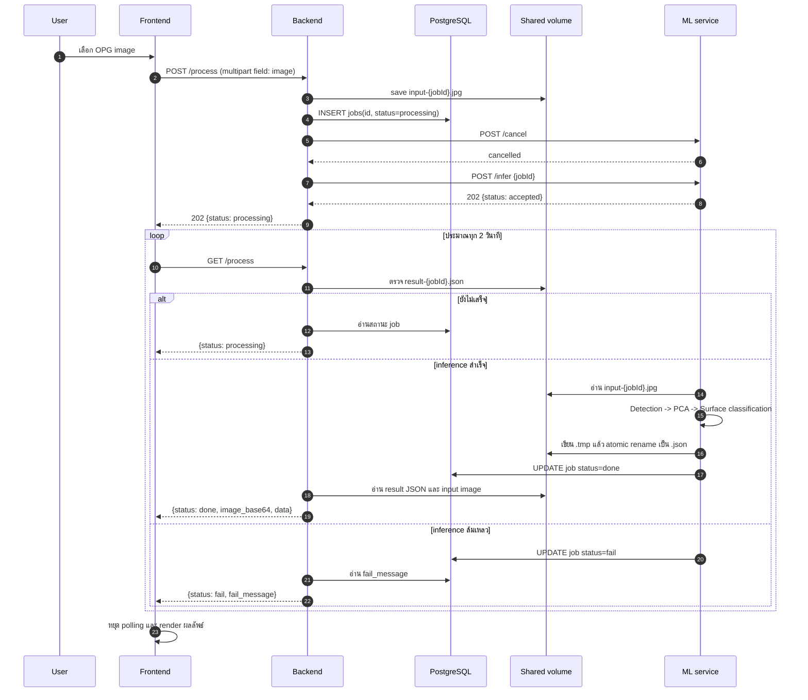

# ML Service Data Flow

> **STATUS (2026-10-28): SUPERSEDED — historical reference only.**
> เอกสารนี้อธิบาย flow ก่อน pipeline v2 (Stage 1 caries YOLO บนภาพพาโนรามา +
> Stage 3b CNN / RF) ซึ่ง **ไม่ตรงกับ implementation ที่ให้บริการแล้ว**.
> Flow ปัจจุบันอยู่ที่ `docs-md/pipeline-v2-caries-crop.md`:
> Pano-Seg → dedupe → crop PAD 20 → Crop-Seg → 1-class caries YOLO บน tooth crop
> → geometry heuristic → crop→pano. RF/CNN ถูกถอดออกจาก serving แล้ว.

รายละเอียดต่อไปนี้เป็น snapshot ของ data flow ก่อน pipeline v2 และไม่ใช่ contract ปัจจุบัน สำหรับ flow ที่ใช้งานอยู่ให้ยึด `api-contract-v1.md` และ `pipeline-v2-caries-crop.md`.

## 1. ภาพรวม Architecture

```mermaid
flowchart LR
    User[ผู้ใช้ / Browser] -->|POST /process\nmultipart image| FE[Frontend SPA\n:3000]
    FE -->|HTTP| BE[Backend API\nFastify :8000]

    BE -->|เขียน input-{jobId}.jpg| Shared[(Shared volume\n/shared)]
    BE -->|INSERT / อ่านสถานะ job| DB[(PostgreSQL\njobs)]
    BE -->|POST /cancel\nPOST /infer {jobId}| ML[ML Service\nFastAPI :8001]

    ML -->|อ่าน input-{jobId}.jpg| Shared
    ML -->|อ่าน model weights| Weights[(Mounted weights\n/weights read-only)]
    ML -->|เขียน result-{jobId}.tmp\natomic rename เป็น .json| Shared
    ML -->|UPDATE jobs: done/fail| DB

    FE -->|GET /process polling| BE
    BE -->|status + result JSON\n+ image_base64| FE
```

### หน้าที่ของแต่ละส่วน

| ส่วน | หน้าที่ | ข้อมูลที่รับ/ส่ง |
|---|---|---|
| Frontend | รับภาพจากผู้ใช้, เริ่ม job, poll สถานะ, แสดงผลบน canvas | ส่ง `image`; รับ `status`, `image_base64`, `data` |
| Backend | เป็น public API และ job coordinator | บันทึกภาพ, สร้าง job, เรียก ML, อ่านผลกลับ |
| ML service | รัน inference แบบ asynchronous ใน process แยก | รับ `jobId`; อ่านภาพ; สร้างผล JSON |
| PostgreSQL | เก็บสถานะและ metadata ของ job | `processing`, `done`, `fail` และ `fail_message` |
| Shared volume | แลกเปลี่ยนไฟล์ระหว่าง backend กับ ML service | `input-{jobId}.jpg`, `result-{jobId}.json` |
| Model weights | ไฟล์ model สำหรับ inference | mount เป็น `/weights` แบบ read-only |

Backend และ ML service ต้อง mount `shared_data` volume เดียวกัน และต้องใช้ database เดียวกัน

## 2. End-to-end Flow



## 3. API Contract

### Frontend -> Backend

#### `POST /process`

- Content type: `multipart/form-data`
- Field: `image`
- สำเร็จ: HTTP `202`

```json
{ "status": "processing" }
```

Backend สร้าง `jobId` จาก timestamp แล้วบันทึกไฟล์เป็น `/shared/input-{jobId}.jpg` ก่อน dispatch ไปยัง ML service

#### `GET /process`

Frontend เรียกซ้ำตาม `VITE_POLL_INTERVAL_MS` (ค่าเริ่มต้นประมาณ 2 วินาที)

กำลังประมวลผล:

```json
{ "status": "processing" }
```

สำเร็จ:

```json
{
  "status": "done",
  "image_base64": "data:image/jpeg;base64,...",
  "data": {
    "meta": {
      "job_id": 1710000000000,
      "completed_at": "2026-01-01T00:00:00+00:00",
      "image_size": { "width": 4000, "height": 2000 },
      "tooth_count": 20,
      "caries_count": 2
    },
    "teeth": []
  }
}
```

ล้มเหลว:

```json
{ "status": "fail", "fail_message": "..." }
```

### Backend -> ML service

#### `POST /infer`

```json
{ "jobId": 1710000000000 }
```

ตอบ HTTP `202` เมื่อรับ job แล้ว:

```json
{ "status": "accepted", "job_id": 1710000000000 }
```

#### `POST /cancel`

Backend เรียกก่อนเริ่ม job ใหม่ เพื่อหยุด inference ที่กำลังทำอยู่ ปัจจุบันระบบรองรับ active inference ได้ทีละหนึ่ง job

#### `GET /health`

ใช้ตรวจว่า ML service ตอบสนองและมี active job ใดอยู่:

```json
{ "ready": true, "artifacts": {}, "active_job_id": null }
```

## 4. ML Inference Pipeline

```mermaid
flowchart TD
    I[input-{jobId}.jpg] --> D[Stage 1: Detection]
    D --> T[ตรวจฟันและ caries\nพร้อม tooth polygon / FDI]
    T --> P[Stage 2: PCA alignment]
    P --> A[คำนวณ major/minor axes\nและ rotation]
    A --> C[Stage 3: Surface classification]
    C --> N[Stage 3b: CNN cnn_pca42\nจำแนก surface findings - โมเดลหลัก]
    N --> R[RF 13 features\nfallback เมื่อ CNN ไม่พร้อม]
    R --> O[Build result JSON\nmeta + teeth]
    O --> W[เขียน result-{jobId}.tmp\nfsync + atomic rename]
    W --> J[UPDATE jobs = done]
```

รายละเอียดหลัก:

1. **Detection**: ใช้ model ตรวจฟัน, FDI และ caries จากภาพ panoramic
2. **PCA alignment**: คำนวณแกนหลักของฟันเพื่อช่วยจัดแนวข้อมูล
3. **Surface classification**: Stage 3 หาจุด caries แล้ว Stage 3b ใช้ CNN (`cnn_pca42`, 5-fold + `calibration_pca.json`) เป็นตัวจำแนก surface หลัก ถ้าโหลด CNN ไม่ได้จะ fallback เป็น Random Forest 13 features (`dental_caries_surface_random_forest_13_features.pkl`) — เลือกโหมดด้วย env `SURFACE_CNN_MODE` (`off` | `shadow` | `cnn`) และค่าที่ deploy จริงตอนนี้คือ `cnn` (รายละเอียด/ข้อจำกัด: `docs-md/surface-cnn-full-report.md`)
4. **Publish result**: เขียนไฟล์ชั่วคราวก่อน rename แบบ atomic เพื่อลดโอกาสที่ backend จะอ่าน JSON ที่เขียนไม่ครบ

ผลลัพธ์ระดับ tooth จะอยู่ใน `data.teeth` และ metadata รวมอยู่ใน `data.meta`

## 5. สิ่งที่ทีม Frontend ต้องยึดถือ

- ส่งไฟล์ด้วย field ชื่อ `image` เท่านั้น
- หลังได้ HTTP `202` ให้เริ่ม polling `GET /process`
- หยุด polling เมื่อได้ `done` หรือ `fail`
- ตรวจ `status` ก่อนอ่าน `image_base64` และ `data`
- รองรับ network error ระหว่าง polling; frontend ปัจจุบันใช้ backoff สูงสุด 8 เท่า
- `image_base64` เป็น data URL ที่พร้อมนำไปใช้กับ image/canvas ได้โดยตรง

## 6. สิ่งที่ทีม Backend ต้องยึดถือ

- ต้องเขียน input image ลง shared volume ก่อนเรียก `POST /infer`
- ต้องส่ง `jobId` เดียวกับชื่อไฟล์ input ไปยัง ML service
- `ML_SERVICE_URL` ภายใน Docker Compose คือ `http://ml-service:8001`
- ต้องใช้ `shared_data` และ PostgreSQL ชุดเดียวกับ ML service
- การตัดสินว่าเสร็จสำเร็จใช้ทั้ง result JSON และสถานะ DB: มีไฟล์ผลลัพธ์จึงอ่านผล, แต่ถ้า DB เป็น `fail` ให้ส่ง error กลับ frontend
- หลีกเลี่ยงการเริ่มหลาย job พร้อมกัน เพราะ `POST /infer` จะ cancel job ที่ active ก่อนเสมอ
- ควร cleanup ไฟล์ input/result ตาม lifecycle ของ job เพื่อไม่ให้ shared volume โตไม่จำกัด

## 7. Ports และ Runtime Configuration

| Service | Container port | Host port โดยทั่วไป |
|---|---:|---:|
| Frontend | 3000 | 3000 |
| Backend | 8000 | 8000 |
| ML service | 8001 | 127.0.0.1:8001 |
| PostgreSQL | 5432 | 127.0.0.1:5432 |

ตัวแปรสำคัญ:

- `FRONTEND_API_BASE_URL`: URL ที่ browser ใช้เรียก backend เช่น `http://localhost:8000`
- `ML_SERVICE_URL`: URL ที่ backend ใช้เรียก ML service เช่น `http://ml-service:8001`
- `SHARED_DIR`: path ภายใน container โดยทั่วไปคือ `/shared`
- `ML_WEIGHTS_HOST_DIR`: path บน host ที่ mount เป็น `/weights`
- `ML_DEVICE`: อุปกรณ์ inference เช่น `cpu`
- `VITE_POLL_INTERVAL_MS`: ระยะ polling ของ frontend

## 8. Source of Truth ในโค้ด

- Backend route: `backend/src/routes/process.ts`
- Backend ML client: `backend/src/services/mlClient.ts`
- Shared file naming: `backend/src/lib/imageStore.ts`
- Frontend API client: `frontend/src/api/processClient.ts`
- Frontend polling: `frontend/src/features/analysis/usePolling.ts`
- ML API: `ml-service/app/main.py`
- ML pipeline: `ml-service/app/pipeline/orchestrator.py`
- Service wiring และ volumes: `docker-compose.yml`

> หมายเหตุ: README เดิมยังอธิบาย Phase 1 ที่ใช้ Mock ML อยู่ เอกสารฉบับนี้อ้างอิง flow ของ source ปัจจุบันที่มี `ml-service` แล้ว

## 9. Detailed API Spec สำหรับ Frontend Mock

ส่วนนี้เป็น contract ที่ทีม frontend ใช้สร้าง mock และเขียน renderer ได้โดยไม่ต้องเดาจาก model ภายใน

### 9.1 Response envelope จาก Backend

Backend ส่ง response 4 รูปแบบ โดยใช้ `status` เป็น discriminator:

#### Idle

```json
{
    "status": "idle"
}
```

ใช้เมื่อยังไม่มี job ที่กำลังทำงาน

#### Processing

```json
{
    "status": "processing"
}
```

ใช้ระหว่างรอ ML service ทำงาน frontend ไม่ควรอ่าน `data` หรือ `image_base64` ใน response นี้

#### Fail

```json
{
    "status": "fail",
    "fail_message": "Inference failed."
}
```

ใช้เมื่อ upload, dispatch หรือ inference ล้มเหลว

#### Done

```json
{
    "status": "done",
    "image_base64": "data:image/jpeg;base64,/9j/4AAQ...",
    "data": {
        "meta": {
            "processed_at": "2026-09-30T10:20:30.123Z",
            "models": {
                "detector": "Tooth_seg_pano_20250319.pt",
                "classifier": "cnn_pca42 | fallback: dental_caries_surface_random_forest_13_features.pkl"
            },
            "timings_ms": {
                "detection": 1420,
                "pca_alignment": 18,
                "surface_classification": 34,
                "total": 1472
            }
        },
        "image": {
            "width": 1600,
            "height": 800
        },
        "teeth": []
    }
}
```

`done` response ต้องมีทั้ง `image_base64` และ `data` เสมอ แม้ `teeth` จะเป็น array ว่าง

หมายเหตุ: ml-service ปัจจุบันยังไม่ส่ง `meta.models` และ `meta.timings_ms` (orchestrator ส่งแค่ `job_id`, `completed_at`, `image_size`) — backend adapter เติม default เป็น `{"detector":"unknown","classifier":"unknown"}` และ `{}` (ดู `backend/src/services/resultAdapter.ts`) ชื่อ model ที่แสดงในตัวอย่างนี้คือ artifact ที่ติดตั้งและรันจริง ณ ตอนนี้ ใช้เพื่อการอ้างอิง ไม่ได้แปลว่า service ส่งคีย์นี้ออกมา

### 9.2 `data.meta`

| Field | Type | Required | ความหมาย |
|---|---|---:|---|
| `processed_at` | `string` | ใช่ | เวลาเสร็จสิ้นการประมวลผลในรูป ISO-8601 เช่น `2026-09-30T10:20:30.123Z` |
| `models.detector` | `string` | ใช่ | ชื่อหรือ version ของ model ที่ใช้ตรวจฟัน/segmentation |
| `models.classifier` | `string` | ใช่ | ชื่อหรือ version ของ model ที่ใช้จำแนก surface |
| `timings_ms` | `Record<string, number>` | ใช่ | เวลาแต่ละ stage หน่วย milliseconds; key อาจเพิ่มได้ |

`timings_ms` เป็น metadata สำหรับ debug/monitoring ไม่ใช่ข้อมูลที่ใช้วาดภาพโดยตรง

### 9.3 `data.image`

| Field | Type | Required | ความหมาย |
|---|---|---:|---|
| `width` | `number` | ใช่ | ความกว้างภาพต้นฉบับเป็น pixel |
| `height` | `number` | ใช่ | ความสูงภาพต้นฉบับเป็น pixel |

ทุกพิกัดใน `teeth` อ้างอิงภาพขนาดนี้ ไม่ใช่ขนาด canvas ที่ถูก resize บนหน้าจอ

### 9.4 `data.teeth[]`

หนึ่งรายการแทน tooth ที่ panoramic tooth detector ตรวจพบ

| Field | Type | Required | ใช้ทำอะไร |
|---|---|---:|---|
| `id` | `number` | ใช่ | running ID ของรายการผลลัพธ์; ML ปัจจุบันเริ่มที่ `1` |
| `fdi` | `number` | ใช่ | หมายเลขฟันตามระบบ FDI เช่น `11`, `36`, `48` |
| `confidence` | `number` ในช่วง `0..1` | ใช่ | confidence ของ panoramic tooth detector ไม่ใช่ caries confidence |
| `bbox` | `[x, y, width, height]` | ใช่ | bounding box ของ tooth ในภาพต้นฉบับ |
| `mask` | `MaskData` | ใช่ | segmentation mask ของ tooth |
| `axes` | `ToothAxes` | ใช่ | แกน PCA และมุมจัดแนว tooth |
| `surfaces` | `SurfaceFinding[]` | ใช่ | finding ของ surface ที่ตรวจพบ; อาจเป็น `[]` |

### 9.5 Bounding box

รูปแบบคือ `[x, y, width, height]` หรือ `xywh` ไม่ใช่ `[x1, y1, x2, y2]`

```json
"bbox": [740, 340, 130, 170]
```

ความหมาย:

- `x`: pixel ของขอบซ้าย
- `y`: pixel ของขอบบน
- `width`: ความกว้าง box เป็น pixel
- `height`: ความสูง box เป็น pixel
- จุดกำเนิด `(0, 0)` อยู่มุมซ้ายบนของภาพ
- `x` เพิ่มไปทางขวา และ `y` เพิ่มลงด้านล่าง
- พิกัดเป็น pixel ของภาพต้นฉบับ ไม่ normalize เป็น `0..1`

สำหรับการวาดบน canvas ที่ถูก scale ให้คำนวณ:

```text
scaleX = canvasWidth / data.image.width
scaleY = canvasHeight / data.image.height
screenX = x * scaleX
screenY = y * scaleY
screenWidth = width * scaleX
screenHeight = height * scaleY
```

### 9.6 Mask

รูปแบบที่ ML ปัจจุบันส่งจริงคือ polygon:

```json
"mask": {
    "encoding": "polygon",
    "data": [
        [772.0, 340.0],
        [868.0, 345.0],
        [870.0, 505.0],
        [748.0, 510.0]
    ]
}
```

| Field | Type | ความหมาย |
|---|---|---|
| `encoding` | `"polygon"` หรือ `"rle"` | วิธีแปลความหมายของ `data`; ML ปัจจุบันใช้ `polygon` |
| `data` เมื่อเป็น polygon | `Array<[x, y]>` | จุด contour ตามลำดับในพิกัดภาพต้นฉบับ |
| `data` เมื่อเป็น rle | `number[]` | reserved สำหรับ run-length encoding; ยังไม่ถูก emit โดย ML ปัจจุบัน |

การวาด polygon บน canvas:

1. scale ทุกจุดด้วย `scaleX` และ `scaleY`
2. `moveTo` จุดแรก
3. `lineTo` จุดถัดไปตามลำดับ
4. `closePath()` แล้วเลือก `fill()` หรือ `stroke()`

Polygon นี้คือ mask ของ tooth ไม่ใช่ mask ของ lesion โดยตรง

### 9.7 PCA axes

```json
"axes": {
    "major": [0.12, 0.99],
    "minor": [-0.99, 0.12],
    "rotation_deg": -6.8
}
```

| Field | Type | ความหมาย |
|---|---|---|
| `major` | `[dx, dy]` | eigenvector หลักของ tooth; เป็น direction vector ไม่ใช่จุดปลายเส้น |
| `minor` | `[dx, dy]` | eigenvector รองของ tooth |
| `rotation_deg` | `number` | มุมที่ใช้จัดแนว tooth ไปยัง canonical orientation |

ทั้ง `major` และ `minor` ไม่ใช่พิกัด image point จึงต้องนำไปคูณความยาวและวางที่จุดศูนย์กลางของ tooth หากต้องการวาดแกน

กรณี PCA ใช้ไม่ได้ ML จะส่งค่า fallback:

```json
"axes": {
    "major": [0, 0],
    "minor": [0, 0],
    "rotation_deg": 0
}
```

frontend ควรถือว่า vector `[0, 0]` หมายถึง “ไม่มีแกนที่เชื่อถือได้” และไม่ควรวาดเส้นแกน

### 9.8 Surface findings

```json
"surfaces": [
    {
        "name": "occlusal",
        "label": "caries",
        "probability": 0.88
    }
]
```

| Field | Type | ค่า/ความหมาย |
|---|---|---|
| `name` | enum string | `mesial`, `distal`, `occlusal`, `buccal`, `lingual` |
| `label` | enum string | `caries` หรือ `sound` |
| `probability` | `number` ในช่วง `0..1` | probability ของ class ที่ classifier เลือก |

ความหมายของ `probability` ต้องแยกจาก `tooth.confidence`:

- `tooth.confidence`: ความมั่นใจว่า object นี้เป็น tooth ที่ detector ตรวจพบ
- `surface.probability`: ความมั่นใจของ surface classifier
- caries detector confidence: **ยังไม่ถูกส่งใน response ปัจจุบัน**

ML ปัจจุบันส่งเฉพาะ surface ที่มี caries finding โดยทั่วไป ดังนั้น tooth ที่ไม่มี caries จะมี:

```json
"surfaces": []
```

ไม่ได้หมายความว่า surface ทั้งหมดถูกตรวจว่า `sound` แต่หมายความว่าไม่มี caries finding ที่ถูกส่งออกมา

### 9.9 Optional diagnostic fields ที่ ML มี แต่ frontend schema ปัจจุบันยังไม่รับรอง

ภายใน implementation บางกรณีอาจมี field เหล่านี้:

```json
{
    "axes": {
        "major": [0.12, 0.99],
        "minor": [-0.99, 0.12],
        "rotation_deg": -6.8,
        "clamped": false
    },
    "surfaces": [
        {
            "name": "distal",
            "label": "caries",
            "probability": 0.0,
            "method": "XThirds_Fallback",
            "fallback_reason": "Empty caries region after noise removal"
        }
    ]
}
```

สถานะปัจจุบัน:

- `axes.clamped`: ML อาจส่ง แต่ frontend Zod schema ยังไม่ประกาศ
- `surfaces[].method`: `CNN` (โมเดลหลัก) หรือ `RF` / `XThirds_Fallback` (fallback); frontend Zod schema ประกาศรองรับ `CNN` แล้ว
- `surface_source` (`cnn` | `rf`) และ `shadow_cnn`: มีใน raw result JSON ที่ ml-service เขียน แต่ไม่อยู่ใน API contract — adapter ตัดคีย์ที่ไม่ประกาศออก (zod ไม่ได้เปิด passthrough)
- `surfaces[].fallback_reason`: อาจมีเฉพาะ fallback บางกรณี
- ถ้า parse ผ่าน Zod schema ปัจจุบัน field ที่ไม่ประกาศอาจถูก strip ออกจาก object ที่ frontend ใช้งาน

ถ้าทีมต้องการใช้ diagnostic fields เหล่านี้จริง ควรเพิ่มเข้า schema แบบ explicit ก่อนทำ UI ที่พึ่งพา field ดังกล่าว

## 10. Canonical Mock JSON สำหรับ Frontend

ตัวอย่างนี้ตรงกับ schema ที่ frontend `parseProcessResponse()` รับอยู่ และมีข้อมูลพอสำหรับวาด image, bbox, mask, PCA axes และ surface label:

```json
{
    "status": "done",
    "image_base64": "data:image/jpeg;base64,/9j/4AAQSkZJRgABAQAAAQ...",
    "data": {
        "meta": {
            "processed_at": "2026-09-30T10:20:30.123Z",
            "models": {
                "detector": "Tooth_seg_pano_20250319.pt",
                "classifier": "cnn_pca42 | fallback: dental_caries_surface_random_forest_13_features.pkl"
            },
            "timings_ms": {
                "detection": 1420,
                "pca_alignment": 18,
                "surface_classification": 34,
                "total": 1472
            }
        },
        "image": {
            "width": 1600,
            "height": 800
        },
        "teeth": [
            {
                "id": 1,
                "fdi": 36,
                "confidence": 0.9731,
                "bbox": [740, 340, 130, 170],
                "mask": {
                    "encoding": "polygon",
                    "data": [
                        [772.0, 340.0],
                        [850.0, 342.0],
                        [868.0, 380.0],
                        [860.0, 480.0],
                        [780.0, 510.0],
                        [748.0, 470.0]
                    ]
                },
                "axes": {
                    "major": [0.12, 0.99],
                    "minor": [-0.99, 0.12],
                    "rotation_deg": -6.8
                },
                "surfaces": [
                    {
                        "name": "occlusal",
                        "label": "caries",
                        "probability": 0.8812
                    }
                ]
            },
            {
                "id": 2,
                "fdi": 37,
                "confidence": 0.9417,
                "bbox": [880, 345, 125, 165],
                "mask": {
                    "encoding": "polygon",
                    "data": [
                        [895.0, 348.0],
                        [980.0, 345.0],
                        [1005.0, 390.0],
                        [995.0, 490.0],
                        [910.0, 505.0],
                        [885.0, 450.0]
                    ]
                },
                "axes": {
                    "major": [0.0, 0.0],
                    "minor": [0.0, 0.0],
                    "rotation_deg": 0
                },
                "surfaces": []
            }
        ]
    }
}
```

### 10.1 Minimal fixtures ที่ควรมี

ทีม frontend ควรเตรียม mock อย่างน้อย 5 กรณี:

1. `idle`
2. `processing`
3. `fail` พร้อม `fail_message`
4. `done` ที่มี tooth หลายรายการ, polygon mask, caries finding และ tooth ที่ไม่มี caries (`surfaces: []`)
5. `done` ที่ `teeth: []` เพื่อรองรับภาพที่ตรวจไม่พบ tooth

## 11. Contract Mismatch ที่ต้องแก้ก่อนต่อ Integration จริง

ปัจจุบัน ML result JSON กับ frontend Zod schema ยังไม่ตรงกัน:

| จุดต่าง | ML ปัจจุบัน | Frontend ต้องการ |
|---|---|---|
| เวลา | `meta.completed_at` | `meta.processed_at` |
| image size | `meta.image_size` | `data.image` |
| model metadata | ไม่มี `meta.models` | ต้องมี `detector`, `classifier` |
| timing metadata | ไม่มี `meta.timings_ms` | ต้องมี object ของ milliseconds |
| extra diagnostics | `clamped`, `method`, `fallback_reason` อาจมี | schema ยังไม่ประกาศ |
| ID | ML เริ่มที่ `1` | frontend ไม่บังคับค่าเริ่มต้น |
| surface cardinality | ส่งเฉพาะ finding ที่พบ หรือ `[]` | รองรับ array ว่าง แต่ไม่ควร assume ว่ามี 5 รายการ |

**ข้อเสนอสำหรับ implementation:** ใช้ schema ในหัวข้อ 9-10 เป็น canonical API contract แล้วแก้ producer ฝั่ง ML ให้ส่ง `meta` และ `image` ตามนั้น หรือเพิ่ม adapter ที่ backend ก่อนส่งให้ frontend หากต้องการรักษา result file format เดิมไว้

จนกว่าจะเลือกวิธีใดวิธีหนึ่ง frontend mock ควรยึด **Canonical Mock JSON** ในหัวข้อ 10 ไม่ใช่ raw JSON ปัจจุบันจาก ML เพราะ raw JSON ปัจจุบันจะถูก `parseProcessResponse()` ปฏิเสธจาก field ที่หายไป
