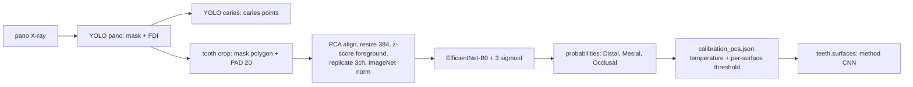

# รายงานฉบับเต็ม: โมเดล CNN จำแนกพื้นผิวฟันผุรายซี่ (Stage 3b) และการนำขึ้นใช้งานจริง
# Full Report: Per-Tooth Caries Surface CNN (Stage 3b) and Its Deployment

> **STATUS UPDATE (2026-10-28): REFERENCE ONLY — NOT SERVING.**
> CNN ถูกถอดออกจาก serving path แล้ว; `ml-service/app/pipeline/orchestrator.py`
> ไม่ import `surface_cnn.py` อีกต่อไป และ `SURFACE_CNN_MODE` ไม่มีผลกับผลผลิตจริง.
> Surface ของ pipeline v2 มาจาก deterministic geometry heuristic
> (`app/pipeline/surface_heuristic.py`, `method = "Geometry_Heuristic"`).
> เอกสารนี้เก็บไว้เป็นประวัติการทดลอง/ทางเลือกในอนาคต (Decision Log: เก็บ
> `cnn_pca42` เป็น option ไม่ใช่ primary). Flow ปัจจุบัน:
> `docs-md/pipeline-v2-caries-crop.md`.

> สถานะเอกสาร (Document status): 20 ตุลาคม 2026 — CNN ถูก freeze และตั้งเป็นโมเดลหลักของ Stage 3b ใน `ml-service` แล้ว (`SURFACE_CNN_MODE=cnn`)
> ขอบเขต (Scope): วิธีได้มาของโมเดล CNN (ข้อมูล, โปรโตคอล, การฝึก, การ calibrate), หลักฐานผลการวัด, และรายละเอียดการ deploy ใน `dental-caries-detection`
> เอกสารพี่น้อง (Companion): `caries-detection-model/PIPELINE_DOCUMENTATION_TH_EN.md` (รายงาน Data Science ฉบับเดิม 14 ต.ค. 2026 — ก่อนมีผล Stage 2 ของ CNN)
> กฎคำศัพท์: คำย่อเขียนคำเต็มก่อนวงเล็บครั้งแรก (Average Precision (AP), Convolutional Neural Network (CNN)) ชื่อไฟล์/คำสั่ง/รหัสการรันคงรูปเดิม

---

## 0. บทสรุปผู้บริหาร / Executive Summary

### ภาษาไทย

CNN ตัวนี้ทำนาย **พื้นผิวที่ผุของฟันแต่ละซี่** (Distal = ด้านไกลกลาง, Mesial = ด้านใกล้กลาง, Occlusal = ด้านบดเคี้ยว) จากภาพเอกซเรย์พาโนรามา โดยใช้เฉพาะสิ่งที่ production เห็นจริง (มาสก์ฟันจาก YOLO พาโนรามา + หมายเลข Federation Dentaire Internationale (FDI)) — **พิกัดรอยผุไม่ถูกใช้เป็น input**

- สถาปัตยกรรม: EfficientNet-B0 + head เดียว 3 sigmoid ต่อซี่ (multi-label), input 384×384, ablation `pca` (จัดแนวแกนฟันด้วย Principal Component Analysis (PCA), ไม่ใช้ Contrast Limited Adaptive Histogram Equalization (CLAHE)), loss = focal (gamma = 2), 5 folds × 14 epochs, seed 42 (มี seed 43 เป็นการทำซ้ำเพื่อวัด variance ของการฝึก)
- หลักฐานเลือก arm (เทียบ `pca` กับ `off` บน 2 seeds): **Distal NON-INFERIOR, Mesial NON-INFERIOR, Occlusal INCONCLUSIVE** (เกณฑ์ margin 0.05 ตาม Evaluation stage lock v2)
- ผลบนเส้นทาง engine จริง (5-fold out-of-fold (OOF) thresholds, 201 เคส / 6,012 ซี่): Recall 0.781 / 0.726 / 0.853, Precision 0.335 / 0.247 / 0.164
- **เกณฑ์วิศวกรรม end-to-end ที่ประกาศไว้ก่อนรัน = FAIL**: ΔAP (เทียบ cached-crop) −0.0507 / −0.0877 / −0.0227 vs งบ ≤ 0.05 → Distal และ Mesial ตก, Occlusal ผ่าน
- เดือน ต.ค. 2026 เจ้าของโครงการตัดสินใจ **override** เกณฑ์ดังกล่าวและตั้ง CNN เป็นโมเดลหลัก โดยเก็บ Random Forest (RF) ไว้เป็น fallback ที่ปิดการใช้งาน (ดูข้อ 7)
- ยังไม่มี external validation และยังไม่มีค่า inter-rater Cohen's kappa จากทันตแพทย์ → ใช้เป็น **screening aid** เท่านั้น ยังไม่พอวินิจฉัยเอง

### English (simple)

This CNN predicts **the carious surface of each tooth** (Distal, Mesial, Occlusal) from one panoramic X-ray using only what production sees (pano YOLO mask + Federation Dentaire Internationale (FDI) number). Lesion coordinates are never model inputs.

- EfficientNet-B0 + a single 3-sigmoid multi-label head, 384×384 input, ablation `pca` (Principal Component Analysis (PCA) alignment, no CLAHE), focal loss (gamma 2), 5 folds × 14 epochs, seed 42 (seed 43 as a training-variance replicate).
- Arm selection against `off` on 2 seeds: **Distal NON-INFERIOR, Mesial NON-INFERIOR, Occlusal INCONCLUSIVE** (margin 0.05 per Evaluation stage lock v2).
- On the real engine path (5-fold out-of-fold (OOF) thresholds, 201 cases / 6,012 teeth): Recall 0.781 / 0.726 / 0.853, Precision 0.335 / 0.247 / 0.164.
- The **pre-declared end-to-end engineering gate FAILED**: ΔAverage Precision (AP) −0.0507 / −0.0877 / −0.0227 against a ≤ 0.05 budget.
- In October 2026 the project owner **overrode** that gate and made the CNN the primary Stage 3b model, with the Random Forest (RF) kept as a disabled-by-default fallback (section 7).
- No external validation and no inter-rater Cohen's kappa yet: **screening aid only, not diagnostic**.

---

## 1. โมเดลนี้คืออะไร / What the Model Is



| หัวข้อ (Item) | ค่า (Value) | ที่มา (Source) |
|---|---|---|
| Backbone | `efficientnet_b0` (feature dim 1280) | checkpoint + `pipeline.build_cnn` |
| Head | `Dropout(0.3)` + `Linear(1280, 3)` + sigmoid (multi-label) | `surface_cnn._build_backbone` |
| Metadata/Numeric fusion | ปิด (`use_metadata=False`) — FDI ไม่เข้า head | checkpoint config |
| Input | 384×384, 1 channel → replicate 3 channels, ImageNet normalization | `ablation pca` + `img_size 384` |
| Preprocessing (ablation `pca`) | PCA alignment เปิด, CLAHE ปิด | `pipeline.ablation_to_pre("pca", 384)` |
| Crop rule | มาสก์ฟันจาก YOLO พาโนรามา + `CROP_PAD = 20` | เทียบเท่า `pipeline.ToothDetector.detect` |
| Loss | focal (`SigmoidFocalLoss`, gamma = 2.0, pos_weight) | `pipeline.py` L889, L1452 |
| พารามิเตอร์จริงต่อซี่ (Serving) | 5 checkpoints เฉลี่ย sigmoid แล้ว temperature-scale | `CnnBundle.predict` |

**Output ต่อซี่ (ตามสัญญาเดิมของ API):** `surfaces: [{name: "distal"|"mesial"|"occlusal", label: "caries", probability: 0–1, method: "CNN"}]` — ซี่หนึ่งได้ 0–3 รายการ (เฉพาะพื้นผิวที่ความน่าจะเป็น ≥ threshold ของพื้นผิวนั้น)

**ความต่างเชิงเจตนาจากโค้ดฝึก (บันทึกไว้ ไม่เงียบ):**

1. ตอนเสิร์ฟสร้าง backbone ด้วย `weights=None` (ไม่ดาวน์โหลด ImageNet weights) เพราะ `state_dict` ของ checkpoint เขียนทับน้ำหนักทุกตัว และคอนเทนเนอร์อาจออฟไลน์
2. แครอปสร้างจากมาสก์พาโนรามาโดยไม่ผ่านตัว refine แครอปของ Detectron2 (ตอนฝึกใช้) — ช่องว่างนี้คือสิ่งที่ข้อ 5 วัด

---

## 2. ได้โมเดลมาอย่างไร / How the Model Was Obtained

### 2.1 กติกาที่ล็อกไว้ก่อนเห็นผล (Protocol lock)

อ้าง `caries-detection-model/outputs/PROTOCOL_LOCK.md`:

| กติกา (Rule) | ค่า (Value) |
|---|---|
| เกณฑ์ adopt arm | Nadeau & Bengio corrected t interval ของ ΔAP: ขอบล่างต้องมากกว่า −0.05 (margin ล็อกก่อนรัน) |
| Metric หลัก | AP ต่อ fold เป็น mean ± sd + cluster bootstrap; pooled Recall/Precision/F1 จาก per-fold thresholds (**ห้ามรวม probability ข้าม fold เป็นเส้นเดียว**) |
| Splits/seeds | seed 42 เป็น reference, เพิ่ม seed 43 เป็นการทำซ้ำ (k = folds × seeds) |
| Peeked set | 100 เคส ถูกตัดออกจาก **ทุก** การรันฝึกและประเมิน (`--exclude @peeked`) |
| Threshold ตอนฝึก | tune บน tune data เท่านั้น (บังคับด้วย `verify_nested_thresholds`), target Recall 0.80 |
| Threshold ตอนส่งมอบ | `calibrate`: temperature scaling รายพื้นผิว บน 100 เคส peeked แล้วจึงตั้ง threshold, target Recall 0.85 |
| ข้อจำกัดที่ต้องเปิดเผย | ค่า peeked เป็น diagnostic เท่านั้น ห้ามอ้างเป็น performance; label ceiling รอ kappa; external test ขนาด ~103 เคส ใช้ครั้งเดียว |

### 2.2 ข้อมูล (Data)

| ชุด (Set) | ขนาด (Size) | บทบาท (Role) |
|---|---|---|
| Cross-validation 201 เคส | 6,020 ซี่ต่อ fold (train 4,816 / test 1,204); ประเมินจริง 6,012 ซี่ | ฝึก 5 folds + OOF |
| Peeked 100 เคส | 3,019 ซี่ (`calibration_pca.json`) | fit temperature + threshold ของ delivery |
| Prevalence (reference) | Distal 6.3% (379 positive), Mesial 4.8% (288), Occlusal 2.3% (136) | ใช้เทียบ lift ของ AP |

> หมายเหตุความถูกต้อง: จำนวนเคสทั้งหมดของชุดข้อมูลต้นทาง (และข้อสงสัยว่า Detectron2 crop weights เคยเห็นเคสชุดนี้หรือไม่) ระบุไว้ใน PROTOCOL_LOCK.md ว่าเป็นข้อจำกัดที่ต้องเปิดเผย — เอกสารนี้ไม่ยืนยันตัวเลขดังกล่าว

### 2.3 การฝึก (Training)

| พารามิเตอร์ (Parameter) | ค่า (Value) |
|---|---|
| ablation / backbone / loss | `pca` / `efficientnet_b0` / `focal` |
| img_size / epochs | 384 / 14 |
| cv / n_folds | `stratified-groupkfold` / 5 |
| seed | 42 (reference), 43 (replication) |
| exclude | `@peeked` (100 เคส) |
| epoch selection | tune macro AP (threshold-free), early stopping patience 8 |
| จำนวนรอบที่รันจริง | 4 รัน (`pca` 42/43, `off` 42/43) |

ไฟล์ rันที่ได้: `outputs/oof_pca_stratified-groupkfold_seed42_exc100.{csv,json}`, `..._seed43_...`, `oof_off_...` และ checkpoint `best_pca_s42_f{0..4}.pt`

### 2.4 คำสั่งที่ใช้ (verifiable verbs ของ `pipeline.py`)

ผ่าน `pipeline.py` (subcommands ที่มีจริง: `build-dataset`, `train`, `find-epoch`, `ablate`, `baseline`, `compare`, `oof-report`, `compare-oof`, `calibrate`, `kappa`, `sample-size`, `predict`):

```bash
# 1) ฝึก 5 folds (seed 42 = reference; seed 43 = replication)
python pipeline.py train --ablation pca --backbone efficientnet_b0 --loss focal \
    --img_size 384 --epochs 14 --cv stratified-groupkfold --seed 42 --exclude @peeked

# 2) รายงาน OOF ต่อ fold (AP mean/sd, pooled decisions ด้วย per-fold thresholds)
python pipeline.py oof-report --ablation pca --cv stratified-groupkfold --seed 42 --exclude @peeked

# 3) เทียบ arm pca vs off บน 2 seeds (เกณฑ์ margin 0.05)
python pipeline.py compare-oof --exclude @peeked --seed 42
python pipeline.py compare-oof --exclude @peeked --seed 43

# 4) calibrate สำหรับ delivery (temperature + threshold รายพื้นผิว จาก 100 เคส peeked)
python pipeline.py calibrate --ablation pca --seed 42
```

> ก่อนรันจริงให้ยืนยัน flag ด้วย `python pipeline.py <verb> --help` (เอกสารนี้ยึดจาก argparse ที่ตรวจในไฟล์ ไม่ได้ invent flag เพิ่ม)

### 2.5 การ calibrate สำหรับ delivery

`outputs/calibration_pca.json` (คัดค่าจริง; **ชุด peeked = diagnostic only**):

| พื้นผิว | Temperature | Threshold | Recall@threshold | Precision@threshold | n_pos | Brier raw → calibrated |
|---|---:|---:|---:|---:|---:|---:|
| Distal | 0.7751 | 0.21186 | 0.8516 (Wilson 0.787–0.899) | 0.2139 | 155 | 0.0601 → 0.0581 |
| Mesial | 0.7705 | 0.30945 | 0.8548 (0.782–0.906) | 0.2477 | 124 | 0.0573 → 0.0547 |
| Occlusal | 0.6907 | 0.05866 | 0.8608 (0.768–0.920) | 0.1611 | 79 | 0.0239 → 0.0220 |

`recall_target = 0.85`, `n_folds = 5`, `prefix = best_pca_s42_f` — ค่าเหล่านี้คือ operating point ที่ระบบใช้จริงเมื่อ `SURFACE_CNN_MODE=cnn`

---

## 3. หลักฐานการเลือก arm / Arm-Selection Evidence

ที่มา `outputs/compare_oof_2seeds.json` (margin 0.05, bootstrap 500, k = 10):

| พื้นผิว | ΔAP mean (pca − off) | bootstrap 95% CI | corrected-t CI | แยกได้? | Verdict |
|---|---:|---|---|---|---|
| Distal | +0.0293 | [0.0027, 0.0545] | [−0.0491, +0.1076] | ใช่ | **NON-INFERIOR** |
| Mesial | +0.0310 | [−0.0008, +0.0648] | [−0.0240, +0.0860] | ไม่ | **NON-INFERIOR** |
| Occlusal | (ค่าอยู่ในไฟล์) | — | — | — | **INCONCLUSIVE** |

ข้อจำกัดที่ต้องเขียนกำกับ: การเทียบนี้เป็นการเทียบ **arm** (`pca` vs `off`) ไม่ใช่การเทียบ CNN กับ RF — ตัวเลข RF ที่ใช้เทียบในรายงานนี้เป็นเชิงทิศทางเท่านั้น

---

## 4. ผลการวัดของ CNN / Measured Results

### 4.1 Cached-crop (ระดับแครอปที่ตรงกับตอนฝึก)

6,012 ซี่ / 201 เคส, AP = ค่าเฉลี่ยต่อ fold:

| พื้นผิว | AP (mean ± sd) | Pooled Recall | Precision | n_pos | Prevalence |
|---|---:|---:|---:|---:|---:|
| Distal | 0.629 ± 0.075 | 0.813 | 0.338 | 379 | 6.3% |
| Mesial | 0.552 ± 0.069 | 0.771 | 0.261 | 288 | 4.8% |
| Occlusal | 0.604 ± 0.086 | 0.809 | 0.196 | 136 | 2.3% |

### 4.2 End-to-end (เส้นทาง engine จริง: YOLO → แครอปจากมาสก์ → CNN)

โมเดลเดียวกัน (fold checkpoints), threshold = per-fold ของแต่ละ fold (ไม่ re-tune):

| พื้นผิว | AP (คำนวณจาก ΔAP) | Recall | Precision | TP / FP / FN | Coverage |
|---|---:|---:|---:|---|---:|
| Distal | ≈ 0.579 | 0.781 | 0.335 | 296 / 587 / 83 | 6,010 / 6,012 |
| Mesial | ≈ 0.465 | 0.726 | 0.247 | 209 / 637 / 79 | (99.97%) |
| Occlusal | ≈ 0.582 | 0.853 | 0.164 | 116 / 590 / 20 | — |

- เวลารัน: 358.2 วินาที / 201 เคส ≈ 1.78 วินาที/เคส ≈ 60 มิลลิวินาที/ซี่ (CPU)
- Threshold ต่อ fold ที่ใช้ (ไม่มี re-tune): f0 0.40/0.30/0.10 · f1 0.55/0.50/0.50 · f2 0.45/0.50/0.30 · f3 0.65/0.60/0.70 · f4 0.70/0.60/0.45
- Self-check ของ harness: AP 0.629220 / 0.552276 / 0.604349 (ตรงกับ cached-crop ข้อ 4.1; mismatch 1 เคสจาก rounding boundary)

### 4.3 เกณฑ์ end-to-end ที่ประกาศก่อนรัน (engineering gate)

เกณฑ์: AP และ Recall ต่อพื้นผิวต้องลดไม่เกิน 0.05 (absolute) เมื่อเทียบ cached-crop ด้วยโมเดล/โปรโตคอลเดียวกัน

| พื้นผิว | ΔAP | ผล | ΔRecall | ผล |
|---|---:|---|---:|---|
| Distal | −0.0507 | **FAIL** | −0.0317 | ผ่าน |
| Mesial | −0.0877 | **FAIL** | −0.0451 | ผ่าน |
| Occlusal | −0.0227 | ผ่าน | +0.0441 | ผ่าน |
| **รวม** | | **FAIL** | | ผ่าน |

### 4.4 Docker parity (ความถูกต้องเชิงตัวเลขเทียบต้นฉบับ)

| การตรวจ | ผล |
|---|---|
| Tensor exact-hash (6 เคส) | 6/6 ตรง |
| Probabilities max &#124;Δ&#124; | 2.272e-07 |
| Oracle `vendored == original` | 6/6 |
| Cross-env host vs container | grid maxΔ 0.0363 / 0.0491, probs ≤ 2.0e-03, `original == host_ref` 0/6 (ข้อจำกัดที่บันทึกไว้: OpenCV ของคอนเทนเนอร์ต่างจาก host ที่ระดับ geometry ของแครอป) |

### 4.5 ประสิทธิภาพเชิงระบบ (จาก bench + run จริง)

| ตัวชี้วัด | ค่า |
|---|---|
| โหลด bundle | 1.596 วินาที |
| Latency (bench batch-30) | 213.55 มิลลิวินาที/ซี่ (ถูกแทนที่ด้วยตัวเลข run จริง ~60 มิลลิวินาที/ซี่) |
| RSS | 34.7 → 571.3 → 665.3 MiB (bench; ไม่ได้วัดซ้ำบน run จริง) |

---

## 5. ของที่ส่งมอบ / Delivered Artifacts

| ไฟล์ | ขนาด (B) | SHA-256 |
|---|---:|---|
| `cnn_pca42/best_pca_s42_f0.pt` | 16,329,410 | `266AD0172677271A5E2B9686808CD3F42B11377CF735540937FD19EA38DFC57A` |
| `cnn_pca42/best_pca_s42_f1.pt` | 16,329,410 | `65BAB185DA59C80B08C865B23A6A1A77AA65BCD7292096C801E5E6E0290281EF` |
| `cnn_pca42/best_pca_s42_f2.pt` | 16,329,410 | `BEEE3E30A7337760D8C553C32D861D572DEE632C16C43832345C62C34B870ED1` |
| `cnn_pca42/best_pca_s42_f3.pt` | 16,329,410 | `1BF358A027AA8FCEBAEE297F7E30B15B677E2F84264340D09C9D0AE5D807A83B` |
| `cnn_pca42/best_pca_s42_f4.pt` | 16,329,410 | `4E1D6838EE4259D666CB00153FF7141CDB2E6193F08D681ADF730B02DD2F6837` |
| `cnn_pca42/calibration_pca.json` | 6,562 | `D22036F398604043482C862019F1607325C0627F959C100F6E596EC8251B9DF1` |
| `dental_caries_surface_random_forest_13_features.pkl` (fallback) | — | `201459B7A54E8B32B4AC4ED7CA77A198E622D9237E98B50C3426CA048D0E2686` |
| `Tooth_seg_pano_20250319.pt` | — | `502bd58099e50d5c5bb16245aa5a135943fbd87debe9f66928a5b938798ca579` |
| `caries_detect.pt` | — | `515e09fe1a11c683dfaa94156a679bdbee7ab177848c6558a63f159cbf8dc1fd` |
| `Tooth_seg_crop_20250424.pth` (ปิดใช้งาน) | — | `b39fef8288634e6e756d3aace628d145d0f927a76d3f7d9bfa17f919a8c9b4a9` |

ตำแหน่งติดตั้งจริง (หลังจัดให้ตรงกับที่ใช้งาน): `dental-caries-detection/ml-service/weights/` (bind mount → `/weights` ในคอนเทนเนอร์, อ่านอย่างเดียว) และโฟลเดอร์ CNN ที่ `/weights/cnn_pca42`

หมายเหตุความสะอาดของโฟลเดอร์: ใน `ml-service/weights/` อาจยังมี `rf_classify_ml.pkl` (ไฟล์รุ่นเก่า) หลงเหลืออยู่ — ไม่มีโค้ดใดอ้างถึง และไม่มีเอกสารใดอ้างถึงแล้ว (อัปเดต `docs-md/ml-service-data-flow.md` เป็น `cnn_pca42` เรียบร้อย) การย้ายไฟล์นี้ออกไม่กระทบระบบ เพราะ `models/versions.py` ชี้ที่ไฟล์ 13 features เท่านั้น

ความสมบูรณ์ระดับไฟล์ (parity): `tests/test_surface_cnn_parity.py` ตรวจว่าโค้ด preprocessing ที่ vendor ไว้เหมือนต้นฉบับ (`caries-detection-model/pipeline.py`) ทั้งเชิงข้อความและเชิงตัวเลข โดยมีเครื่องมือสร้าง reference ที่ `caries-detection-model/deploy/make_parity_reference.py` และ smoke test ที่ `deploy/smoke_test_effnet.py`

---

## 6. การนำขึ้นใช้งาน / Deployment

### 6.1 โหมดการทำงาน (environment only)

`SURFACE_CNN_MODE` = `off` | `shadow` | `cnn` (ค่าเริ่มต้นในโค้ด = `off`; ที่ deploy จริงตอนนี้ = `cnn`)

| โหมด | พฤติกรรม | เจ้าของผล `teeth[].surfaces[]` |
|---|---|---|
| `off` | ไม่โหลด/ไม่รัน CNN | RF |
| `shadow` | คำนวณ CNN แล้วเก็บเป็นบล็อกแยก | RF (ไม่ถูกแก้) |
| `cnn` | ใช้ผล CNN ที่ผ่าน temperature + threshold เป็นผลหลัก | CNN (`method: "CNN"`) — ถ้า CNN ใช้ไม่ได้ → RF (fallback) |

### 6.2 ตัวแปรสภาพแวดล้อม

| ตัวแปร | ค่าเริ่มต้น | ความหมาย |
|---|---|---|
| `SURFACE_CNN_MODE` | `off` | โหมดตามข้อ 6.1 |
| `SURFACE_CNN_DIR` | `/weights/cnn_pca42` | โฟลเดอร์ checkpoint + calibration |
| `SURFACE_CNN_CALIB` | `<DIR>/calibration_pca.json` | ไฟล์ temperature/threshold |
| `SURFACE_CNN_DEVICE` | `ML_DEVICE` หรือ `cpu` | `cpu` หรือ `cuda` |
| `SURFACE_CNN_THREADS` | `4` | จำนวน thread ของ torch |
| `SURFACE_CNN_MAX_TEETH` | `0` (ไม่จำกัด) | ข้าม stage ถ้าซี่เกินค่านี้ |

### 6.3 คีย์ในไฟล์ผลลัพธ์

- `surface_source`: `"cnn"` หรือ `"rf"` — บอกว่าใครผลิต `teeth[].surfaces[]` (audit ได้)
- `shadow_cnn`: บล็อกหลักฐานของ CNN (`mode`, `ready`, `n_teeth`, `teeth[{fdi, probabilities, thresholds, positive}]`, `notes`, `info`, `timings_ms`)
- ทั้งสองคีย์เป็นคีย์ระดับบนสุดที่ schema ของ backend/frontend ไม่ได้ประกาศ → ถูกตัดทิ้ง (zod strip) จึงไม่กระทบสัญญาเดิม

### 6.4 เงื่อนไขที่ตกไปใช้ RF (fallback) โดยไม่ทำให้งานล้ม

1. โหลด bundle ไม่ได้ (ไม่มี checkpoint ในโฟลเดอร์ / โหลด error)
2. ไม่มี prediction (ไม่มีซี่ที่เข้าเงื่อนไขให้ให้คะแนน)
3. ไม่โหลด calibration (ไม่มี threshold จึงตัดสินไม่ได้)

ทุกกรณีถูกจับใน `try/except` และบันทึกเป็น warning — งาน inference ยังออกผลด้วย RF

### 6.5 สัญญาฝั่งผู้ใช้ผลลัพธ์ (ต้องแก้พร้อมกัน)

| จุด | สิ่งที่ต้องรองรับ |
|---|---|
| `backend/src/services/resultAdapter.ts` | allowlist รับ `"CNN"`; ส่ง `probability` ผ่านสำหรับ CNN (เดิมบังคับ null ให้ non-RF) |
| `frontend/src/domain/inference.ts` | type union + `z.enum` รับ `"CNN"` |

ถ้าไม่แก้ทั้งสองจุด งานจะ fail ที่ backend ด้วย `Unsupported surface method: CNN`

### 6.6 การย้อนกลับ (Rollback)

```bash
# .env
SURFACE_CNN_MODE=shadow     # หรือ off
docker compose up -d ml-service
```

### 6.7 การตรวจสุขภาพระบบ

`GET /health` → `ready` + `artifacts{pano_detector, crop_segmenter, caries_detector, surface_classifier}`; ปัจจุบัน `crop_segmenter = disabled`, อื่น ๆ `verified`

---

## 7. การตัดสินใจ override และข้อจำกัดที่ต้องเปิดเผย / Override Decision and Mandatory Disclosures

1. **Override (บันทึกไว้):** เกณฑ์ end-to-end ที่ประกาศก่อนรัน (ข้อ 4.3) ตกที่ Distal และ Mesial แต่เจ้าของโครงการสั่งให้ใช้ CNN เป็นโมเดลหลัก — เป็นการตัดสินใจของเจ้าของ ไม่ใช่ผลการทดสอบ
2. **Peeked-set คือ diagnostic only:** threshold/อุณหภูมิที่ใช้จริง fit บน 100 เคส peeked (ข้อ 2.5) ห้ามอ้างตัวเลขนั้นเป็น performance
3. **ยังไม่มี external validation:** ขนาดชุด external ตามโปรโตคอล ~103 เคส และยังไม่ได้รัน
4. **ยังไม่มี label ceiling (kappa):** ต้องมีทันตแพทย์ 2 คนอ่านแบบ blinded 30–50 เคส — ยังไม่ได้ทำ
5. **Mesial recall 0.726** บนเส้นทาง engine (ต่ำกว่าเป้า 0.80) และ **Occlusal precision 0.13–0.20** (false positive สูง)
6. **การเทียบ RF เป็นเชิงทิศทางเท่านั้น** (ไม่ได้รันเทียบ CNN vs RF บนชุดเดียวกันตามเกณฑ์ adopt)
7. **ช่องว่าง train/serve:** ไม่ผ่านตัว refine แครอปของ Detectron2 ตอนเสิร์ฟ (วัดผลแล้วในข้อ 4.2) และโหลด backbone ด้วย `weights=None`
8. **ข้อจำกัด cross-environment:** ค่าตัวเลขในคอนเทนเนอร์ต่างจาก host เล็กน้อย (ข้อ 4.4)
9. **ยังไม่ได้ทดสอบระดับ HTTP API** สำหรับ fallback/rollback (ทดสอบที่ระดับ pipeline/container เท่านั้น)
10. **Detection caveat จากโปรโตคอล:** ไม่ทราบว่า Detectron2 crop weights เคยเห็นเคสชุดนี้หรือไม่

---

## 8. วิธีทำซ้ำผล (Reproduction)

1. ฝึก/ประเมินด้วยคำสั่งข้อ 2.4 บน `caries-detection-model` (ยืนยัน flag ด้วย `--help`)
2. สร้าง parity reference: `python deploy/make_parity_reference.py` (ใน environment เดียวกับที่ฝึก) แล้วรัน `ml-service/tests/test_surface_cnn_parity.py`
3. วัด end-to-end ระดับระบบ: `ml-service/tests/e2e_offline_eval.py` (โหลด YOLO 2 ตัวตาม `models/versions.MODEL_VERSIONS`, ไม่ต้องใช้ RF; มี `--limit` สำหรับ smoke) — สคริปต์ self-check กับ cached-crop ก่อนจึงรายงานผล
4. วัดประสิทธิภาพ: `ml-service/tests/bench_surface_cnn.py`

---

## 9. ภาคผนวก / Appendix

### 9.1 ไฟล์ที่เกี่ยวข้อง

| ไฟล์ | บทบาท |
|---|---|
| `ml-service/app/pipeline/surface_cnn.py` | โมดูล Stage 3b (vendored preprocessing, `CnnBundle`, `run_shadow`, `primary_findings`) |
| `ml-service/app/pipeline/orchestrator.py` | เรียก Stage 3b และกำหนด `surface_source` |
| `ml-service/tests/test_surface_cnn_parity.py` | parity กับต้นฉบับ (ข้อความ + ตัวเลข) |
| `ml-service/tests/e2e_offline_eval.py` | วัด end-to-end + gate ≤ 0.05 |
| `ml-service/tests/bench_surface_cnn.py`, `tests/remake_reference_in_env.py` | ประสิทธิภาพ / สร้าง reference ใน environment ใหม่ |
| `caries-detection-model/pipeline.py` | ต้นฉบับการฝึก/ประเมิน/calibrate |
| `caries-detection-model/outputs/PROTOCOL_LOCK.md` | กติกาและเกณฑ์ที่ล็อกก่อนรัน |

### 9.2 ตรวจซ้ำ SHA-256 ของ CNN

ค่าทั้งหมดถูกบันทึกไว้ใน §5 (ตรวจครั้งแรก 20 ตุลาคม 2026 ที่ `ml-service/weights/`):

```powershell
Get-ChildItem "D:\Mahidol University\SP\dental-caries-detection\ml-service\weights\cnn_pca42" -File |
  ForEach-Object { "{0}  {1}" -f (Get-FileHash $_.FullName -Algorithm SHA256).Hash, $_.Name }
```
